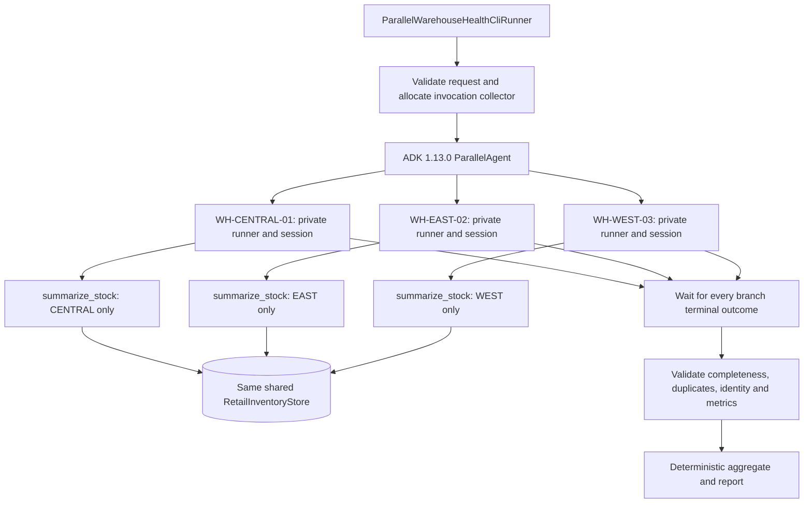

# Phase 5B.2 — Parallel warehouse health assessment

## Architecture and execution



The accepted requests are `assess warehouses` and `assess warehouse health`, case-insensitive.
Other input receives clarification before branch/model/tool execution. This phase always assesses
the three configured warehouses and all categories; individual warehouse/category filters are rejected.

The installed JAR was inspected with `javap`. `ParallelAgent.Builder` exposes `subAgents(...)`
through BaseAgent and `scheduler(Scheduler)`. Normal execution schedules branch subscriptions
and merges their event streams. It does not itself implement a typed result collection contract
or recover independently from a failing branch.

`WarehouseHealthWorkflow` is a root BaseAgent that creates a fresh actual ParallelAgent for each
invocation. Its three branch adapters run on `Schedulers.io()`. Each adapter owns a private
InMemoryRunner, fresh session, LlmAgent, callbacks, result reference and output key. No Phase 5A
or Phase 5B.1 agents are reparented. The production LlmAgents retain the existing model constant
(`gemini-3.8-flash`) and credential configuration.

Each branch exposes only the existing `StockSummaryTool` FunctionTool. Gemini is restricted to
one `summarize_stock` call. Model output is checked before execution: exactly one designated
call, the assigned warehouse and no category restriction. Accompanying model text is discarded.
After validated tool completion, a local acknowledgement avoids a second Gemini request.

## Concurrency and aggregation contract

- The shared store supplies read-only operations to all tools. Branches do not share mutable
  ADK session state, callback timing maps or model instances in the production factory.
- Each private session uses its assigned `temp:warehouse_health:<warehouse>` result key.
- A fresh invocation-local ConcurrentHashMap collector has one slot per warehouse. Immutable
  result snapshots are published at terminal branch completion. Duplicate publication invalidates
  that warehouse slot instead of overwriting a previous success or double-counting it.
- Nested tool/session events are consumed privately. They are not concurrently appended to the
  parent session. Actual executions are recorded by the existing audit logger.
- Each branch recovers model/tool/validation errors before the outer ParallelAgent merges it.
  A 60-second absolute branch deadline converts a stalled branch to `TIMEOUT`. Other branches
  continue. Model failures do not generate misleading tool-start events.
- Aggregation is deferred until the parallel stream has completed, including failure recovery.
  It checks the three expected slots and treats missing output as `MISSING_OUTPUT`.
- Only the parent aggregation stage writes parent session state, once, under
  `temp:warehouse_health:<workflowId>:assessment`. Different invocations cannot overwrite this key.
- The root result includes workflow ID, parent correlation ID, stable warehouse ordering,
  per-branch status/reason/duration/result, success/failure counts and validated totals.

Full success means all three branches have valid successful summaries. Partial success means
one or two do. Complete failure means none do. Totals are explicitly for successful warehouses
only; a complete failure has an empty totals map, not invented zero stock.

Validation checks warehouse/category scope, SUCCESS status, non-negative integer metrics,
item completeness, unique SKU positions, per-item warehouse identity and balance arithmetic,
and agreement between item-level evidence and summary totals/health counts. `NO_DATA` and
tool-domain errors are explicitly unavailable outcomes, not measured empty warehouse health.

The deterministic report includes each warehouse status and metric values plus overall totals.
It preserves existing summarize_stock semantics: `healthyStockCount` includes UNMONITORED
positions. It does not create purchase orders or infer missing inventory.

## Observability

Existing `AgentAuditLogger` methods record branch lifecycle, canonical tool arguments,
actual tool start/success/failure, duration and the parent session/invocation correlation.
Additional `[WAREHOUSE-HEALTH]` structured log records include workflow ID, correlation ID,
branch name, warehouse, lifecycle/tool outcome and duration. Successes and failures are correlated
without logging raw model responses, credentials or exception messages from model failures.
Failures use fixed codes such as `INVALID_ARGUMENTS`, `TOOL_ERROR`, `TIMEOUT` and `BRANCH_ERROR`.
The SDK may emit its own diagnostic logs; this workflow does not change global logging behavior.

## Run

Use existing credentials; do not put API keys in commands or source files.

```powershell
Set-Location 'C:\agent-AI-workspace\retail-adk-agent'
$env:JAVA_HOME = 'C:\Program Files\Java\jdk-17'
mvn compile exec:java '-Dexec.mainClass=com.retail.agent.parallel.ParallelWarehouseHealthCliRunner'
```

Enter `assess warehouses`, then `quit` when done. The standalone main closes its runner and
RxJava schedulers on exit. Existing CLIs and workflow code are unchanged.

## Tests and live validation

```powershell
mvn clean test
```

Offline validation: 122 tests discovered, 118 passed, 4 gated live tests skipped, zero failures/errors.
All 15 new offline parallel tests passed. No live Gemini request was made during implementation.

The offline suite uses scripted model transports while exercising the actual ParallelAgent,
private runners, existing tools and aggregation. A barrier test requires all three model calls
to overlap on separate threads; it does not merely assert that three sequential calls happened.
Tests cover scope restrictions, isolated results, totals, missing/duplicate/malformed outputs,
one/multiple/all branch failures, converted tool exceptions, timeout recovery, observability,
invalid input, immutable snapshots, empty data and invocation isolation.

The live test remains disabled unless explicitly enabled:

```powershell
mvn test '-Dtest=ParallelWarehouseHealthLiveSmokeTest' '-DrunLiveParallelWarehouseTest=true'
```

It requires full success and actual recorded `summarize_stock` calls for each warehouse.
Normal builds do not read credentials or call Gemini. Live reliability is not established by
scripted tests; run the gated test separately with the configured Gemini credentials.

## Limitations

- The store is thread-safe in memory, but concurrent reads are not a cross-warehouse transaction
  or consistent point-in-time snapshot. External mutations may change values during assessment.
- Parallel execution increases simultaneous Gemini requests; quotas and endpoint failures can
  produce partial results. There are no retries in this phase.
- Cancellation/deadlines stop waiting, but cannot guarantee interruption of a non-cooperative
  blocking model/tool. Late work remains private and cannot publish a second aggregate slot;
  it may finish an SDK request or produce late tool logs.
- A custom RetailInventoryStore passed to this factory must support concurrent read access.
- The collector and sessions are in memory. There is no durable recovery, distributed execution
  or bidirectional audio/video runLive support. Use one active request per parent session.
- Catastrophic runner/scheduler failures can abort infrastructure without a consolidated report.
- No LoopAgent, automatic commits, external integrations or Phase 5B.3 behavior were added.
