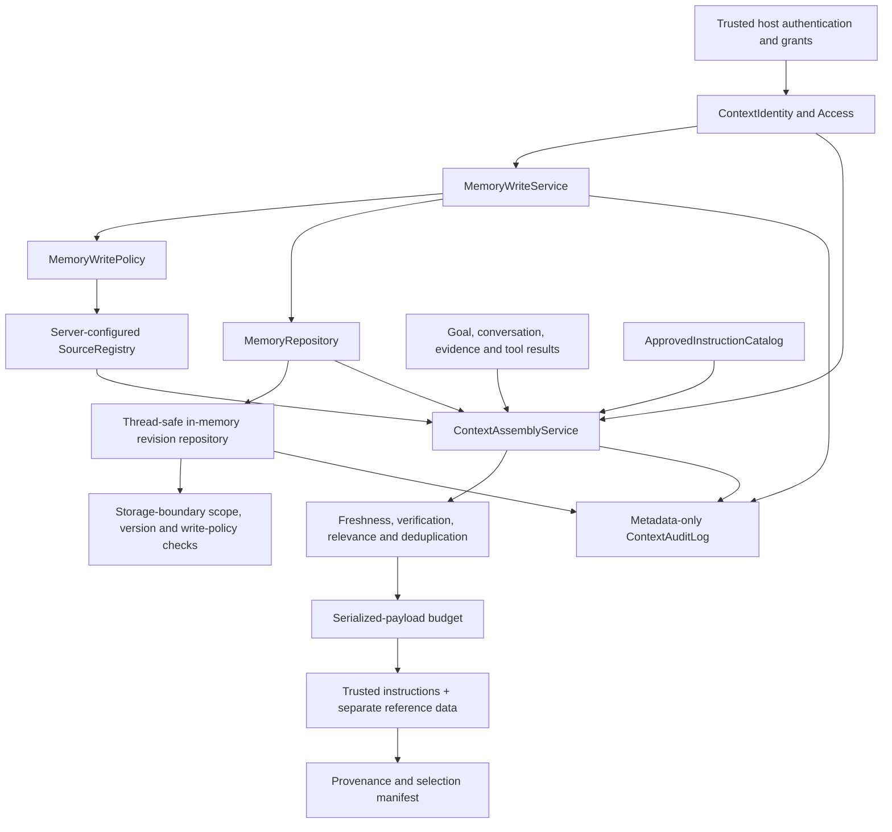

# Phase 6.1 — Context Engineering Foundation

## Scope and inspection

This milestone adds an isolated `com.retail.agent.context` package. It makes no changes to
Phase 5A, Phase 5B.1, Phase 5B.2, existing CLIs, tools, inventory stores, model selection,
credentials, POM dependencies or existing tests. The working tree was clean at baseline
commit `1445ba6` when implementation began. No automatic commit is made.

The installed Google ADK **Java 1.13.0** JAR was inspected with `javap`, including:

- `BaseMemoryService.addSessionToMemory(Session)` and `searchMemory(String, String, String)`.
- `InMemoryMemoryService`, which implements that interface.
- `ReadonlyContext` accessors for session/user/invocation ID, events and state.
- `BaseSessionService` create/get/list/delete session and append event APIs.

These APIs do not supply this milestone's tenant-bound authorization, revision policies,
verification authority, revocation or procedural approval contract. The new repository is a
separate application abstraction rather than a Python ADK API imitation or an adapter that
silently ingests all sessions. A future explicit ADK adapter can consume this structured output
after review. This milestone does not connect the new context to any validated agent workflow.

## Component architecture



## Memory classification and lifecycle

| Category | Purpose | Write and trust rules |
| --- | --- | --- |
| Working | Current task and intermediate context | Requires a session or task scope; candidate/reference data only |
| Episodic | Explicitly saved previous interactions and outcomes | Owner-scoped; candidate/reference data, not authoritative facts |
| Semantic | Knowledge and factual definitions | Candidates remain separate; VERIFIED requires verification capability and KNOWLEDGE or TOOL_RESULT provenance |
| Procedural | Approved reference procedures | Requires procedural approval capability, APPROVED status and PROCEDURE provenance |

Records contain a UUID logical memory ID, category, tenant/user and optional session/task scope,
content, deeply immutable structured metadata, canonical source/provenance, creation/update/expiry
timestamps, verification, sensitivity, version, superseded-version link and lifecycle status.

Create starts at version 1. Update checks the expected version atomically, preserves ownership,
scope, category and creation time, marks the previous stored revision SUPERSEDED and appends
a new ACTIVE revision. Revoke appends a REVOKED revision and supersedes the old head. Delete
removes the complete in-memory history. Neither reads nor search can resurrect an old revision.
Returned record values remain immutable even when their stored revision is later superseded.

Expiration is exclusive: `expiresAt <= now` is unavailable. Expiration filters reads/searches;
there is no background physical purge. New writes already expired are rejected. Revocation and
deletion are authorized operations even for expired data; updating expired/revoked data is rejected.

Candidates are not facts. Unverified semantic memories are stored separately by classification
and excluded from authoritative context selection. Metadata fields such as `role=system` or
`verified=true` do not affect the typed verification or authority fields.

## Context assembly lifecycle

1. Accept a host-authenticated identity and requested session/task scope. Check grants.
2. Resolve requested system-instruction and policy IDs to immutable server-owned catalog bodies.
3. Resolve user goal and supplied conversation/evidence/tool references through the source registry;
   validate source origin and sensitivity. These are reference data regardless of their wording.
4. Retrieve authorized current memories, filtering exact tenant/user ownership, session/task scope,
   clearance, expiry, revocation and supersession. Search is bounded to 1000 candidates.
5. Re-read revisions before use, reject changed/stale entries, recheck scope, verification and provenance.
6. Rank relevant memories deterministically by keyword overlap, category and scope specificity;
   resolve ties by update time then stable memory ID. Matching scoped working memory can remain
   relevant without lexical overlap. Procedural memories still require relevance.
7. Deduplicate normalized reference content, preferring verified provenance over untrusted copies.
   Only whitespace and case are normalized: numeric signs, decimal points and punctuation remain.
   Mandatory instructions, policies and the goal are never removed by copied reference content.
8. Retain mandatory approved instructions, policies and user goal, or reject an insufficient budget.
   Select optional items by deterministic priority, omitting complete blocks rather than truncating
   content or dropping its provenance. Enforce a configurable maximum selected-memory count.
9. Return `AssembledContext`: separate trusted-instruction and reference-data blocks, with a manifest.

Display order is system instructions, policies, goal, supplied conversation, retrieved evidence,
tool results and ranked memories. Selection priority can differ from display order. Source and trust
information survive deduplication and budget selection. Omission reasons include irrelevance,
unverified/unapproved semantic/procedural memory, stale revisions, duplication, memory limit and budget.
Unauthorized records are not listed in manifests, even as rejected memory IDs.

The manifest records assembly ID and timestamp, estimator name, budget/used estimate, selected
block/memory IDs and versions, source IDs, verification, sensitivity and omission reasons. Its ID
links to the context assembly audit event. The administrative audit records IDs/actions/outcomes
and counts, never content, goals, arbitrary metadata values or credentials.

## Budgeting and serialization

The default estimator counts UTF-8 bytes of the **entire actual serialized context payload**,
including provenance, classifications, metadata, keys, escaping, brackets and separators. It is
conservative in normal usage, but is an estimate, **not Gemini's tokenizer**. Inject a deterministic
`TokenEstimator` for another accounting strategy. Model/API-specific framing and transport overhead
will need an allowance in a future adapter. The external audit manifest is not sent as model context
and is not counted in this payload budget. Per-block estimates do not sum exactly to total framing cost.

Required blocks must fit. Optional blocks are indivisible. Oversized blocks are skipped while smaller
eligible blocks can still fit. Budget selection never strips a mandatory policy to make room for evidence.
The context renders as escaped JSON; embedded strings cannot inject a new trusted-instruction field.
This is a structural trust boundary, not a claim that arbitrary LLM prompt injection has been solved.

## Trust boundaries and security controls

- `ContextIdentity` is an application-internal claim, not an authentication mechanism. A trusted host
  must authenticate the caller and construct tenant/user/grant/capability/clearance values. Never
  deserialize claims from user text, model output or retrieved memory. The demo creates synthetic
  identities; it does not establish production authentication or access production credentials.
- Tenant/user ownership is exact; there is no wildcard or implicit cross-user/tenant sharing.
  A record without session/task scope is global only **within that owner**. Tenant-shared knowledge
  would require an explicit future ACL contract. Session and task grants are explicit host inputs.
- `MemoryWriteService` validates ownership/grants, type-specific verification and source policies.
  The repository rechecks these policies, so direct storage calls cannot bypass them.
- Verification requires separate `VERIFY_SEMANTIC` authority; procedural changes require
  `APPROVE_PROCEDURE`. Updating, revoking or deleting an already authoritative record requires
  its corresponding authority, preventing downgrade-then-poison attacks by ordinary authors.
- Registry references are exact server-configured IDs. Unknown references, other-user references,
  wrong origins and unauthorized tenants are rejected. No supplied URL is fetched or trusted.
  Provenance is an authorized attestation; it is not cryptographic proof that a claim is true.
- Catalog bodies are host-owned and immutable. Request fields select their IDs; requests cannot
  supply trusted instruction text. Retrieved content and user-authored memories **never become
  system instructions**. Even APPROVED procedural memories are separately labeled reference data.
- Sensitivity clearance applies to reads, writes, catalog entries and caller-supplied context data.
  Classification is caller/host supplied; there is no automatic PII/secret detector in this phase.
- Metadata is recursively snapshotted into bounded immutable JSON-compatible structures.
  Arbitrary Java objects, excessive nesting/content and invalid identifiers are rejected.
- Every repository operation is synchronized and optimistic updates are atomic. These protections
  apply to this in-memory implementation, not to a future distributed deployment automatically.
- Context assembly has no write side effects. Conversations are persisted only by an explicit
  authorized write. The ADK automatic session-to-memory method is deliberately not invoked.
- Audit is a bounded, application-administrative in-memory sink (2000 records), not a caller-facing
  endpoint or durable/tamper-evident compliance store. Host ingress must audit parser failures
  that occur before a validated request reaches these services.

## Java class responsibilities and created files

All production files are new under `src/main/java/com/retail/agent/context/`:

| File | Responsibility |
| --- | --- |
| `MemoryTypes.java` | Closed category, verification, sensitivity, lifecycle, origin and capability enums |
| `ContextIdentity.java` | Authenticated host claim, authorized access and immutable ownership scopes |
| `MemoryRecord.java` | Immutable memory revisions and validated write drafts |
| `StructuredValues.java` | Bounded metadata snapshots and deterministic escaped JSON |
| `SourceRegistry.java` | Canonical source provenance allowlist |
| `MemoryWritePolicy.java` | Type/source/capability/clearance/expiry write checks |
| `MemoryRepository.java` | Scope-aware storage/search/version/revoke/delete interface |
| `InMemoryMemoryRepository.java` | Synchronized revision storage and filtering |
| `MemoryWriteService.java` | Explicit authorized write/update/revoke/delete operations |
| `ApprovedInstructionCatalog.java` | Trusted system/policy body selection by approved ID |
| `ContextAssemblyService.java` | Authorized retrieval, relevance, deduplication and budgeting |
| `AssembledContext.java` | Structured blocks, trust boundary, manifest and serialized payload |
| `ContextAuditLog.java` | Structured metadata-only audit sink |
| `ContextEngineeringCliRunner.java` | Deterministic offline milestone demonstration |

New test files under `src/test/java/com/retail/agent/context/`:
`ContextFixture.java`, `MemoryRepositoryTest.java`, `ContextAssemblyServiceTest.java`.
This document is `docs/phase-6-1-context-engineering.md`. No existing file is modified.

## CLI examples

PowerShell:

```powershell
Set-Location 'C:\agent-AI-workspace\retail-adk-agent'
$env:JAVA_HOME = 'C:\Program Files\Java\jdk-17'
mvn compile exec:java '-Dexec.mainClass=com.retail.agent.context.ContextEngineeringCliRunner'
```

Windows CMD:

```bat
cd /d C:\agent-AI-workspace\retail-adk-agent
set "JAVA_HOME=C:\Program Files\Java\jdk-17"
mvn compile exec:java "-Dexec.mainClass=com.retail.agent.context.ContextEngineeringCliRunner"
```

The CLI runs seven scenarios automatically and exits; no prompt or credentials are required:
initial context with no memories, scoped working-memory follow-up, explicit episode, verified fact,
approved reference procedure plus catalog policy, expired/cross-tenant/unauthorized-session rejection,
and a budget that omits optional memory blocks while retaining required instructions and goal.
It prints synthetic demonstration content only, selected classifications and manifest budget counts.
It uses an injectable fixed demonstration clock, advancing it explicitly for expiry; it does not
represent current inventory measurements or dates. IDs are generated per run.

## Tests

```powershell
mvn clean test
```

The deterministic tests cover all four categories, ownership, tenant/user/session/task isolation,
expiry boundary, revocation/deletion, supersession and compare-and-swap races, verified facts,
procedural authority, source rejection, sensitivity, immutable metadata, concurrent repository
operations, ordered blocks, relevance, deduplication including signed numbers, full serialized
budgeting, configurable estimates, poisoning attempts, manifest provenance and audit generation.
The existing workflow regression suite is retained. No new live test is necessary for this offline
milestone. The existing four live Gemini tests remain gated and skipped in normal builds.

Observed validation on this implementation: `mvn clean test` reported **148 discovered,
144 passed, 4 skipped, zero failures and zero errors**. The 26 new context tests passed
(12 repository/write-policy tests and 14 assembly tests). The CLI completed all seven scenarios
with `BUILD SUCCESS`; its constrained example used 997/997 estimated units, retaining both
approved instruction blocks and the user goal while omitting all four optional memories.

## PostgreSQL migration considerations — proposal only

1. Implement the same `MemoryRepository` interface; no PostgreSQL dependency or schema is added now.
2. Use tenant/user-scoped memory heads plus immutable revision rows, UUID IDs, UTC `timestamptz`,
   JSONB metadata, typed enum/check constraints and explicit source/provenance references.
3. Enforce tenant/user/session/task/clearance predicates in every read and write, with PostgreSQL
   row-level security as defense in depth. Bind identity using trusted per-transaction state;
   clear connection-pool session settings to avoid cross-tenant leakage.
4. Perform expected-version comparison, supersession and head replacement in one transaction.
   Use `UPDATE ... WHERE version = expectedVersion` or row locks plus uniqueness constraints.
   Revocation must atomically prevent older revisions becoming eligible again.
5. Preserve the same application write policy, verification/approval requirements and source allowlist
   at the storage boundary. Add durable approval attestations; never infer VERIFIED from imported text.
6. Index ownership/scope/lifecycle/expiry and keyword search. Replace the current bounded candidate
   scan with explicit deterministic pagination or ranked SQL while preserving authorization first.
   pgvector is not part of this milestone.
7. Add a transactional audit outbox and durable administrative audit sink, retention/erasure policy,
   encryption, least-privilege database roles and cross-tenant integration tests before production use.
8. Preserve immutable version references in manifests and define the freshness snapshot used by
   assembly. Test concurrent revision/revoke/expiry behavior against a real PostgreSQL instance.

## Known limitations

In-memory data and audit disappear on restart; histories grow until deleted. No authentication
provider, shared multi-user knowledge ACL, encryption, external source verification, durable
approval workflow, embedding retrieval, background TTL purge or database has been introduced.

Ranking is lexical and deterministic over a fixed repository snapshot, clock and estimator. It is
not semantic understanding. Deduplication is conservative normalized-text equality, not inference
that differently worded claims are equivalent. A search returns at most 1000 recent authorized
candidates and a context selects at most 100 memories; relevance outside that retrieval window
is not evaluated. Context data lists are bounded to 64 items per category.

Assembly rechecks versions/freshness before use but is not a single transaction across all reads;
a revoke immediately after the final check cannot retroactively retract an already returned
context. Manifests pin versions and time; a future live adapter must define freshness/revalidation.
Deletion cannot erase previously returned objects, contexts or audit IDs held by other code.

No original workflow consumes this context yet. Phase 6.2, PostgreSQL, pgvector, production
credentials, external memory frameworks, live calls and automatic commits are explicitly excluded.
