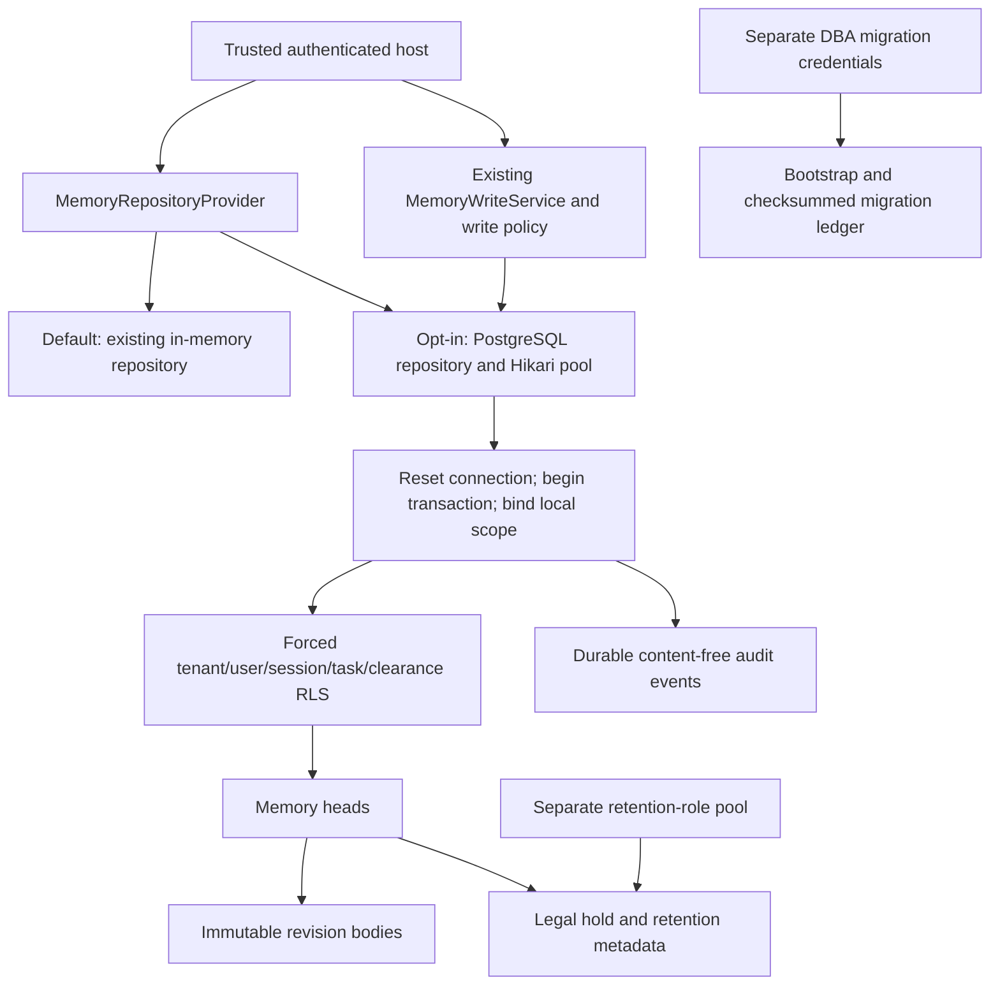

# Phase 6.2 — PostgreSQL persistent agent memory

## Scope and compatibility

The Phase 6.1 files were inspected before editing. They remain unmodified, including
`MemoryRepository`, `MemoryRecord`, `MemoryWritePolicy`, `ContextIdentity`, `ContextAuditLog`,
the in-memory repository, assembler, tests and demo. Their uncommitted state at the start of
this milestone is preserved. Phase 5A/5B.1/5B.2 agents, tools, workflows, Gemini configuration
and existing entry points are unchanged. Memory is not integrated into any ADK agent.

The only existing tracked file changed is `pom.xml`, adding PostgreSQL JDBC 42.7.14,
HikariCP 7.1.0 and an explicit Jackson databind 2.20.2 dependency for JSONB metadata.
No H2, pgvector, embedding retrieval or external memory framework is used.

## Architecture



`PostgresMemoryRepository` implements the actual Phase 6.1 interface. Create, read, search,
optimistic update, revoke and delete retain ownership, category, scope, provenance, clearance,
expiry and trust semantics. The same Java write policy is rechecked at storage entry points.
The repository can be supplied to the existing assembler and write service explicitly.

`MemoryRepositoryProvider.open(clock, policy, audit)` defaults to the existing in-memory
implementation. Setting `MEMORY_REPOSITORY=postgres` selects the pooled PostgreSQL implementation
for callers of that provider; it does not change existing factories or demo/agent behavior.
The returned Handle owns the pool and must be closed by the host.

## Schema and migrations

| Object | Purpose |
| --- | --- |
| `retail_memory.schema_history` | Ordered migration version, SHA-256 checksum, application time; owner only |
| `memory_heads` | Tenant/user UUID identity, immutable scope/category, current version/status/clearance/expiry and retention metadata |
| `memory_versions` | Complete typed revision content, JSONB metadata, source provenance, timestamps, verification, supersession and lifecycle |
| `audit_events` | UUID event ID, authorized scope, timestamp, action, outcome, optional memory/version and affected count; no content |

Heads use a `(tenant_id, user_id, memory_id)` primary key. Revisions add `version` to that
key. Deferred head-to-current-revision integrity allows atomic creation and head advancement.
Revisions link to their predecessor and cascade only when their head is explicitly deleted.
Check constraints enforce classifications, positive versions, source ownership, timestamps,
working scope, and semantic/procedural provenance. A trigger makes historical bodies immutable;
the allowed update is lifecycle transition to SUPERSEDED. Scope, current-head expiry,
revision ordering and audit scope have indexes.

Migration resources:

- `src/main/resources/db/memory/bootstrap.sql`: DBA-only creation/validation of NOLOGIN roles
  and the private schema. It does not assign passwords or create application login accounts.
- `src/main/resources/db/memory/V001__persistent_memory.sql`: versioned schema, constraints,
  RLS functions/policies, retention/history triggers and least-privilege grants.
- `PostgresMigrations`: explicit bootstrap or transactional migration execution, serialized with
  an advisory transaction lock. An applied checksum mismatch aborts. Repeated migration is a no-op.
  Future versions must be registered in the ordered migration runner; never edit applied SQL.

## Transactions and durable audit

Before using a borrowed connection, the repository resets session settings, starts a transaction
and uses parameterized `set_config(..., true)` to set tenant, user, session, task, clearance and
capabilities. Identity values never enter SQL strings. A transaction-local statement timeout is set.
Commit/rollback removes local claims; a final reset clears session-level settings before pool return.

Updates first lock the authorized head, then read its revision in a fresh READ COMMITTED statement
snapshot. The expected version is checked, the old revision is superseded, a new revision is inserted
and the head advances with a version predicate. Its audit event is inserted on the same connection
before commit. Concurrent writers with one expected version have only one winner.

Successful repository operations have durable audit records. Delete audits survive content deletion
because audit IDs deliberately have no cascading content FK. Local Phase 6.1 audit is mirrored only
after database commit. Denials/errors remain in the existing local audit; rolled-back success events
are not committed. Context-assembly audit still uses Phase 6.1's local sink: this phase does not
silently replace that independent audit interface or claim all application events are durable.

The integration test injects an audit INSERT failure during update and verifies that the head,
revision history and success audit all roll back. Driver/database error details should be sent only
to protected operational diagnostics; the administrative CLI does not echo URLs or credentials.

## Security model and trust boundaries

- All data tables have ENABLE and FORCE ROW LEVEL SECURITY. Missing/empty tenant or user
  settings result in no visible rows and rejected inserts. Session/task and clearance are also scoped.
- The application login inherits only `retail_memory_app`, is not the table/schema owner, and
  has no superuser, BYPASSRLS, CREATEROLE or CREATEDB privileges. The repository rejects unsafe
  connections, owner membership, pg_write_all_data membership and mixed runtime/retention roles.
- `retail_memory_owner` is NOLOGIN and owns migrations/objects. Runtime cannot alter schema,
  disable RLS, assume owner role, truncate tables, rewrite history bodies or update/delete audit rows.
- Runtime can update only current head fields and the allowed history lifecycle field.
  It cannot alter legal-hold or retention fields.
- A separate `retail_memory_retention` login/pool can configure legal hold/retention for authorized
  owner scopes through `PostgresRetentionService`. It cannot read memory content or act as runtime.
- Source references and authority continue to be validated by the existing host-configured policy.
  No database import or source text is automatically trusted or verified.
- Tenant settings are **claims supplied by the trusted host**, not database authentication. A person
  holding the shared service credentials and arbitrary SQL execution can assert another tenant via
  custom settings. RLS validates the bound scope; it does not authenticate end users or defend against
  a compromised service credential holder. Never expose raw SQL or these credentials to clients.
  Stronger protection against a compromised host requires separate tenant credentials or a signed
  context-binding gateway, outside this milestone. RLS tests cover configured-scope enforcement,
  missing context, privilege escalation and disabling attempts, not an impossible authentication claim.

All runtime SQL is constant/prepared; search text, IDs, capabilities, categories and scopes are bound
parameters. A quoted SQL-injection-like search is tested as literal data. Static migration SQL is
trusted deployment code. Test-only generated role identifiers are controlled by the test fixture.

## Retention and deletion

Every head stores `legal_hold`, optional `retain_until` and `retention_policy`. Defaults allow explicit
authorized deletion or cleanup after expiry. Expiry is a visibility rule, not immediate erasure.

`PostgresRetentionService.configure(...)` changes retention under a separate database role and
expected version, with a durable audit event in the same transaction. The database delete trigger
blocks held records and future retain-until deadlines, including direct runtime DELETE statements.
Runtime credentials cannot release that protection. Updates/revocation retain older content revisions;
legal hold protects deletion of the entire history, not just the current row.

`PostgresMemoryRepository.cleanupExpired(access, limit)` is an explicit bounded operation (1–1000),
not an automatic scheduler. It uses authorized scope, clearance, write/verification/approval policies,
row locking with SKIP LOCKED, expiry filtering and retention checks. Each deletion and its audit are
in one transaction. Held/retained rows are skipped. Explicit delete removes the head and all revisions;
it does not delete audit evidence. Administrative audit retention is intentionally indefinite here:
a DBA must define archival/retention separately. Runtime cannot purge audit history.

Deletion cannot remove already returned contexts, exports, WAL archives or backups. Restoring a
backup can restore previously deleted content. Track deletion/hold decisions outside backup restore
points and reapply them during recovery; legal/compliance retention periods are deployment policy.

## Local Windows setup and migration

Use the PostgreSQL 18 installation at `C:\Program Files\PostgreSQL\18` or another supported local
PostgreSQL installation. Create a **dedicated** application database using an administrator:

PowerShell:

```powershell
& 'C:\Program Files\PostgreSQL\18\bin\createdb.exe' -h localhost -U postgres -W retail_agent_memory
Set-Location 'C:\agent-AI-workspace\retail-adk-agent'
$env:JAVA_HOME = 'C:\Program Files\Java\jdk-17'
$env:MEMORY_POSTGRES_MIGRATION_URL = 'jdbc:postgresql://localhost:5432/retail_agent_memory'
$env:MEMORY_POSTGRES_MIGRATION_USER = 'postgres'
# Supply MEMORY_POSTGRES_MIGRATION_PASSWORD through your protected environment/secret mechanism.
mvn compile exec:java '-Dexec.mainClass=com.retail.agent.context.PostgresMemoryAdminCliRunner' '-Dexec.args=bootstrap'
mvn exec:java '-Dexec.mainClass=com.retail.agent.context.PostgresMemoryAdminCliRunner' '-Dexec.args=migrate'
```

CMD:

```bat
"C:\Program Files\PostgreSQL\18\bin\createdb.exe" -h localhost -U postgres -W retail_agent_memory
cd /d C:\agent-AI-workspace\retail-adk-agent
set "JAVA_HOME=C:\Program Files\Java\jdk-17"
set "MEMORY_POSTGRES_MIGRATION_URL=jdbc:postgresql://localhost:5432/retail_agent_memory"
set "MEMORY_POSTGRES_MIGRATION_USER=postgres"
rem Supply the migration password through your protected environment before running Maven.
mvn compile exec:java "-Dexec.mainClass=com.retail.agent.context.PostgresMemoryAdminCliRunner" "-Dexec.args=bootstrap"
mvn exec:java "-Dexec.mainClass=com.retail.agent.context.PostgresMemoryAdminCliRunner" "-Dexec.args=migrate"
```

After bootstrap, use administrator psql to provision separate login accounts, with passwords prompted
by psql instead of literals in files/history:

```sql
CREATE ROLE retail_memory_service LOGIN NOSUPERUSER NOCREATEDB NOCREATEROLE NOBYPASSRLS IN ROLE retail_memory_app;
\password retail_memory_service
CREATE ROLE retail_memory_retention_service LOGIN NOSUPERUSER NOCREATEDB NOCREATEROLE NOBYPASSRLS IN ROLE retail_memory_retention;
\password retail_memory_retention_service
```

For production deployment, provision a separate migration login authorized to SET ROLE
`retail_memory_owner`; do not reuse the DBA/migration credentials in runtime pools.
Bootstrap requires DBA role-creation authority and should be run once deliberately.

## Environment configuration

| Variable | Default / purpose |
| --- | --- |
| `MEMORY_REPOSITORY` | `in-memory`; set `postgres` only for callers of the new provider |
| `MEMORY_POSTGRES_URL` | Required PostgreSQL JDBC runtime URL; no embedded user/password |
| `MEMORY_POSTGRES_USER` | Required non-owner runtime login |
| `MEMORY_POSTGRES_PASSWORD` | Required runtime password, never logged or committed |
| `MEMORY_POSTGRES_POOL_SIZE` | 4; allowed 1–32 |
| `MEMORY_POSTGRES_CONNECTION_TIMEOUT_MS` | 10000; allowed 250–120000 |
| `MEMORY_POSTGRES_MIGRATE` | `false`; explicit `true` runs migration with the separate migration pool |
| `MEMORY_POSTGRES_MIGRATION_URL/USER/PASSWORD` | Separate owner/DBA migration configuration |
| `MEMORY_POSTGRES_TEST_DISPOSABLE` | Integration fixture authorization only; must be `true` on `retail_memory_it` |

Retention operations use a separately configured DataSource under the retention login, not runtime.
Use `sslmode=verify-full` with trusted server certificates for remote deployments. Pool size/timeouts
are bounded; connection identity is not derived from URL query parameters. Never put passwords in
JDBC URLs or `-D` command arguments. Defaults do not read database credentials or open connections.

## Validation commands and actual results

Normal offline build:

```powershell
mvn clean test
```

The database class is gated by `-DrunPostgresMemoryTests=true`. A normal build does not require
PostgreSQL and skips the 12 database tests along with the four existing live Gemini tests.

To run a real isolated PostgreSQL fixture without installing/changing a service, use the helper:

PowerShell:

```powershell
Set-Location 'C:\agent-AI-workspace\retail-adk-agent'
.\scripts\Run-PostgresMemoryIntegrationTests.ps1 -PgBin 'C:\Program Files\PostgreSQL\18\bin'
```

CMD:

```bat
cd /d C:\agent-AI-workspace\retail-adk-agent
powershell.exe -NoProfile -File scripts\Run-PostgresMemoryIntegrationTests.ps1 -PgBin "C:\Program Files\PostgreSQL\18\bin"
```

The helper creates a unique temporary data directory, generated credentials, random loopback port
and database `retail_memory_it`. It runs this command with the disposable migration environment:

```powershell
mvn test '-Dtest=PostgresMemoryIntegrationTest' '-DrunPostgresMemoryTests=true'
```

It then stops only its own cluster, restores process environment and removes its verified temporary
directory, including password material. No existing service/database is modified. The test class
also requires `MEMORY_POSTGRES_TEST_DISPOSABLE=true` and exact database name `retail_memory_it`,
because it truncates that fixture between tests. Never enable it against an application database.
To target an externally provisioned **disposable** fixture, provide the migration variables plus
that explicit flag before running the Maven command.

Observed results: offline **163 discovered, 147 passed, 16 skipped, zero failures/errors**;
real PostgreSQL 18 integration **12 passed, zero skipped/failures/errors**. Database tests cover
pool/repository recreation, all categories, tenant/user/session/task/clearance isolation, direct SQL
RLS, missing context, role restrictions, pool contamination/reset, concurrent CAS/create, audit
failure rollback, supersession, revocation, expiry, cleanup, retention and durable deletion audits.
Configuration tests verify offline defaults and reject embedded credentials/invalid pool bounds.

## File inventory

New production classes under `src/main/java/com/retail/agent/context/`:
`PostgresMemoryRepository`, `PostgresTransactions`, `PostgresMigrations`,
`PostgresRetentionService`, `MemoryRepositoryProvider`, `PostgresMemoryAdminCliRunner`.

New resources: `db/memory/bootstrap.sql`, `db/memory/V001__persistent_memory.sql`.
New tests: `PostgresMemoryIntegrationTest`, `MemoryRepositoryProviderTest`.
New helper: `scripts/Run-PostgresMemoryIntegrationTests.ps1`.
New documentation: this file. Modified existing file: `pom.xml` only.

## Backup, recovery and limitations

Use authenticated/encrypted connections, database backups and WAL/PITR according to deployment
requirements. Back up roles and schema ownership as well as data; restore with the correct RLS,
FORCE flags, grants, trigger functions and migration checksums before enabling service traffic.
Test restores and reapply erasure/hold decisions after recovery. No backup job is installed here.

The trusted host still authenticates caller identity, validates grants and owns source registries.
RLS is defense in depth for host-bound claims, not an authentication provider. Runtime SQL access
is a privileged service capability and must not be exposed to agents or end users. Durable repository
audit is not a database-wide SQL auditing extension: out-of-band DBA/direct-SQL changes require
administrative audit controls. Failures/security rejections and context-assembly events retain
Phase 6.1's local audit behavior; only successful repository/retention events are transactional here.

PostgreSQL timestamps have microsecond precision; written timestamps are normalized accordingly.
JSONB metadata round-trips JSON numeric semantics, not every Java numeric subtype identity.
Search is literal substring matching with deterministic update-time/UUID ordering and the same
1000-result bound; it has no embeddings, pgvector or semantic search. Revision bodies stay until
authorized deletion and there is no background scheduler. Cleanup is per authorized owner/scope,
not a cross-tenant superuser sweep. A malicious/compromised DBA can bypass application controls.

No changes to Gemini, production credentials, live calls, agent integration or automatic Git commits
are part of Phase 6.2. Stop here for review.

Primary dependency/security references: [pgJDBC downloads](https://jdbc.postgresql.org/download/),
[HikariCP](https://github.com/brettwooldridge/HikariCP),
[PostgreSQL row security](https://www.postgresql.org/docs/current/ddl-rowsecurity.html).
