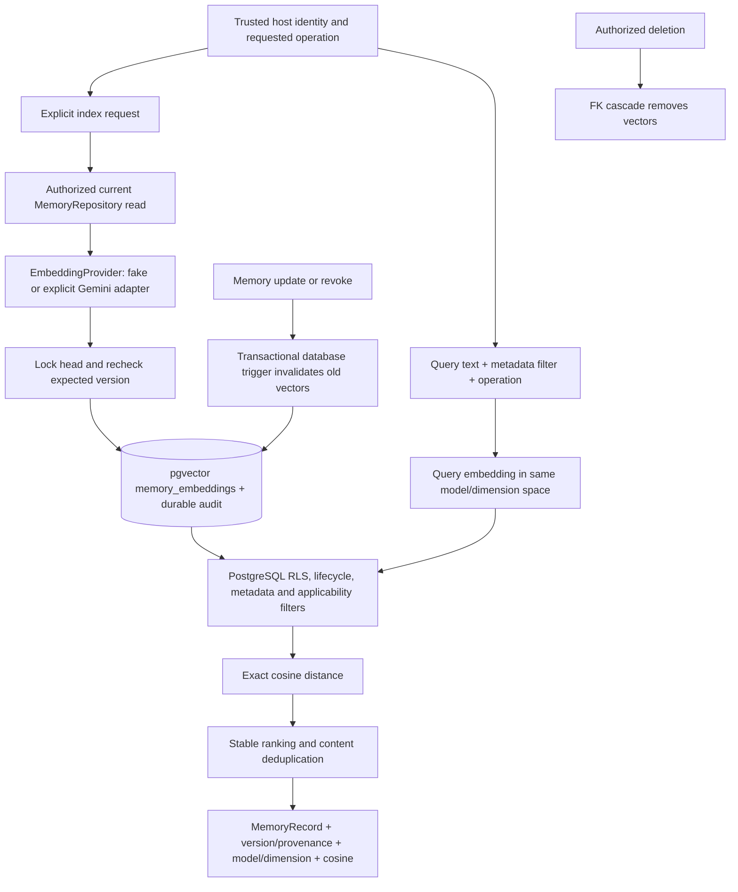

# Phase 6.3 — Semantic and procedural memory retrieval

## Scope and inspected foundation

The existing Phase 6.1 and 6.2 records, repository interface, write policy, source registry,
context assembly, transaction binding, role validation, migrations, tests and documentation
were reviewed first. Their uncommitted state is preserved. No agent workflow, chat model,
credentials configuration, repository contract or V001 migration was replaced or modified.

This phase adds an explicit retrieval/indexing service. Existing ContextAssemblyService and
ADK agents do not silently start embedding or querying vectors. No Phase 6.4 governance
behavior, embedding background worker or automatic Git commit is added.

## Retrieval architecture



`MemoryRepository` retains all Phase 6.1 signatures and behavior. `SemanticMemoryRetrieval`
is additive and accepts the existing repository, runtime pool, embedding provider, Clock and
ContextAuditLog. It returns immutable Match values with complete memory records and provenance.

Only VERIFIED semantic records and APPROVED procedural records may be indexed. Indexing
also requires WRITE_MEMORY plus the corresponding verification/approval capability. User-supplied
candidate facts, interaction memories and unapproved procedures are not searchable as facts.

Document embedding happens outside the transaction, after an authorized read. Index publication
then locks the current head and checks the expected version again. A concurrent update causes
a version conflict rather than attaching an old-content vector to a new revision. INSERT uses an
idempotent version/model/dimension key; reindexing that same current key does not create duplicates.

## Embedding providers and verified Java API

The installed GenAI Java SDK is 1.77.0. `javap` verified:

- `Client.models.embedContent(String model, String contents, EmbedContentConfig config)`.
- `EmbedContentConfig.Builder.taskType(String)` and `outputDimensionality(Integer)`.
- `EmbedContentResponse.embeddings()` and `ContentEmbedding.values()` returning float lists.

The Google documentation confirms `gemini-embedding-001` remains a supported text embedding
model, with 3072 default dimensions and recommended 768, 1536 or 3072 dimensions. The optional
adapter deliberately supports these three configured dimensions; examples/live tests use 768.
The chat model `gemini-3.8-flash` is unchanged. The newer embedding model is not selected implicitly.

`GeminiEmbeddingProvider` receives an explicitly supplied Client and does not own/close it. It uses
RETRIEVAL_DOCUMENT and RETRIEVAL_QUERY task types, checks response dimension/model and normalizes
vectors. Model ID and dimension are stored with every vector; different spaces are never mixed.
The SDK's autoTruncate configuration is platform-specific and is not set in Developer API mode.
The model input limit is 2048 tokens; callers must manage appropriate document size. This phase
does not silently chunk or summarize long memories. API errors leave no published embedding.

`FakeEmbeddingProvider` is a deterministic SHA-256 lexical feature-hashing implementation for
offline tests/demo only. It is not a trained semantic model or an evaluation of Gemini quality.
It has its own model ID. Normalized immutable vectors reject zero norm, NaN/infinite values,
dimension mismatches and malformed model configuration.

## V002 migration and schema

`V002__semantic_retrieval.sql` adds `retail_memory.memory_embeddings`:

| Field | Meaning |
| --- | --- |
| tenant_id / user_id | Exact ownership, protected by RLS |
| memory_id / memory_version | FK to the immutable content revision |
| session_id / task_id / sensitivity | Copied scope/clearance, checked against that revision |
| model_id / dimension | Explicit embedding space identity |
| embedding | pgvector vector; dimension and nonzero norm checked |
| created_at | Database creation timestamp |
| validity | VALID or INVALID |

The composite primary key includes tenant, user, memory ID/version, model and dimension.
A B-tree lookup index supports those fields. There is no HNSW or IVFFlat index; the initial
query is exact. No benchmark claim is made and no approximate index is justified in this phase.

The vector type is not fixed to one dimension so fake/test and configured Gemini spaces can
coexist, but each row must match its declared dimension. Retrieval first materializes the eligible
model/dimension scope before applying distance; mismatched spaces cannot cause accidental
cross-space ranking or a vector-distance dimension error.

V001 is unchanged and its checksum remains valid. `PostgresMigrations.migrate(...)` still applies
only the Phase 6.2 schema, so pgvector is not required by old databases/tests. The new explicit
`migrateSemantic(...)` path verifies the extension is installed in public, then applies V002 using
the existing owner/advisory-lock/checksum mechanism. Upgrading V001/V002 is not one combined
transaction: each version is independently transactional, as recorded by schema_history.

## Authorization, versioning and invalidation

The embedding table has ENABLE/FORCE RLS. Runtime SELECT requires bound tenant/user/session/task/
clearance, VALID status, a current ACTIVE head/revision, unexpired database timestamp and verified/
approved classification with correct source origin. Runtime cannot see old/invalid vectors even
through direct SQL. INSERT requires the same eligibility plus mutation authority and exact revision
scope/clearance. Runtime has no vector UPDATE/DELETE permission or owner-role membership.

A fixed SECURITY DEFINER invalidation trigger runs as the NOLOGIN owner with a tightly scoped
owner policy and fixed search_path. It changes validity, not vector content. It invalidates vectors
within the same transaction when a head's version, lifecycle or expiry changes, including revocation.
Failure rolls back the original mutation and its audit as well; V001 retention and write policies stay
in effect. It does not accept arbitrary tenant arguments or expose a general privileged SQL function.

Time passing does not fire a database trigger. Expired vectors are immediately ineligible through
SELECT policy and search predicates. The explicit owner-scoped `invalidateExpired(access)` operation
can persist INVALID status for eligible expired rows, with a durable audit event. No scheduler is added.
Memory deletion cascades to vectors through revision FKs; legal holds still protect that deletion.
Invalid historical vectors remain physically stored until deletion, so retention/backups still apply.

As in Phase 6.2, PostgreSQL scope settings are claims asserted by trusted authenticated host code.
RLS is not end-user authentication and does not defend against a compromised service credential
holder who can issue arbitrary SQL and rebind claims. No such credentials are exposed to agents.
All query parameters, vector literals, metadata filters and operations use prepared statements.

## Hybrid retrieval and procedure applicability

`SemanticMemoryRetrieval.Query` contains text, an operation identifier, exact JSONB metadata
containment filters, result limit (1–100) and minimum cosine (-1..1). Hybrid here means metadata
filtering plus vector similarity, not a separate lexical/full-text score fusion algorithm.

PostgreSQL filters authorization and metadata first. It joins only the head's current revision and
enforces VERIFIED semantic facts or APPROVED procedures. Procedure metadata must contain an
explicit nonempty string array, for example:

```json
{"operations":["inventory.assess","inventory.review"],"warehouse":"WH-CENTRAL-01"}
```

Procedures without explicit applicability are not indexable through the service and never match
an operation query. A new approved procedure revision invalidates the previous vector; it must be
explicitly embedded before appearing for its new operations. No old approved procedure is used as
a fallback while a new version is not indexed.

Ranking uses `1 - cosine_distance`, then update timestamp descending, then UUID. PostgreSQL
window deduplication removes copies with identical case/whitespace-normalized content within
the same memory category. Numeric signs/punctuation and category boundaries are preserved.
Returned values remain memory reference data; the service does not turn them into system instructions.

Successful index/search/expiry-maintenance events commit with their durable audit rows. Local
ContextAuditLog mirrors database-operation outcomes. Preflight repository reads retain their
Phase 6.2 audit behavior. External embedding failures cannot create partial vector writes.

## Windows pgvector installation and migration

For a reviewed installation, follow the official pgvector Windows instructions using Visual C++
Build Tools and the PostgreSQL server headers. The implementation validation built official
pgvector v0.8.7 with installed VS 2019 x64 Build Tools against PostgreSQL 18. No existing
Program Files files were changed: a temporary PostgreSQL distribution was used for the tests.

Example administrator/native-tools CMD commands for a deliberate installation:

```bat
set "PGROOT=C:\Program Files\PostgreSQL\18"
git clone --branch v0.8.7 https://github.com/pgvector/pgvector.git
cd pgvector
nmake /NOLOGO /F Makefile.win
nmake /NOLOGO /F Makefile.win install
```

Then, as DBA in the chosen database:

```sql
CREATE EXTENSION IF NOT EXISTS vector WITH SCHEMA public;
```

Use existing protected migration credentials from Phase 6.2. Runtime credentials must not install
extensions or run owner migrations.

PowerShell:

```powershell
Set-Location 'C:\agent-AI-workspace\retail-adk-agent'
$env:JAVA_HOME = 'C:\Program Files\Java\jdk-17'
mvn compile exec:java '-Dexec.mainClass=com.retail.agent.context.PostgresMemoryAdminCliRunner' '-Dexec.args=migrate-semantic'
```

CMD:

```bat
cd /d C:\agent-AI-workspace\retail-adk-agent
set "JAVA_HOME=C:\Program Files\Java\jdk-17"
mvn compile exec:java "-Dexec.mainClass=com.retail.agent.context.PostgresMemoryAdminCliRunner" "-Dexec.args=migrate-semantic"
```

No migration, backfill or live embedding call runs automatically. Existing approved records can be
indexed explicitly by an authorized host, passing the expected memory version. Re-embed whenever
the model/dimension configuration changes; never relabel existing vectors as another model.

## CLI, tests and API usage

Offline contract demo (no PostgreSQL or credentials):

```powershell
mvn compile exec:java '-Dexec.mainClass=com.retail.agent.context.SemanticMemoryCliRunner'
mvn clean test
```

The CLI demonstrates deterministic normalized fake embeddings and cosine calculation. It does
not claim to query live warehouse memory. The retrieval API is called explicitly by the trusted host:

```java
var retrieval = new SemanticMemoryRetrieval(runtimePool, postgresRepository,
        new FakeEmbeddingProvider(768), clock, audit);
retrieval.index(authorizedScope, memoryId, expectedVersion);
var matches = retrieval.search(authorizedScope, new SemanticMemoryRetrieval.Query(
        "inventory replenishment evidence", "inventory.assess",
        Map.of("warehouse", "WH-CENTRAL-01"), 10, 0.0));
```

For real embeddings, explicitly inject `new GeminiEmbeddingProvider(client, 768)` using the
existing credential mechanism. Do not submit tenant content externally unless the host authorizes
that provider. The adapter never changes the chat model or logs content/vectors/credentials.

Real database tests, using a PostgreSQL distribution where pgvector is available:

```powershell
.\scripts\Run-PostgresMemoryIntegrationTests.ps1 -PgBin 'C:\Program Files\PostgreSQL\18\bin' -Semantic
```

CMD:

```bat
powershell.exe -NoProfile -File scripts\Run-PostgresMemoryIntegrationTests.ps1 -PgBin "C:\Program Files\PostgreSQL\18\bin" -Semantic
```

The helper's default Phase 6.2 path is unchanged. `-Semantic` selects the new gated suite on an
isolated cluster with generated credentials. For an explicitly authorized disposable fixture:

```powershell
mvn test '-Dtest=SemanticMemoryIntegrationTest' '-DrunPostgresMemoryTests=true' '-DrunSemanticMemoryTests=true'
```

The exact database name `retail_memory_it` and `MEMORY_POSTGRES_TEST_DISPOSABLE=true` safety
requirements remain. Tests truncate fixture content; never use an application database.

Live embedding adapter test (explicit opt-in only):

```powershell
mvn test '-Dtest=GeminiEmbeddingLiveTest' '-DrunLiveEmbeddingTests=true'
```

The live test is compiled but not executed during offline or database validation. It requires valid
existing Gemini credentials and checks the requested 768-dimensional response, not retrieval quality.

Observed database validation: **19 passed, no failures/errors/skips** on real PostgreSQL 18 with
pgvector 0.8.7. This includes seven new retrieval tests and the twelve Phase 6.2 tests repeated on
the V002 schema. Coverage includes ranking/deduplication, operation/metadata filters, stale-vector
invalidation, expiry/deletion, direct runtime SQL RLS, dimension separation and a deterministic
concurrent-update-during-embedding race. Four additional offline provider/query tests cover vector
validation, normalization, immutability and query bounds. Normal Maven tests gate all database/live work.

## Files created and changed

Final normal `mvn clean test`: **187 discovered, 151 passed, 36 skipped, zero failures/errors**.
The skips comprise 31 database tests (including inherited schema regression coverage) and five
explicitly gated live tests. The separate real database run passed all 19 tests. The offline CLI
completed with cosine 1.0 for identical inputs and made no network/database calls.

New production classes in `com.retail.agent.context`: `EmbeddingProvider`, `FakeEmbeddingProvider`,
`GeminiEmbeddingProvider`, `SemanticMemoryRetrieval`, `SemanticMemoryCliRunner`.
New SQL: `db/memory/V002__semantic_retrieval.sql`.
New tests: `EmbeddingProviderTest`, `GeminiEmbeddingLiveTest`, `SemanticMemoryIntegrationTest`.
New documentation: this file.

Modified: `PostgresMigrations` (explicit V002 path), `PostgresMemoryAdminCliRunner` (new command),
`PostgresMemoryRepository` (decoder exposed package-private/static for reuse, behavior unchanged),
`PostgresMemoryIntegrationTest` (package-private fixture access for inherited schema regression),
and `Run-PostgresMemoryIntegrationTests.ps1` (optional -Semantic path, default unchanged).
No additional Maven dependencies, repository interface changes or old SQL checksum changes.

## Known limitations

Exact search scans authorized eligible rows and sorts distances; no ANN benchmark or HNSW is
included. Large collections may require query plans, tenant partitioning, metadata indexing and
benchmarks before a later approximate index decision. Fake embeddings do not measure semantic
quality. Gemini account/model availability and request limits were not live-tested in this milestone.

Retrieval sees a PostgreSQL statement snapshot; a revoke after a result has been returned cannot
retroactively retract it. Manifests/consumers should retain and revalidate version information before
acting. Similarity is relevance, not factual verification or procedure approval. Source governance
and trust continue to originate with authorized memory writes; Phase 6.4 enhancements are excluded.

Indexing is explicit and synchronous, with no queue/retry/backfill scheduler. Updated memories may
temporarily have no searchable vector. Historical invalid vectors remain protected in storage and
backups until authorized deletion; standard Phase 6.2 retention and recovery limitations apply.
Expiry uses database statement time as well as the service clock; deployments must synchronize clocks.
No tenant content was sent to Gemini, no ADK workflows were integrated and no commit was created.

Sources: [Google embedding documentation](https://ai.google.dev/gemini-api/docs/embeddings),
[pgvector official installation/search documentation](https://github.com/pgvector/pgvector).
