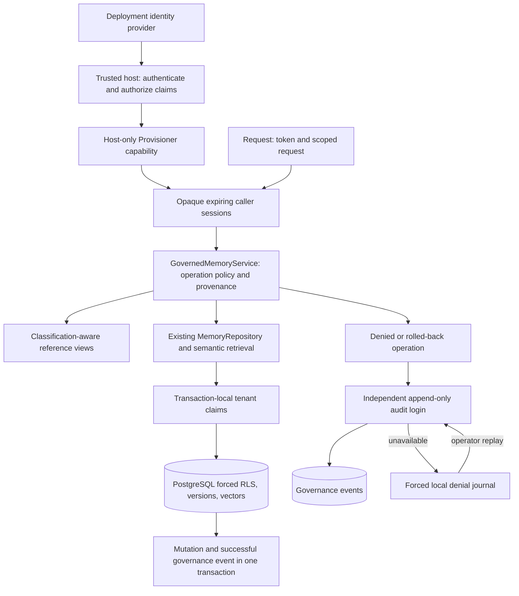

# Phase 6.4: Enterprise memory governance

This phase adds an opt-in host-facing governance API. It does not connect memory to ADK agents, change Gemini configuration, or change Phase 5 workflows. Existing `MemoryRepository`, source authorization, exact vector ranking, versioning and V001/V002 RLS remain intact. The prior Phase 6.1–6.3 files were already uncommitted when this work began.

## Architecture and trust boundaries



`TrustedCallerBoundary.bootstrap(clock)` returns separate boundary and provisioner capabilities. The host must retain the provisioner privately and issue credentials **only after** validating identity-provider authentication, tenant membership, clearance, permitted session/task scope and operation grants. Neither prompts nor tool arguments are authenticated claims. Caller constructors are private; handles issued by a different boundary, revoked handles and expired handles are rejected on every operation. Credentials contain 256 random bits; only SHA-256 token hashes are stored. Lifetime is bounded to 24 hours. Credentials' string representation is redacted. Do not log bearer tokens.

This is a host authentication boundary, not an IdP integration. Any Java code able to bootstrap a new service, access the provisioner or use internal repositories is trusted code. The public pre-existing repository APIs remain available for compatibility and must not be exposed to untrusted tools or network clients. Existing agents are deliberately not rewired.

## Operation policy

All operations require a current authenticated handle and authorized scope. Session grants are separate from existing identity capabilities; both must permit a mutation. Existing source/type/clearance/write rules remain authoritative.

| Operation | Additional governance requirements |
| --- | --- |
| Read/search | READ grant; repository scope/clearance/expiry predicates; canonical provenance revalidation |
| Create | CREATE; authoritative drafts additionally require VERIFY or APPROVE |
| Update | UPDATE; cannot change verification state or lower classification; changing an existing authoritative record also requires its VERIFY/APPROVE grant |
| Verify | Explicit `verify`, VERIFY grant, semantic VERIFIED draft and existing VERIFY_SEMANTIC capability/provenance rules |
| Approve | Explicit `approveProcedure`, APPROVE grant, procedural APPROVED draft and existing APPROVE_PROCEDURE capability/provenance rules |
| Revoke/delete | Corresponding grant; authoritative targets require VERIFY/APPROVE; repository version, retention and legal-hold constraints |

The current procedural contract accepts approved procedures rather than candidate procedures. Governance preserves that contract; creation of an approved procedure requires both CREATE and APPROVE. `approveProcedure` supports an explicit approved procedural revision. No new pending-review workflow is invented.

The unchanged repository read contract hides expired/revoked records. Deleting a hidden record conservatively requires both VERIFY and APPROVE grants, plus DELETE and the existing underlying capabilities, since an empty read cannot establish its verification category. This also restricts deletion of expired candidates; use an appropriately authorized retention operator rather than relaxing the hidden-record check.

## Classification and poisoning controls

Server-issued delivery classification cannot exceed identity clearance. Repository clearance still determines visibility; records above clearance remain absent. Records above the delivery ceiling have content replaced with `[REDACTED]`, empty metadata and no detector signals. IDs, versions and memory types remain visible to these already authorized readers. Views never include raw provenance, embeddings or cosine scores. Semantic retrieval keeps existing SQL eligibility, metadata filters and deterministic ordering, then applies the delivery projection.

Every view has trust `UNTRUSTED_REFERENCE_DATA`, including approved procedures. None becomes a system/developer instruction. Existing approved instruction catalogs and context assembly remain separate. Downstream consumers must preserve this separation.

Sources must resolve in the server-managed registry and stored provenance must match its canonical source on delivery. The registry is a trust anchor; operators must authenticate and curate its contents. It is not cryptographic proof that source assertions are true.

The detector flags common instruction overrides, role spoofing and credential-exfiltration requests, including simple Unicode normalization/format-character obfuscation. Candidate content is retained as flagged reference data. Authoritative drafts with signals in content or metadata are rejected for external review. Reserved policy/verification/identity metadata keys are rejected. Approval grants are required regardless of detector results. Detection has false positives and false negatives and cannot certify content as safe; there is no unsafe override endpoint.

## Retention, derived data and deletion

PostgreSQL continues enforcing existing legal holds and `retain_until` via its delete guard. Runtime logins cannot configure or release holds; that requires the separate existing retention role. Expired/revoked/superseded records remain excluded from retrieval. V002 invalidation and cascading foreign keys continue removing vectors on permitted physical deletion. Optimistic versions remain mandatory. Offline repositories retain their existing behavior and do not simulate DBA retention controls.

No summaries are generated automatically. Governed writes declaring `derivedFrom`, `references` or `summaryOf` are rejected: a lineage-aware derived-memory lifecycle is not implemented. Existing or externally generated summaries and exports require an operator-maintained dependency inventory and explicit deletion/recomputation review. Undeclared natural-language references cannot be detected reliably. Do not enable derived-summary ingestion under this API until that responsibility is implemented; rejecting declared lineage is a deliberate restriction, not automatic cascading summary deletion.

Minimal audit evidence survives memory deletion: random event/authentication IDs, timestamp, operation/outcome/reason codes and authorized successful memory ID/version. Denials omit requested memory IDs and content. Tenant/user IDs are pseudonymous identifiers, not anonymous data. Audit retention, legal hold, restricted export, erasure exceptions and access must be governed by deployment policy. No automatic audit purge is enabled. Local journals must receive the same retention/access controls.

Deleting active rows does not erase WAL, replicas, exported reports, OS files, logs or backups. Use encrypted backups, restricted access, defined retention and destruction schedules. Recovery can resurrect deleted data: replay a separately protected erasure ledger and reapply holds/revocations before serving restored databases. This phase does not implement that recovery orchestration or external data deletion.

## Audit and atomicity

For governed PostgreSQL create/update/verify/approve/revoke/delete, `GovernanceAuditScope` calls a hook inside the existing JDBC mutation transaction. The new SUCCESS event and existing audit event commit with the memory mutation. Any audit insert failure rolls back the memory and both successful events. Scope is synchronous/thread-local and removed in `close`; it must not be propagated across asynchronous boundaries.

Failures are recorded after the repository has unwound/rolled back, using an independent connection. Missing identity produces an unattributed denial. Security exceptions are DENIED; other operation failures are ROLLED_BACK (a prevalidation failure can have no database changes to roll back). Exception messages, memory bodies, metadata, tokens and embedding data are not audit payloads. Successful reads retain existing repository audit semantics; the new table focuses on governed mutations and security denials. In-memory success audit remains the existing local `ContextAuditLog`, not durable PostgreSQL evidence.

`PostgresGovernanceAudit` requires a separate least-privilege `retail_memory_audit_writer` member. That role can only INSERT DENIED/ROLLED_BACK rows and has no memory-table or audit SELECT/UPDATE/DELETE grants. Runtime can only INSERT scoped SUCCESS rows. Forced RLS applies to the new table. Event UUID duplicates are acknowledged only after rollback of the independent replay transaction, giving idempotent replay without SELECT permission.

Wrap the independent sink in `DurableGovernanceOutbox(securePath, sink)` for a database-outage fallback. Journal files contain only bounded validated audit fields, are forced to storage before returning and are replayed explicitly with `replay()`. A destination failure leaves files available for retry. If both sinks fail, the API reports audit unavailability; it never authorizes the failed operation. There is no background replay daemon: monitor disk space/backlog and schedule replay in the host. File-system durability across power loss depends on Windows/filesystem guarantees; secure ACLs, encryption and directory/volume durability are deployment responsibilities. Use one outbox owner per directory, not concurrent JVMs. A process crash between rollback and audit emission can leave a denial gap; this is not an exactly-once distributed audit protocol.

Commit-acknowledgement failures may have an unknown transaction outcome. Reconcile by memory version and database audit evidence before retrying; do not assume an observed connection failure proves rollback. DB owners/superusers can alter audit tables; external tamper-evident storage is a deployment responsibility.

## SQL and migrations

V003 adds `governance_events` with UUID primary key, metadata-only event fields, outcome/vocabulary checks, tenant/user timestamp index, forced RLS and separate insert policies. It changes no V001/V002 table or policy. Bootstrap additionally provisions/validates the NOLOGIN audit-writer group role and rejects unsafe/mixed memberships. Existing V001/V002 migration checksums are untouched. Migration remains checksummed and transactional.

1. Back up and test restore. Use a DBA/migration login, never a runtime login.
2. Install pgvector in `public` as documented in Phase 6.3.
3. Rerun `bootstrap`, then `migrate-governance` using the CLI below.
4. DBA provisions a dedicated LOGIN with NOSUPERUSER NOCREATEDB NOCREATEROLE NOBYPASSRLS and membership only in `retail_memory_audit_writer`. Supply its password through a secure channel; never commit it or put it in command history.
5. Retain separate runtime, retention and migration credentials. Constructors reject privileged/mixed runtime roles.

RLS trusts transaction-scoped `retail.*` GUCs set by trusted host code, preserving the existing design. A person holding runtime DB credentials can set those GUCs themselves; this does **not** authenticate arbitrary direct SQL clients. Do not distribute runtime DB credentials or expose arbitrary SQL. Tests demonstrate denial without identity context, scoped cross-tenant isolation, inability to disable RLS/become owner and append-only role restrictions; they do not establish protection against a compromised trusted host or a runtime-credential holder forging claims. A DB-verified identity broker would be a separate architectural change.

## Configuration and host composition

Existing `MEMORY_REPOSITORY` defaults to `in-memory`; existing `MEMORY_POSTGRES_*` and migration settings are unchanged. Governance migration is explicit and is not automatically run by the repository provider. New writer-pool inputs are `MEMORY_POSTGRES_AUDIT_URL`, `MEMORY_POSTGRES_AUDIT_USER`, `MEMORY_POSTGRES_AUDIT_PASSWORD`; URL credentials are rejected using the same existing validation. Shared pool size/timeout settings apply. Configure credentials privately in the host environment, without printing values.

Example host composition (host owns and closes pools):

```java
var deployment = TrustedCallerBoundary.bootstrap(clock);
// Retain deployment.provisioner() only in the authenticated host integration.
var writerPool = PostgresGovernanceAudit.writerPool(System::getenv);
var independent = new DurableGovernanceOutbox(secureAuditDirectory,
    new PostgresGovernanceAudit(writerPool));
var governed = new GovernedMemoryService(deployment.boundary(), repository, sources, independent);
// Authenticate token through governed.authenticate(...) to audit authentication denials.
```

There is no production network endpoint or automatic IdP adapter. This composition is intentionally separate from ADK workflows. Boundary sessions are process-local; clustered deployments need sticky sessions or a separately reviewed distributed token/session implementation. Revocation is checked per operation; revocation racing an already authorized in-flight transaction does not cancel that transaction.

## Windows commands

PowerShell (JDK 17):

```powershell
Set-Location C:\agent-AI-workspace\retail-adk-agent
$env:JAVA_HOME = 'C:\Program Files\Java\jdk-17'
mvn clean test
mvn exec:java '-Dexec.mainClass=com.retail.agent.context.MemoryGovernanceCliRunner'
# Requires privately configured migration environment and installed pgvector:
mvn exec:java '-Dexec.mainClass=com.retail.agent.context.PostgresMemoryAdminCliRunner' '-Dexec.args=bootstrap'
mvn exec:java '-Dexec.mainClass=com.retail.agent.context.PostgresMemoryAdminCliRunner' '-Dexec.args=migrate-governance'
# Disposable temporary PostgreSQL only; requires pgvector installed in this distribution:
.\scripts\Run-PostgresMemoryIntegrationTests.ps1 -Governance -PgBin 'C:\Program Files\PostgreSQL\18\bin'
```

Windows CMD:

```bat
cd /d C:\agent-AI-workspace\retail-adk-agent
set "JAVA_HOME=C:\Program Files\Java\jdk-17"
mvn clean test
mvn exec:java -Dexec.mainClass=com.retail.agent.context.MemoryGovernanceCliRunner
mvn exec:java -Dexec.mainClass=com.retail.agent.context.PostgresMemoryAdminCliRunner -Dexec.args=bootstrap
mvn exec:java -Dexec.mainClass=com.retail.agent.context.PostgresMemoryAdminCliRunner -Dexec.args=migrate-governance
powershell -NoProfile -File scripts\Run-PostgresMemoryIntegrationTests.ps1 -Governance -PgBin "C:\Program Files\PostgreSQL\18\bin"
```

The demo uses synthetic identities and in-memory storage; expected output shows redacted delivery, poisoning rejection and revoked-caller rejection. It is not an authentication setup command. The integration script creates/stops/deletes its own unique test cluster and restores process environment; no existing database is used. Direct gated Maven requires an explicitly disposable database named `retail_memory_it`, migration variables, `MEMORY_POSTGRES_TEST_DISPOSABLE=true` and all three gates:

```powershell
mvn test '-Dtest=GovernanceMemoryIntegrationTest' '-DrunPostgresMemoryTests=true' '-DrunSemanticMemoryTests=true' '-DrunGovernanceMemoryTests=true'
```

Normal Maven builds need neither PostgreSQL nor Gemini. No live Gemini calls are needed to validate these governance controls.

## Source inventory

Created under `src/main/java/com/retail/agent/context/`:

- `TrustedCallerBoundary.java`: trusted provisioning, opaque credentials, expiry/revocation and operation grants.
- `GovernedMemoryService.java`: host API, policy, redaction, explicit verification/approval and semantic delivery.
- `MemoryPoisoningDetector.java`: advisory instruction-like-content signals.
- `GovernanceAudit.java`, `GovernanceAuditScope.java`: minimal events and successful mutation transaction scope.
- `PostgresGovernanceAudit.java`: independent denial writer, environment-configured writer pool and idempotent replay.
- `DurableGovernanceOutbox.java`: forced metadata-only fallback and explicit replay.
- `MemoryGovernanceCliRunner.java`: isolated offline demonstration.

Modified existing context files: `PostgresMemoryRepository.java` (transactional audit hook), `PostgresTransactions.java` (role separation checks), `PostgresMigrations.java` (explicit V003 upgrade), `PostgresMemoryAdminCliRunner.java` (migration command). SQL: updated `bootstrap.sql`, new `V003__memory_governance.sql`. Tests: new `MemoryGovernanceTest.java`, `GovernanceMemoryIntegrationTest.java`; existing `PostgresMemoryIntegrationTest.java` exposes fixture helpers package-locally. Updated `scripts/Run-PostgresMemoryIntegrationTests.ps1` with an opt-in governance switch. No new Maven dependencies were needed for Phase 6.4.

## Validation

The real PostgreSQL suite repeats all 19 Phase 6.2/6.3 contracts on V003 and adds 9 governance tests: transactional approval audit, injected post-governance-audit failure/rollback, minimal denial evidence, idempotent independent replay, direct role restrictions, hold/retention/vector deletion, concurrent version conflicts, semantic redaction and hidden-record deletion approval. Validation uses real PostgreSQL 18 and official pgvector 0.8.7, not H2.

Validation on 2026-11-17:

| Command | Actual result |
| --- | --- |
| `mvn clean test` | BUILD SUCCESS; 230 discovered, 166 passed, 64 skipped, zero failures/errors |
| Isolated PostgreSQL `-Governance` suite | BUILD SUCCESS; 28 passed, zero skipped/failures/errors |

The 64 normal-build skips comprise 59 gated database cases (12 base + 19 semantic + 28 governance) and 5 pre-existing live tests. The 15 new offline governance cases require no database or Gemini credentials. The PostgreSQL test run used a privately staged pgvector build because the installed PostgreSQL distribution lacked the extension; no installed server or existing database was modified. The test cluster was stopped and removed.
