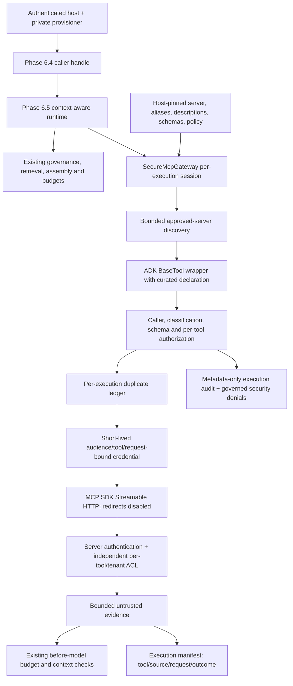

# Phase 6.6A: Secure MCP integration

## Repository findings and verified APIs

No Spring Boot MCP server exists inside the ADK repository. On 2026-11-18 the user supplied the separate existing project at `C:\agent-AI-workspace\retail-stock-investigator\retail-inventory-mcp`. It uses Spring Boot 4.0.3, Spring AI 2.0.2 and Java 21. Its optional API-key filter was disabled by default, and its data was an unscoped single demo inventory. The integration now includes reviewed tool mappings and three additive server security files; business tools, service logic, dependencies and existing tests were preserved. The server project is not a Git repository. The ADK application remains on Java 17.

The secured build was validated on temporary loopback port 18080 using a private ephemeral delegation key, then stopped. The existing user-managed process on port 8080 was not restarted and still requires an operator restart with the dedicated key to load the added filter. Do not treat that old process as secured by an on-disk source change.

Installed classes were inspected with JDK 17 `javap`. ADK Java 1.13.0 exposes `BaseTool.declaration()`, `BaseTool.runAsync(Map, ToolContext)`, `LlmAgent.Builder.tools(...)` and the Phase 6.5 synchronous callbacks. The wrapper uses these actual Java extension points rather than Python ADK interfaces.

MCP SDK 2.1.0 targets Java 17 (class version 61). The implemented HTTP adapter uses verified `McpClient.sync`, `McpSyncClient.initialize/listTools/callTool`, `HttpClientStreamableHttpTransport`, request customizers and three-argument `McpSchema.CallToolRequest` with `_meta`. See the [official Java SDK documentation](https://java.sdk.modelcontextprotocol.io/latest/) and [client API source documentation](https://github.com/modelcontextprotocol/java-sdk/blob/main/docs/client.md).

Dependencies added: `io.modelcontextprotocol.sdk:mcp:2.1.0` and explicit `jackson-annotations:2.21`. The SDK's Jackson 3 mapper needs `JsonSerializeAs`, which was missing when the existing Jackson dependency won transitive resolution. The real SDK HTTP test reproduced that linkage error; pinning annotations resolved it. Existing ADK Jackson 2 `jackson-databind:2.20.2` is retained. No Spring AI, LangChain4j, model provider or SQL changes were introduced.

## Architecture



The original single-agent runner and Phase 5A/5B workflows are untouched. Existing Phase 6.5 constructors continue to create a runtime with no MCP tools. `runtime.withMcpGateway(gateway)` creates a new immutable runtime configuration; it does not mutate another runtime or share caller state between sessions. Existing `Result` accessors and its prior constructor remain available; the additive `mcpEvidence` and `executionManifest()` expose MCP provenance separately from the original assembly manifest.

## Trusted registration and discovery

Only host-created `ToolPolicy` registrations can become ADK tools. Each pins a public `mcp_...` alias, exact remote name, curated description, input schema, output classification and safe-idempotency decision. An unknown discovered tool is ignored. Missing registered tools, duplicate discovery names and schema drift fail closed. Direct gateway calls also require successful discovery; callers cannot bypass it by guessing an alias.

Server-provided descriptions, annotations, server instructions and logging messages are never copied into model instructions or tool declarations. A model sees only host-curated aliases/descriptions and pinned schemas. The SDK adapter does not configure sampling, elicitation, resource loading or prompt retrieval. Server log notifications have a no-op consumer.

`McpInputSchema` intentionally supports a closed subset: a flat object of bounded strings, required fields, full-match patterns, optional enums and `additionalProperties:false`. Discovery must exactly match the host-pinned `discoverySchema`. The original six-argument policy constructor uses the local schema for both; an additive constructor permits a separately reviewed remote snapshot while retaining stricter local validation. `RetailInventoryMcpPolicies` pins the actual Spring-generated schemas (including descriptions as drift-check data) but sends only curated descriptions and stricter local schemas to Gemini. Remote descriptions are never promoted to model declarations. This is not a general JSON Schema implementation. Adapt a tool explicitly rather than silently dropping schema constraints. Host-authored regular expressions are trusted configuration and should remain simple/bounded.

Reserved identity field names cannot be registered, and unknown arguments are rejected. The stock example allows only `warehouseId` and three known warehouse values. Any `tenantId`, `userId`, authorization or token parameter from a model is rejected before network execution.

## Authorization and identity propagation

The gateway consumes the existing opaque caller handle and reuses governance's READ/scope checks. It requires authenticated session/task scope, enforces output classification and evaluates a separate host per-tool policy using trusted tenant/user/session/task claims. Memory READ alone does not grant MCP access. Checks occur again on invocation and even before returning a duplicate's cached result. Revoked or expired callers cannot read cached evidence.

The downstream credential is **not** the caller's opaque Phase 6.4 credential, Gemini key, database credential or a token copied from a prompt. `McpDelegation.Issuer` receives minimal trusted claims: approved server audience, tenant, user, exact remote tool, request UUID and short expiry. Session/task grants remain local unless a future service has a justified need for them. Credentials override no tool arguments and are carried only in the transport's Authorization header.

The supplied local integration profile uses a dedicated >=32-byte HMAC key and a signed opaque bearer format, with a maximum 120-second validity window (gateway issuance uses 60 seconds). This is **not JWT or a complete OAuth implementation**. The signing key is separate from all existing credentials. It must be provisioned to the approved local server securely and never printed. `Credential.toString()` is redacted. Production hosts may supply an issuer backed by approved token exchange and use the server's standard authorization mechanism. Do not pass a token to an audience it was not issued for. The [MCP authorization specification](https://github.com/modelcontextprotocol/modelcontextprotocol/blob/main/docs/specification/2026-07-28/basic/authorization/index.mdx) describes the standard HTTP authorization profile; this local signed-token adapter does not replace a production OAuth deployment.

### Required server boundary

The delegation contract is now implemented in the supplied server by `DelegationVerifier` and `SecureMcpDelegationFilter`. The filter requires a valid dedicated key at startup and checks tenant/user, tool, request UUID and arguments before handing JSON-RPC to Spring's MCP transport. It preserves the body using a servlet request wrapper and does not depend on a thread-local identity surviving asynchronous dispatch. A compatible Spring Boot service must enforce all of the following before accessing business data:

1. Require Authorization on the MCP endpoint; reject unauthenticated requests with HTTP 401/403. Verify signatures, audience, expiry and its **own** current tenant/user ACL with `authenticate`.
2. Allow `initialize`/notifications only within authenticated sessions. Restrict `tools/list` to the `discovery` delegation scope. Reject unsupported methods and unsafe Origin values according to the server deployment policy.
3. In the actual `tools/call` handler, call `authorize(bearer, audience, actualToolName, requestId, serverPolicy)` again. Obtain the request UUID from the host-generated `_meta["retail/requestId"]`; compare it to the signed token. Enforce the server's per-tool authorization, validate arguments again, and scope inventory/database queries from the verified claims, never from arguments.
4. Persistently deduplicate request UUIDs at the service boundary where duplicate prevention across reconnects/restarts matters. Authoritative side effects require server-side atomic idempotency/business transaction support. The sample integration is advisory/read-only; never register a mutating tool merely because the server advertises it as safe.

These are framework-neutral compiled Java helpers, not invented Spring APIs. Example handler logic:

```java
var claims = verifier.authorize(bearer, "local-stock", actualToolName, requestId,
    c -> tenantAccess.isAllowed(c.tenant(), c.user(), actualToolName));
var validated = pinnedSchema.validate(arguments);
// Use claims.tenant()/user() to select authorized data in the server's service layer.
// Do not construct tenant identity from validated arguments.
```

`tenantAccess` represents a production server's real ACL integration. The supplied demo server instead owns data for one configured tenant/user (`retail-demo`/`analyst`) and rejects every other tenant/user. It is not a new multi-tenant inventory repository. Its configurable `app.mcp.allowed-tools` list independently limits the three read-only operations. Existing service methods remain unchanged. The local HMAC profile alone does not revoke an already issued token immediately; production ACL/revocation integration remains required. The gateway rechecks its caller after transport returns and discards evidence if authorization changed. This cannot undo a remote operation already in progress.

## Transport, bounds, retries and cancellation

The SDK adapter supports Streamable HTTP, not legacy SSE or arbitrary stdio commands. Endpoint URIs are host configuration only. HTTPS is required except literal `127.0.0.1` HTTP for local integration. Embedded credentials, query strings and fragments are rejected. JDK HTTP redirects are disabled, and request customization checks that scheme, authority and path remain the approved destination before attaching credentials. Default TLS certificate verification is retained.

An SDK client is created/initialized/closed per operation, preventing authenticated MCP sessions from being shared across users. Discovery accepts a single page of at most 128 tools and the HTTP adapter caps responses at 64 KiB. Evidence is text-only and capped at 16,000 UTF-8 bytes; images, embedded resources and other content types are rejected. Structured server payloads and metadata are not promoted into trusted fields.

The gateway owns four daemon workers and a queue of sixteen tasks. Configured deadlines are 10 ms–30 seconds per attempt. Timeout cancels the waiting future and interrupts the local worker; `Session.close()` cancels pending operations, and gateway close shuts workers down. SDK request/initialization/connect timeouts provide another bound. Cancellation is best effort: an interrupted client cannot prove that the server stopped or never executed. Timeouts/cancellation return explicit `TIMEOUT_UNKNOWN`/`CANCELLED_UNKNOWN` and are not treated as confirmed rollback.

Only host-declared safe-idempotent operations get one connection-failure retry, using the **same** request UUID. Other operations get one attempt. Server-declared annotations never determine retry safety. Calls within an execution are serialized and canonical tool+argument keys share an in-memory terminal result, including failures/unknown outcomes. A reservation is created before dispatch so a response-validation failure cannot cause resubmission. There are at most 64 distinct calls per execution. Duplicate callers still undergo authorization checks.

This ledger is per execution and per process. It does not provide exactly-once execution across fresh turns, crashes or restarts, and different argument keys are separate operations. Retrying a safe read can contact the server twice; the fake server tests also demonstrate server-side request-ID deduplication. Do not rely on the gateway alone for side-effect safety. Connection/auth/protocol failures are sanitized; remote authorization exceptions are not retried as connection failures when the SDK exposes that classification.

## Evidence, budgets, governance and audit

MCP results use a gateway-owned envelope with `authority=UNTRUSTED_REFERENCE_DATA`, structured status and gateway-owned provenance. Server text is placed under `evidence`; it cannot replace the authenticated caller, provenance, system instruction or policy fields. Actual MCP FunctionResponses remain ordinary ADK tool evidence. The existing Phase 6.5 before-model callback budgets the entire compact request, including these responses, before another Gemini call.

`Result.executionManifest()` combines the original context selection manifest with MCP server/tool/source/request/outcome/duration references and duplicate markers. The source ID must resolve in the existing source registry as TOOL_RESULT for the caller's tenant. Tool response bodies and credentials are not stored in this manifest. The original assembly manifest remains a preexecution selection record and is not rewritten to pretend later tool responses were preassembled.

The host's output classification is enforced before invoking a tool, and used to prevent postrun candidate writes from lowering the classification of MCP evidence. MCP responses are not automatically written to memory. Existing Phase 6.4 candidate-only policies, approval restrictions and derived-summary rejection remain in place. No semantic verification or procedural approval MCP tool is exposed by the example.

`AuditSink` receives execution/request UUID, pinned server/tool, tenant/user, outcome, attempts and duration, never arguments, credential values or response bodies. `McpFileAuditSink` writes timestamped metadata JSONL under a file lock and forces it to storage. Audit append failures propagate rather than returning unaudited successful evidence; a remote call may already have completed, so reconcile using request IDs. The duplicate ledger prevents an audit failure from automatically resending the call within that execution. Security denials also go through the existing governed independent audit path.

Secure file ACLs/encryption, monitoring, rotation, retention, replay/export and tamper evidence are deployment responsibilities. A file append is not atomic with a remote MCP operation, and crashes can leave audit gaps or an incomplete last line. Do not enable HTTP/header wire logging in a deployment that could expose bearer tokens. Existing ADK runtime callbacks continue redacting arguments and using fixed error messages. Production composition should use the existing PostgreSQL denial sink/outbox; the local demo uses console metadata for governance denials plus the dedicated MCP file audit.

## Configuration and entry point

New local-demo CLI: `com.retail.agent.context.McpContextAwareCliRunner`. It uses the unchanged Gemini chat model and credential discovery, fixed local `retail-demo`/`analyst` identity, scoped `mcp-cli`/`warehouse-health`, in-memory memory and the existing shared demonstration inventory store. It is not a production login mechanism. Production hosts attach the gateway with `withMcpGateway` to their existing PostgreSQL/semantic/governed runtime composition.

Required host settings:

| Setting | Meaning |
| --- | --- |
| `MCP_SERVER_URL` | Approved full Streamable HTTP URL, e.g. `http://127.0.0.1:8080/mcp` |
| `MCP_DELEGATION_KEY` | Privately provisioned Base64 encoding of >=32 random bytes; local server verifier must use the matching dedicated key |
| `MCP_AUDIT_FILE` | Absolute path in an operator-secured directory |

Do not paste keys into chat or put them in command history. Audience remains `local-stock`, tenant `retail-demo`, user `analyst`. The original example `stock_health` profile remains the default for compatibility. For the supplied server, set `MCP_TOOL_PROFILE=retail-inventory`; this selects reviewed `RetailInventoryMcpPolicies`:

| Model alias | Actual remote tool | Arguments |
| --- | --- | --- |
| `mcp_get_inventory` | `get_inventory` | `productId` |
| `mcp_get_reorder_status` | `get_reorder_status` | `productId` |
| `mcp_get_sales_summary` | `get_sales_summary` | `productId`, `fromDate`, `toDate` |

Allowed product IDs are `WM-101`, `KB-201`, `MN-301`; they have no invented mapping to the native warehouse/SKU store. Client schemas bound strings/enumerate products; the server revalidates product IDs, argument keys, ISO dates and date order. Sales values are sample totals and are **not date-filtered**.

The server gets its dedicated key from `MCP_DELEGATION_KEY` or `app.mcp.delegation-key`. Missing/short keys prevent startup. Provision the same key privately in server and client environments; no permanent key was saved. If the old optional `app.mcp.api-key` filter is enabled, it remains an additional independent requirement; this delegation-only client profile does not send that legacy API-key header.

## Windows commands

For the actual supplied server, the reproducible helper requires **PowerShell 7**. It builds that server with the installed Java 25 JDK targeting Java 21, starts a separate secured loopback instance on 18080, runs the ADK client on Java 17, then stops the instance and restores environment settings. It does not stop or secure an already-running process on 8080.

```powershell
Set-Location C:\agent-AI-workspace\retail-adk-agent
.\scripts\Run-SpringMcpIntegrationTests.ps1
# Add actual Gemini tool routing:
.\scripts\Run-SpringMcpIntegrationTests.ps1 -Gemini
```

From CMD:

```bat
cd /d C:\agent-AI-workspace\retail-adk-agent
pwsh -NoProfile -File scripts\Run-SpringMcpIntegrationTests.ps1 -Gemini
```

For a manually managed secured instance, privately provision the same dedicated key in server/client environments, restart the server to load the new filter, and select the actual tool profile:

```powershell
$env:MCP_SERVER_URL = 'http://127.0.0.1:8080/mcp'
$env:MCP_TOOL_PROFILE = 'retail-inventory'
$env:MCP_AUDIT_FILE = 'C:\agent-AI-workspace\secure-audit\mcp.jsonl'
mvn exec:java '-Dexec.mainClass=com.retail.agent.context.McpContextAwareCliRunner' '-Dexec.args=Use MCP product tools to assess inventory and reorder status for KB-201'
```

CMD equivalent: `set "MCP_TOOL_PROFILE=retail-inventory"`, then use the existing `mvn exec:java` command with product `KB-201`. The commands below retain the **original stock-health example profile**; use the helper/new `RetailInventorySpringLiveTest` for the supplied server. The old `McpSpringEndpointLiveTest` targets the example `stock_health` contract, not the actual server.

PowerShell:

```powershell
Set-Location C:\agent-AI-workspace\retail-adk-agent
$env:JAVA_HOME = 'C:\Program Files\Java\jdk-17'
mvn clean test
mvn test '-Dtest=SecureMcpGatewayTest,SdkMcpTransportTest'
# Configure the dedicated key privately; only non-secret settings are shown:
$env:MCP_SERVER_URL = 'http://127.0.0.1:8080/mcp'
$env:MCP_AUDIT_FILE = 'C:\agent-AI-workspace\secure-audit\mcp.jsonl'
# Requires a compatible, secured local Spring endpoint:
mvn test '-Dtest=McpSpringEndpointLiveTest' '-DrunLiveMcpTests=true'
# Requires that endpoint plus the project's existing private Gemini credential:
mvn exec:java '-Dexec.mainClass=com.retail.agent.context.McpContextAwareCliRunner' '-Dexec.args=Use mcp_stock_health for WH-CENTRAL-01 and report advisory evidence'
```

Windows CMD:

```bat
cd /d C:\agent-AI-workspace\retail-adk-agent
set "JAVA_HOME=C:\Program Files\Java\jdk-17"
mvn clean test
mvn test -Dtest=SecureMcpGatewayTest,SdkMcpTransportTest
set "MCP_SERVER_URL=http://127.0.0.1:8080/mcp"
set "MCP_AUDIT_FILE=C:\agent-AI-workspace\secure-audit\mcp.jsonl"
mvn test -Dtest=McpSpringEndpointLiveTest -DrunLiveMcpTests=true
mvn exec:java -Dexec.mainClass=com.retail.agent.context.McpContextAwareCliRunner "-Dexec.args=Use mcp_stock_health for WH-CENTRAL-01"
```

Normal Maven testing requires neither an external MCP service nor PostgreSQL/Gemini credentials. The HTTP SDK test starts/stops its own in-process fake loopback server. The explicitly gated Spring live test checks anonymous denial, authenticated discovery/call and cross-tenant denial; it deliberately fails when explicitly enabled without compatible server configuration.

## Source inventory

Created under `src/main/java/com/retail/agent/context/`: `SecureMcpGateway.java`, `McpInputSchema.java`, `McpDelegation.java`, `McpTransport.java`, `SdkMcpTransport.java`, `McpFileAuditSink.java`, `McpContextAwareCliRunner.java`.

Created under `src/test/java/com/retail/agent/context/`: `SecureMcpGatewayTest.java`, `SdkMcpTransportTest.java`, `McpSpringEndpointLiveTest.java`.

Modified: `ContextAwareAdkRuntime.java` (optional immutable gateway integration and additive execution manifest), `GovernedMemoryService.java` (package-private registered tool-evidence provenance check), `pom.xml` (pinned SDK and required annotations). This documentation is new. No SQL, existing memory repository interfaces, Phase 5 workflows or Gemini configuration were changed. Prior uncommitted work was retained; no Git commit was created.

Follow-up additions for the supplied server:

- `RetailInventoryMcpPolicies.java`: actual remote schema snapshots, curated declarations and stricter input validation.
- `SecureMcpGateway.ToolPolicy`: additive separate discovery snapshot; original constructor retained.
- `McpContextAwareCliRunner`: optional `retail-inventory` profile; original profile retained.
- `RetailInventoryMcpPoliciesTest.java`: schema separation, product and identity validation.
- `RetailInventorySpringLiveTest.java`: actual server authentication, three-tool ADK execution, duplicate suppression and a second gate for Gemini.
- `scripts/Run-SpringMcpIntegrationTests.ps1`: isolated server lifecycle and private ephemeral key.
- `integration/retail-inventory-mcp/`: reviewable copies of three files installed additively in the external server: `src/main/java/com/retail/inventory/security/DelegationVerifier.java`, `src/main/java/com/retail/inventory/security/SecureMcpDelegationFilter.java`, `src/test/java/com/retail/inventory/security/SecureMcpDelegationFilterTest.java`. No existing server source file was overwritten.

## Validation

### Secured integration with the supplied server — 2026-11-18

| Validation | Actual result |
| --- | --- |
| ADK `mvn clean test` | BUILD SUCCESS: 312 discovered, 210 passed, 102 intentionally skipped, zero failures/errors |
| Spring server `mvn clean test` | BUILD SUCCESS: 9 passed (6 new security + 3 preserved business tests) |
| Gated real Spring integration, including Gemini | BUILD SUCCESS: 4 passed, zero skipped/failures/errors |

Real Gemini invoked `mcp_get_inventory`, `mcp_get_reorder_status` and `mcp_get_sales_summary` in two model calls. Execution ID: `f622f278-500a-4023-9fc6-c1a2a212e510`. Scripted ADK execution against the actual server independently verified KB-201 actual inventory 15, expected inventory 80, sample-sales caveat and three successful provenance entries. Anonymous and forged requests returned 401; signed cross-tenant requests returned 403. Duplicate gateway calls returned cached evidence without resubmission.

The isolated secured server ran on port 18080 and was stopped after testing. No Gemini/database credentials were propagated to that server process. Its random delegation key existed only in process memory/environment and was not printed or saved. Logs: `phase6-6a-server-tests.log`, `phase6-6a-server-build.log`, `phase6-6a-spring-integration.log`, `phase6-6a-offline.log` (local ignored artifacts). The running old port-8080 process was not restarted.

The following probe and 2026-11-17 results are historical; they explain why server hardening was necessary.

### Local endpoint probe — 2026-11-18

The user supplied `http://localhost:8080/mcp`; probes used literal loopback `http://127.0.0.1:8080/mcp`. The running endpoint accepted unauthenticated MCP initialization with HTTP 200 and negotiated protocol `2025-11-25`. Unauthenticated `tools/list` also succeeded (HTTP 200, SSE-formatted response), exposing:

| Remote tool | Discovered arguments |
| --- | --- |
| `get_inventory` | `productId` |
| `get_reorder_status` | `productId` |
| `get_sales_summary` | `productId`, `fromDate`, `toDate` |

No credentials were sent and no business tool was invoked. Neither `MCP_SERVER_URL` nor `MCP_DELEGATION_KEY` was configured in the client process or Windows user environment. These discoveries do not match the example `stock_health` registration. Initialization/discovery availability does not establish whether the tool handlers have separate authentication; their authorization remains unverified. The endpoint currently fails the documented live test prerequisite that anonymous initialization must be denied. Secure end-to-end execution remains pending server authentication/tenant-policy inspection and reviewed registration of the actual tool schemas; no gateway check was disabled to accommodate it.

Validation on 2026-11-17:

| Validation | Actual result |
| --- | --- |
| `mvn clean test` | BUILD SUCCESS: 306 discovered, 208 passed, 98 intentionally skipped, zero failures/errors |
| New MCP offline cases | 21 gateway/security cases plus 1 actual-SDK HTTP case passed |
| Existing context-aware runtime cases | All 20 passed within the full regression suite |
| Live Spring endpoint test | Gated/skipped: no compatible endpoint or delegation key configured |

The 98 normal-build skips comprise the previous 97 gated cases and one new Spring live case. Local evidence is retained in ignored `phase6-6a-offline.log` and `phase6-6a-sdk.log`. No external PostgreSQL, Gemini or MCP service was required by the clean build.

The 21 fake-transport security tests cover allowlisting, per-tool authorization, identity-argument rejection, cross-tenant/audience/expiry/signature checks at the server boundary, schema drift/duplicate discovery, response injection, invalid inputs, timeouts, cancellation, safe and unsafe retries, ambiguous outcomes, concurrent duplicates, independent sessions, caller revocation, independent server ACL changes, response bounds, actual ADK MCP FunctionResponse events, provenance, output classification and audit failure/metadata-only records.

The separate real-SDK HTTP test negotiates MCP, ignores malicious server descriptions/instructions, discovers the pinned tool, executes one authenticated `tools/call` and verifies anonymous HTTP rejection against an in-process fake server. This is transport evidence, **not a live Spring Boot validation**. Spring live testing remains gated until a separate compatible endpoint is supplied. No combined live Gemini/Spring/PostgreSQL execution is claimed by these offline tests.

Remaining limits: constrained schema/content support; host-managed server/tool trust and classification; custom local delegation profile requiring server wiring; process-local deduplication; best-effort cancellation and unknown remote outcomes; external server idempotency/tenant data authorization; audit durability/retention obligations; and the inherited Phase 6.4/6.5 trust and memory-lineage limitations. No enterprise document RAG, Phase 6.6B or Phase 6.6C was implemented.
