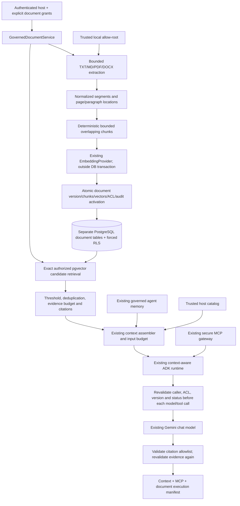

# Phase 6.6B: Enterprise document grounding and governed RAG

## Scope, inspection and preserved work

The Phase 6.1–6.6A source, documentation, caller boundary, assembly/runtime manifests, migrations, embedding contract, JDBC scope binding, MCP integration and test gates were inspected before implementation. The initial implementation plan was reported before editing.

Baseline checkout: branch `phase-5b-workflow-orchestration`, HEAD `1445ba6`. The existing POM modification and untracked Phase 6.1–6.6A source, tests, resources, scripts, integration overlay and documentation were already present; they were retained. No commit, push or deployment was performed. The separate Spring server project was not modified during this phase.

Java remains 17, ADK remains 1.13.0, and `RetailInventoryAgent.MODEL_NAME`/Gemini credential discovery are unchanged. New libraries are Apache PDFBox 3.0.8 and Apache POI OOXML 6.0.0. Their maintained versions and Java compatibility were checked against the [PDFBox release page](https://pdfbox.apache.org/download) and [POI release page](https://poi.apache.org/download.cgi); the actual APIs were then compiled and exercised. POI 6 requires Java 17. No new model provider, vector database, ANN/HNSW index or live enterprise connector was introduced.

## Architecture and data flow



Documents are a separate domain with their own models, repository contract, ACLs, roles, tables and lifecycle. No document is stored as an agent memory or promoted to an approved instruction. Classes share `com.retail.agent.context` to reuse the existing package-private trusted caller/JDBC boundary without adding public identity-unwrapping APIs; they do not implement or change `MemoryRepository`.

The normal context runtime remains unchanged unless the host explicitly attaches `withDocumentGrounding(...)`. Both `withMcpGateway(...)` and `withDocumentGrounding(...)` preserve the other optional integration. Old runtime/result/manifest constructors remain available through additive overloads. Phase 5 agents/workflows and old CLIs do not automatically retrieve documents.

## Models and storage

`EnterpriseDocument` supplies immutable records for heads, drafts, locations, extracted segments, chunks, indexed vectors, versions, citations and evidence. Collections are copied. Records include tenant, owner, source ID/system, document/version/ACL revisions, MIME, classification, raw-source SHA-256, ingestion/source-modified timestamps, status, expiry, legal hold and retain-until metadata. Embeddings carry the existing provider's model ID, dimensions and explicit embedding generation version 1.

New migration: `src/main/resources/db/memory/V004__enterprise_documents.sql`. V001/V002/V003 are untouched. V004 uses the existing private schema and owner/migration history, but separate tables:

| Table | Purpose |
| --- | --- |
| `documents` | Tenant/document head, immutable owner/source, current version, ACL revision, classification, lifecycle, expiry/retention |
| `document_versions` | Version, MIME, source hash, source modification and ingestion times, READY/SUPERSEDED state |
| `document_chunks` | Stable chunk UUID, position, location, UTF-16 offsets, normalized text/hash |
| `document_embeddings` | Versioned chunk vectors, model/dimensions/generation, creation time and validity |
| `document_acls` | Explicit tenant-local user READ grants; owner implicitly reads |
| `document_audit` | Metadata-only durable operations, timestamps, counts and authorized mutation identifiers |

Composite tenant/document/version foreign keys prevent cross-tenant associations. Deferred current-version integrity allows atomic activation. Indexes cover owner/status, ACL principal, embedding profile and audit scope. Exact vector search is used; no HNSW optimization is present.

## Trusted local ingestion

The host creates `GovernedDocumentService` with an authenticated boundary, approved source registry, allow-root extractor, chunk policy, approved embedding provider, repository and independent governance audit sink. Ingestion requires the new `DOCUMENT_INGEST` grant. Existing memory READ/WRITE/VERIFY capabilities do not implicitly grant document access.

`DocumentExtractor` accepts only relative paths below its canonical allow-root. It rejects absolute paths, traversal, Windows alternate-stream separators, symbolic links and resolved paths outside the root. It opens with NOFOLLOW on the final component. The root and ancestors must be controlled by the trusted host; Java path checks do not provide a Windows filesystem sandbox against a hostile actor racing ancestor/junction replacement. Do not expose arbitrary server paths as model/tool arguments.

Limits are host-configurable within hard bounds: at most 10 MB input, 1 million extracted characters, 500 PDF pages, 1,000 ZIP entries and 1,000 chunks. DOCX expansion is bounded to the smaller of 20 MB or 20 times configured input size. The demo/tests use smaller limits. Extraction rejects empty content, unsupported MIME/extension/signature combinations, malformed UTF-8/binary text, corrupt containers and encrypted PDFs; encrypted OOXML/legacy Office formats are not accepted as DOCX. DOCX archives reject traversal entries, VBA parts, XML entity/DOCTYPE declarations and external relationships. No archive is extracted into the filesystem. PDF text extraction is bounded and does not render or execute actions; DOCX text/table extraction does not execute macros, embedded objects or links.

Normalization is deterministic NFC, normalized line endings, bounded spaces/tabs and trimmed segments. Plain text/Markdown preserve paragraphs; Markdown retains heading context. PDF citations retain page numbers. DOCX citations retain paragraph/table-row order, not rendered page numbers. Scanned PDFs without extractable text are rejected; OCR is not implemented. External-linked DOCX files are deliberately rejected rather than followed.

Raw bytes receive a SHA-256 source hash. Chunks stay within extraction segment boundaries and use configurable character size/overlap, avoiding surrogate splits. UUIDs derive from tenant, document ID, version, location, offset and text hash. Offsets are Java UTF-16 character offsets within the normalized segment. Changing the source version changes chunk IDs even if text is identical.

Embeddings are generated before any database activation transaction. Each returned vector is checked against the configured provider model/dimensions, validated by the existing finite/nonzero-vector contract and normalized. A provider failure cannot publish a partial version. Host configuration must authorize sending that classification to an external embedding provider; no network provider is constructed implicitly by the repository or extractor.

## Atomic activation and lifecycle

Creation inserts a head, version, all chunks/vectors, initial ACL and INGEST audit in one transaction. Replacements lock the owner head and compare the expected current version, then insert a complete new version, supersede the old version, invalidate old embeddings and advance the head with its successful audit. Existing ACLs and retention holds survive replacement. Readers continue seeing the previous committed version while extraction/embedding or an activation transaction is in progress. They never fall back to superseded data after activation.

There is no persistent half-indexed document state or asynchronous indexing queue. Failed extraction/embedding/SQL/audit insertion leaves the previous version active, or no document on failed creation. Failed/denied attempts use the separate Phase 6.4 independent audit mechanism after rollback; a caller's audit outage must not be represented as a successful operation. SQL/parser exceptions are sanitized to omit document body diagnostics. Protected operational tooling must diagnose database failures without logging source content.

Explicit operations:

- Version replacement/reindexing: submit the same document ID and expected version. Reindexing creates a new version, even for unchanged source bytes; no stale fallback while changing embedding profiles.
- ACL update: owner-only, optimistic ACL revision; explicit tenant-local users, no wildcard/group/public ACLs. Every change increments the ACL revision and invalidates previously returned evidence snapshots, even for readers who remain authorized.
- Revoke: hide the document and invalidate vectors. Reactivation through ingestion/lifecycle calls is not supported; deliberate recovery requires a separately reviewed new identity/workflow.
- Logical delete: hide content immediately and invalidate vectors while retaining held/retained data.
- Retention: separate grant and database role configure hold/retain-until. A legal hold does not force continued RAG visibility.
- Cleanup: prune superseded versions or physically remove a logically deleted document and its chunks/vectors. Holds/future retention block cleanup in application code and database triggers. The active version cannot be pruned. No automatic scheduler runs.

Expiry is enforced in retrieval SQL/RLS and by the service clock; expiry does not automatically erase data or start a maintenance worker. Audits survive content deletion and have separate operator-defined retention. Cleanup does not delete original source files, exports, WAL, replicas, backups or previously returned contexts. Source-system legal holds and backup deletion/recovery obligations remain deployment responsibilities. Restore must reapply revocations, ACL changes, erasure records and holds before serving data.

## Authorization, ACL and RLS design

New explicit caller grants: `DOCUMENT_READ`, `DOCUMENT_INGEST`, `DOCUMENT_MANAGE`, `DOCUMENT_RETENTION`. The existing trusted boundary validates issuer, expiry, revocation and session/task grants. No identity comes from document text, prompts, filenames, ACL metadata or model output.

The service uses the caller's maximum delivery classification as effective clearance. Documents above that ceiling are excluded in the database, not returned with revealing placeholder IDs. Ingestion cannot exceed that ceiling or lower an existing document's classification. Registry sources must be authorized `RETRIEVED_EVIDENCE` entries. This is host-managed provenance, not cryptographic verification of assertions in a document.

Dedicated NOLOGIN group roles, provisioned by explicit DBA bootstrap:

| Role | Privileges |
| --- | --- |
| `retail_document_app` | Authorized current document/chunk/vector reads; SEARCH/REVALIDATE audit insertion |
| `retail_document_ingest` | Inherits document reads; owner-only ingestion, ACL/lifecycle mutation, ingestion/governance audit |
| `retail_document_retention` | Owner metadata/version reads, hold/retention changes and cleanup; no document text/vector read grant |

Separate login/pool identities are required. Privileged/owner/BYPASSRLS and mixed-role pools are rejected. Document grants do not modify existing memory-role privileges or RLS policies.

All six document tables have ENABLE/FORCE RLS. Tenant/user/clearance claims are bound transaction-locally through the existing reset/begin/bind/commit-or-rollback/reset pattern. Missing context sees no rows. Read policies enforce current active version, document ACL, classification and expiry; embeddings additionally require validity. Fixed, search-path-pinned SECURITY DEFINER boolean helpers inspect only scoped heads/ACLs, break RLS recursion and never return document text. Their internal owner policies remain tenant-bound. Runtime cannot disable RLS, assume owner, write documents, release holds, update/delete audit rows or insert a forged INGEST success as the reader role.

As in Phase 6.2, RLS trusts authenticated host claims. A holder of service database credentials with arbitrary SQL can assert GUC values; these credentials must never be distributed to untrusted clients. This design does not claim to authenticate end users at the database or resist a compromised privileged host/DBA. Production signed database-context brokers or tenant-specific credentials would be a separate change.

## Retrieval, context, citations and output gate

Retrieval checks `DOCUMENT_READ`, embeds the query, and uses a MATERIALIZED eligible set in PostgreSQL **before** cosine distance: exact model/dimensions, valid embedding, current READY version, ACTIVE head, expiry, classification and document ACL. Thresholds and bounded candidates apply in SQL. Java then conservatively deduplicates identical content and overlapping ranges, applies result/evidence-byte budgets, and returns immutable authorized evidence. Invisible documents never appear in decisions/manifests, even as rejected IDs.

The retrieval operation UUID is the durable SEARCH audit event ID. Local bounded `ContextAuditLog` mirrors service outcomes and selected evidence counts with that UUID; PostgreSQL success audits commit with the corresponding read/mutation transaction. Independent denials/rollback events omit requested document identifiers and contents. In-memory success auditing is local, not durable.

The host attaches `new DocumentGrounding(service, limit, threshold, evidenceBudget)` to the existing runtime. Evidence becomes JSON-escaped reference data with `authority=UNTRUSTED_DOCUMENT_EVIDENCE`, separate from governed memory kinds and trusted catalog instructions. Only a fixed code-owned citation policy is appended to system instructions; no document body becomes a system instruction. Memory, document and MCP evidence remain distinct sources.

The existing assembler deduplicates/ranks whole reference blocks and budgets its serialized payload. The separate document budget includes the citation/provenance envelope. At most 50 document results and 100 vector candidates are considered; the existing 64-item evidence-input bound is preserved. Slot/envelope/overall context exclusions are recorded. UTF-8 bytes are a conservative estimator, not Gemini's exact tokenizer. The existing before-model callback still budgets the complete SDK request, tool declarations and subsequent MCP/native tool outputs.

Canonical citation format:

```text
[DOC:<document-UUID>:v<version>:<chunk-UUID>]
```

Each evidence record and manifest also includes source ID, raw-source hash, page/paragraph/section, offsets, ACL revision, classification, retrieval score, embedding model/dimensions/generation, authorization result and inclusion/exclusion decisions. These are internal verifiable citations, not invented public URLs. The trusted source system must retain the original source/version mapping and bytes to independently verify the file hash; this phase does not provide a connector or public citation resolver.

Before each model and tool call, selected document evidence is revalidated against current ACL revision, source allowlist, version, lifecycle, hash, chunk/text/location, classification, embedding profile and expiry. Evidence is checked again before returning the answer. If revoked/changed, execution fails rather than sending it in a subsequent request. A revocation cannot retract an already-sent model request or data already returned to an authorized caller; there is no transaction spanning PostgreSQL and Gemini.

Final DOC markers must exactly match selected authorized citations. Unknown, malformed or missing required markers reject the response; no automatic fabricated citation repair occurs. If no document evidence was included, `Result.answer()` returns a fixed explicit insufficiency message. Raw ADK events remain untrusted diagnostics; user-facing clients must use the validated `answer()` API. Syntactic citation validation does not prove natural-language claim entailment or solve all prompt injection. Those require separate evaluation and deployment controls.

No document/summary is promoted into memory. In grounding mode, postrun host fact submissions are also blocked with `REJECTED_DOCUMENT_DERIVATION` until lineage support exists. Standalone authorized memory APIs and non-grounding runtime behavior remain unchanged. Secure MCP calls still function and have their own execution-manifest provenance.

## Configuration, migration and Windows PowerShell 7 commands

Default `DOCUMENT_REPOSITORY=in-memory` is independent of `MEMORY_REPOSITORY` and opens no database. Opt-in `DocumentRepositoryProvider` accepts:

- `DOCUMENT_REPOSITORY=postgres`.
- Required `DOCUMENT_POSTGRES_READER_URL`, `_USER`, `_PASSWORD`.
- Optional `DOCUMENT_POSTGRES_INGEST_URL`, `_USER`, `_PASSWORD`.
- Optional `DOCUMENT_POSTGRES_RETENTION_URL`, `_USER`, `_PASSWORD`.

Optional pools being absent makes those operations fail closed. Shared pool size/connection-timeout settings reuse the existing `MEMORY_POSTGRES_POOL_SIZE` and timeout settings. URLs cannot contain credentials. No migration runs implicitly. Ingestion roots, extraction/chunk bounds, provider approval, budgets, source registry and principal grants are explicit trusted-host constructor configuration, not prompt parameters.

Review/backup first. Install pgvector in `public` using the Phase 6.3 procedure. Privately configure migration credentials; then use the DBA CLI:

```powershell
Set-Location C:\agent-AI-workspace\retail-adk-agent
$env:JAVA_HOME = 'C:\Program Files\Java\jdk-17'
mvn exec:java '-Dexec.mainClass=com.retail.agent.context.PostgresMemoryAdminCliRunner' '-Dexec.args=bootstrap'
mvn exec:java '-Dexec.mainClass=com.retail.agent.context.PostgresMemoryAdminCliRunner' '-Dexec.args=migrate-documents'
```

As DBA, create separate LOGIN identities with NOSUPERUSER NOCREATEDB NOCREATEROLE NOBYPASSRLS and membership only in the appropriate group. Assign passwords privately using psql `\password`, not SQL literals in history. Do not use owner/migration credentials in application pools. The helper tests create their own generated disposable logins automatically.

Offline validation/demo:

```powershell
mvn clean test
mvn test '-Dtest=DocumentExtractionTest,GovernedDocumentServiceTest,DocumentAdkIntegrationTest'
mvn exec:java '-Dexec.mainClass=com.retail.agent.context.DocumentGroundingCliRunner'
```

The CLI creates/removes its own synthetic Markdown fixture and prints only citation metadata/counts. It does not call Gemini, MCP or PostgreSQL and is not a production identity provider or general filesystem ingestion endpoint.

Real PostgreSQL test distribution with pgvector available:

```powershell
.\scripts\Run-PostgresMemoryIntegrationTests.ps1 -Documents -PgBin 'C:\Program Files\PostgreSQL\18\bin'
```

This creates/stops/removes its own temporary cluster and restores environment values. The installed PostgreSQL used during implementation lacked pgvector, so validation used a private temporary distribution built with official pgvector 0.8.7; no installed files or existing databases were modified. For a separately configured **disposable** `retail_memory_it` database, all gates and existing disposal safeguards are required:

```powershell
mvn test '-Dtest=EnterpriseDocumentPostgresTest' '-DrunPostgresMemoryTests=true' '-DrunSemanticMemoryTests=true' '-DrunGovernanceMemoryTests=true' '-DrunContextRuntimePostgresTests=true' '-DrunDocumentPostgresTests=true'
```

Live tests are **not run automatically**, even if credentials happen to exist. Explicit operator configuration/approval of data egress is required:

```powershell
mvn test '-Dtest=DocumentGroundingLiveTest' '-DrunLiveDocumentEmbeddingTests=true'
mvn test '-Dtest=DocumentGroundingLiveTest' '-DrunLiveDocumentAnswerTests=true'
# Requires the secured real Spring server/key; runs only the combined method:
mvn test '-Dtest=DocumentGroundingLiveTest' '-DrunLiveDocumentMcpTests=true'
# Or isolated Spring helper with explicit model opt-in (PowerShell 7):
.\scripts\Run-SpringMcpIntegrationTests.ps1 -Gemini -DocumentGrounding
```

The combined live test uses real Gemini + secure Spring MCP with in-memory document retrieval/fake embeddings; real PostgreSQL and Gemini embedding behavior are covered by their separate tests. No combined live PostgreSQL/Gemini/MCP claim is made. Existing Phase 6.6A helper behavior stays unchanged unless the new switch is passed; document-test output uses `phase6-6b-spring-integration.log`.

## Complete Phase 6.6B inventory

New production classes under `src/main/java/com/retail/agent/context/`:

1. `EnterpriseDocument.java` — immutable document knowledge/citation models.
2. `DocumentExtractor.java` — bounded allow-root format validation/text extraction.
3. `DocumentChunker.java` — stable version/location chunking.
4. `DocumentRepository.java` — separate storage contract.
5. `InMemoryDocumentRepository.java` — synchronized deterministic offline lifecycle/ACL storage.
6. `PostgresDocumentRepository.java` — parameterized SQL, role separation, atomic activation and RLS retrieval.
7. `GovernedDocumentService.java` — caller/source/classification policy, embedding, retrieval and lifecycle orchestration.
8. `DocumentGrounding.java` — evidence projection, document manifest, revalidation and output citation gate.
9. `DocumentRepositoryProvider.java` — separate opt-in environment/pool configuration.
10. `DocumentGroundingCliRunner.java` — offline synthetic citation demonstration.

New tests under `src/test/java/com/retail/agent/context/`: `DocumentFixture.java`, `DocumentExtractionTest.java`, `GovernedDocumentServiceTest.java`, `DocumentAdkIntegrationTest.java`, `EnterpriseDocumentPostgresTest.java`, `DocumentGroundingLiveTest.java`. Fixtures are generated synthetically in temporary directories, including real PDF/DOCX files; no enterprise documents are committed.

New migration: `src/main/resources/db/memory/V004__enterprise_documents.sql`. New documentation: this file.

Modified existing files:

- `pom.xml`: PDFBox/POI only; chat provider/config unchanged.
- `TrustedCallerBoundary.java`: additive explicit document grants.
- `ContextAwareAdkRuntime.java`: optional grounding, additive document execution manifest, final answer checks and document-derived write rejection.
- `PostgresMigrations.java`: explicit V004 path.
- `PostgresMemoryAdminCliRunner.java`: `migrate-documents` command.
- `src/main/resources/db/memory/bootstrap.sql`: separate document roles and safety checks; no old memory grant/policy changes.
- `scripts/Run-PostgresMemoryIntegrationTests.ps1`: `-Documents` gate.
- `scripts/Run-SpringMcpIntegrationTests.ps1`: explicitly opted-in combined live test selector and separate log.

## Validation results

Observed on 2026-11-18; final totals are recorded after the last run:

| Suite | Result |
| --- | --- |
| Normal `mvn clean test` | 379 discovered: 232 passed, 147 intentionally skipped, zero failures/errors |
| New offline document cases | 22 passed: extraction 7, document governance/lifecycle 9, scripted ADK/MCP integration 6 |
| Real PostgreSQL 18 + pgvector | 42 passed: 10 new document cases plus 32 prior contracts on V004; no skipped/failing cases |
| Gemini document embeddings | Not run; explicit gate disabled |
| Gemini document-grounded answering | Not run; explicit gate disabled |
| Gemini + secured Spring MCP + documents | Not run; explicit gate disabled |

The 147 normal-build skips comprise the prior 102, 42 gated database cases and 3 new live cases. Do not count those as passed. Logs are local ignored `phase6-6b-offline.log`, `phase6-6b-postgres.log`, `phase6-6b-demo.log`.

Security evidence includes real database checks for missing context, cross-tenant and ACL exclusion, denied direct SQL/RLS-disable/owner-role attempts, separate retention privilege without document-body reads, reader inability to forge INGEST audit events, concurrent version conflicts, uncommitted activation invisibility, forced vector/audit insertion rollback, durable audit/operation correlation, expiry, stale vectors, legal holds and cascaded cleanup. Scripted ADK tests verify lower-trust document injection, canonical citation preservation, unknown/missing citation rejection, revoked evidence blocking subsequent calls, no document-derived memory write and MCP coexistence.

## Known limits and future extension points

- No live Box/SharePoint/Jira connectors, OCR, image understanding, arbitrary file formats, public citation URLs or connector deletion are implemented. A future connector must supply stable source identity/version/hash and authorized bytes through the same governed pipeline, without gaining instruction authority.
- ACLs are tenant-local user READ lists plus ownership; groups, deny precedence, delegated document administrators and enterprise IdP integration are not added.
- Local file checks assume a trusted directory/host; parsers run in-process. OS-level parser isolation, CPU/memory watchdogs, malware scanning and hostile filesystem race protection remain deployment work.
- Exact vector search, synchronous embedding and bounded candidate/result limits are deliberate. There is no ANN, background indexing, automatic retries/backfill, full-text hybrid index or recall guarantee outside those limits.
- Deduplication drops a lower-ranked overlapping chunk rather than merging/summarizing it. Citation validation proves marker membership/freshness, not claim entailment, factual truth or general LLM injection immunity.
- Revocation cannot retract a request already sent. Changes between the final database check and network send remain a small race; no distributed model/database transaction is claimed.
- Source hashes verify original bytes only when the trusted source system retains them. Physical DB cleanup does not erase original files/backups; audit/backup/legal-hold policy remains separate.
- In-memory storage/local audit are nondurable. DB runtime credentials and source/catalog configuration are trusted deployment secrets/capabilities, not user authentication.
- Phase 6.6C is not started. No automatic commit, push or deployment occurred; review is required before rollout.
