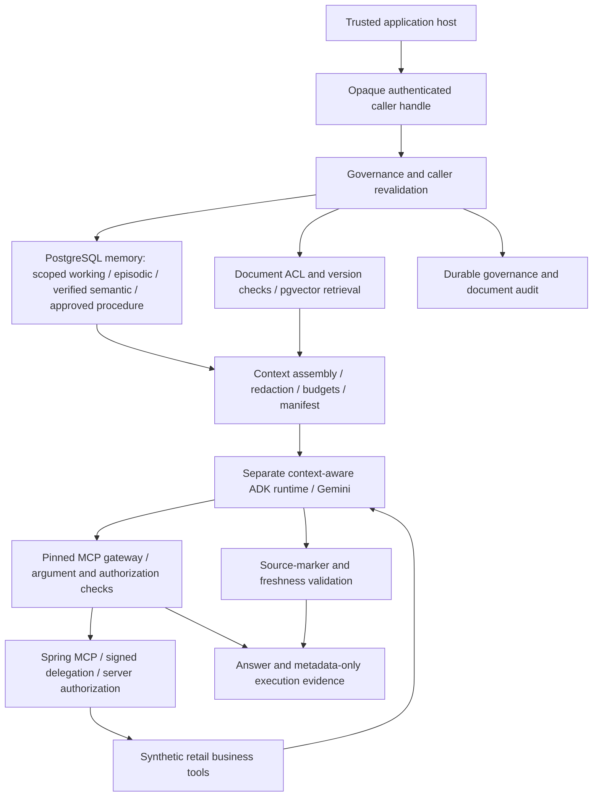

# Phase 6.6C — Enterprise end-to-end validation

## Scope and architecture

This phase validates the existing runtime rather than replacing it. ADK Java remains 1.13.0, Java remains 17, and the Gemini chat configuration is unchanged. Phase 5 workflows and memory repository contracts are unchanged. No SQL migrations were added: the existing memory, embedding, governance and document migrations are exercised together.



Every model/tool boundary retains the Phase 6.5–6.6B checks. Retrieved content is evidence in user context, not trusted system policy. The integration fixture authenticates synthetic analyst `analyst` in tenant `retail-demo`, session `enterprise-s1`, task `reconcile`; prompt text cannot supply this identity. The local Spring profile separately verifies signed delegation, tool identity, arguments and authorized tenant/user.

## Scenario and execution

The host seeds governed working and episodic memories, a verified variance definition, an approved `inventory.assess` procedure, and an authorized Markdown reconciliation document. Semantic/procedural memories and document chunks are indexed in PostgreSQL. The document instructs the analyst to establish counts, review movement/cycle-count evidence, and avoid inferring causes from counts alone. It does not supply inventory quantities or a predetermined conclusion.

The ADK execution retrieves those sources and invokes real `get_inventory`, `get_reorder_status`, and `get_sales_summary` through the gateway. The existing product service returns KB-201 actual 15, expected 80 and reorder threshold 20. The discrepancy is -65. Reorder is advisory; no purchase order is created. The sample sales total is 12; the demo service does not filter sales by the supplied date range. Neither inventory counts nor that sales sample establish a discrepancy cause.

The offline scripted model obtains quantities from actual ADK function responses and calculates the variance; it does not substitute a fixed final response. The live test uses the configured Gemini model. Both use the same context, document, gateway, citation and audit pipeline.

## Source inventory

Added:

- `src/main/java/com/retail/agent/context/EnterpriseExecutionEvidence.java`: bounded host-only metadata export, no-overwrite durable file write, sanitized failure classification.
- `src/test/java/com/retail/agent/context/EnterpriseScenario.java`: shared synthetic host fixture, real or fake infrastructure, governed ingestion and memory indexing.
- `src/test/java/com/retail/agent/context/EnterpriseScriptedModel.java`: deterministic ADK tool-call sequence and response-derived answer.
- `src/test/java/com/retail/agent/context/EnterpriseEndToEndTest.java`: offline combined security and execution tests.
- `src/test/java/com/retail/agent/context/EnterpriseEndToEndPostgresTest.java`: real PostgreSQL/Spring tests and explicitly gated Gemini/embedding execution.
- `scripts/Run-EnterpriseEndToEndValidation.ps1`: isolated Windows integration orchestrator.
- This document.

Modified:

- `scripts/Run-PostgresMemoryIntegrationTests.ps1`: enterprise gates and separate live/default logs.
- `scripts/Run-SpringMcpIntegrationTests.ps1`: enterprise orchestration against an isolated secured Spring server.
- `EnterpriseDocumentPostgresTest.java`: clear fixture role references during teardown so inherited suites can recreate roles safely.
- `.gitignore`: exclude generated `enterprise-evidence/`.

The pre-existing modified POM and untracked Phase 6.1–6.6B work were preserved. No server business contract, agent workflow, model configuration or migration was redesigned.

## Windows PowerShell 7 commands

Run from the repository root. The main project needs JDK 17 and Maven. The separate Spring project needs its compatible Java runtime (its target is Java 21; the installed JDK 25 was used during validation). PostgreSQL defaults to `C:\Program Files\PostgreSQL\18`.

```powershell
Set-Location C:\agent-AI-workspace\retail-adk-agent
$env:JAVA_HOME = 'C:\Program Files\Java\jdk-17'
mvn clean test
mvn test '-Dtest=EnterpriseEndToEndTest'

# Real PostgreSQL + pgvector + secured Spring MCP, scripted ADK model:
.\scripts\Run-EnterpriseEndToEndValidation.ps1 -BuildPgvector

# Explicit live Gemini; deterministic embeddings:
.\scripts\Run-EnterpriseEndToEndValidation.ps1 -BuildPgvector -Gemini

# Explicit live Gemini AND real Gemini embeddings:
.\scripts\Run-EnterpriseEndToEndValidation.ps1 -BuildPgvector -Gemini -RealEmbeddings
```

Configure `GEMINI_API_KEY` privately in the environment inherited by PowerShell for live modes; never put its value in commands, chat or evidence. `-RealEmbeddings` requires `-Gemini`. Real embeddings use the existing Gemini SDK adapter, `gemini-embedding-001`, 768 dimensions. No new model provider is introduced.

`-BuildPgvector` downloads official pgvector v0.8.7 source and requires the installed Visual C++ build tools. It builds into a private temporary PostgreSQL distribution; it does not install into Program Files. Omit this switch when pgvector is already installed. `-PgRoot`, `-MsvcSetup`, and `-ServerProject` can override locations.

The orchestrator starts a disposable PostgreSQL cluster and a secured Spring server on port 18080, generates a private temporary delegation secret, runs migrations/tests and stops its services in `finally`. It does not replace the existing server on 8080 or target a production database. The server project defaults to `C:\agent-AI-workspace\retail-stock-investigator\retail-inventory-mcp`. Initial dependency downloads require network access. Temporary database credentials are removed with the owned fixture directories. No automatic commit or deployment occurs.

## Evidence and results (18 November 2026)

The final complete offline Maven run: **434 discovered, 241 passed, 193 explicitly gated skips, zero failures/errors**, BUILD SUCCESS (`phase6-6c-offline.log`). All nine offline enterprise cases passed. Normal builds need neither PostgreSQL, MCP nor Gemini credentials.

The fully enabled real run passed **46 tests, zero failures/errors/skips** (`phase6-6c-live.log`). This includes 42 inherited real PostgreSQL governance/context/document cases and four enterprise cases. The secured Spring build also passed its nine server tests. PostgreSQL 18, pgvector, real document ingestion, real MCP and live Gemini embeddings/reasoning were exercised, not substituted with H2 or fakes.

Live execution `cd4cf471-dd5d-4184-bbb4-beaa1346ab1e` completed with all three MCP outcomes SUCCESS and two model calls. The selected memory kinds were working, episodic, verified semantic and approved procedure. Two document chunks used `gemini-embedding-001`, dimension 768, embedding generation 1. Context budget was 64000; recorded model-request costs were 13577 and 16668. Source markers passed authorization/version validation. These budget figures use the existing runtime estimator, not provider billing tokens.

The same run also exercised scripted ADK against real PostgreSQL and MCP, execution `73f33a4f-5c3a-4955-ae51-8f5eaaaf709e`, four model calls and three successful MCP calls. Metadata JSON files are under ignored `enterprise-evidence/`; they exclude raw model output, tool bodies, document text, secrets and exception messages. SQL assertions verify committed document retrieval audit, two valid memory embedding rows and successful durable governance events. Fixture databases are then destroyed; the test proves transaction persistence within that database, not production retention.

The final default-mode real-service rerun passed **45 tests, one live-method skip, zero failures/errors**, BUILD SUCCESS (`phase6-6c-enterprise.log`). Execution `4fc50ca7-57b3-4c98-9f79-a67808619d5d` completed with three successful MCP calls and four scripted model calls. Its metadata export includes the committed-audit assertions. This rerun also confirmed signed wrong-user rejection with HTTP 403. No Gemini calls occur in this mode. No requested validation mode remains unrun; the offline skips are deliberate gates for external-dependency suites, not failures.

## Security validation and observability

| Boundary/control | Evidence |
|---|---|
| Trusted tenant/user identity | Combined foreign-tenant/user checks; real Spring forged signature returns 401, wrong tenant returns 403; signed wrong user is also tested |
| Memory/document isolation and RLS | Inherited real PostgreSQL suite exercises application-role direct SQL, ACL and tenant isolation |
| Revoked/expired memory and documents | Offline expiry and mid-execution revocation; real database document revocation blocks the next MCP call and records a denial |
| Prompt injection | A malicious replacement document remains untrusted user evidence; authenticated gateway scope and system instructions remain unchanged |
| Forged citations | Combined test rejects a fabricated marker after real ADK tool execution |
| Budget enforcement | Overflow fails before invoking the model; existing request-level byte bounds remain active |
| Audit failure | Combined tool-audit failure stops execution; inherited database tests verify mutation/audit rollback atomicity |
| Tool authorization, schema, timeout and cancellation | Existing secure gateway deterministic suite remains in the full Maven run; combined connection-failure case reports dependency failure |
| Concurrent sessions | Combined parallel executions preserve session-specific working memory and caller scope; existing database concurrent-update tests remain included |

The execution export records execution ID, authorized caller scope, selected memory IDs/versions/kinds, context exclusions, retrieval operation ID, chunk citations/hash/location/version/ACL and embedding identity, MCP names/outcomes/duration, model-call count, budget decisions, citation validation, caller-associated denials and final status. Sensitive text is not exported. The host must secure the evidence directory and apply its retention policy. Independent denied-operation audit remains separate from successful mutation transactions. A failed execution without a returned runtime result gets an attempt ID and explicitly unavailable runtime execution ID, never a fabricated one.

## Limitations and deployment responsibilities

- Citation validation establishes authorized source-marker identity and freshness, **not factual entailment** or proof that every sentence follows from its citation.
- Synthetic host authentication exercises the trusted caller boundary; this phase does not add enterprise SSO. Local MCP uses the existing HMAC delegation profile, not a new OAuth implementation.
- PostgreSQL RLS protects the runtime role under the existing trusted-host transaction-scoped claims design. Compromise of service credentials or the trusted host is outside that boundary; do not expose raw SQL or tenant-setting capabilities to callers.
- Live retrieval validates transport, indexing and security with a known relevant synthetic corpus; it is not a retrieval-quality benchmark. No HNSW was introduced.
- SDK/provider timeouts and external model behavior remain dependency risks. Deterministic timeout tests do not prove every network failure mode.
- Mid-execution revocation blocks subsequent requests; it cannot retract content already sent to a provider.
- Product-based MCP data and the original warehouse/SKU store are distinct demo datasets. No unsupported warehouse mapping is inferred.
- Audit evidence is metadata-only. Backup retention, production audit sinks, directory ACLs, secret rotation, source-system correctness and recovery policies remain deployment responsibilities.
- No automatic semantic verification, procedural approval, generated-memory promotion or purchase-order action was added. No next phase was started.
