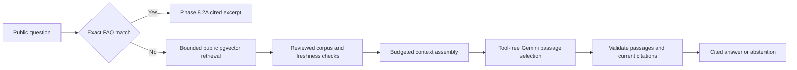

# Phase 8.2 — Registration Knowledge RAG

## Phase 8.2B — Conversational registration

The dedicated ADK registration agent now supports unlisted paraphrases and multi-topic questions when the host enables Gemini synthesis. Exact FAQ matches still take the Phase 8.2A path and can answer without Gemini. The service handles each public question independently in a fresh ADK session.



### Retrieval and evidence rules

- The conversational path bounds input to 1,200 characters, removes common email addresses and UUIDs, and embeds the resulting complete question. One vector search preserves ranking across topics. It uses the existing threshold of 0.05, a maximum of 10 returned candidates, and a 12,000-byte retrieval evidence budget. Public output can draw from the five reviewed topics.
- The host issues the same read-only public document credential used in Phase 8.2A. The existing tenant, ACL, classification, version, and expiry rules apply. The answer path verifies the approved document UUID, source ID, and excerpt digest. A conflicting retrieved candidate fails closed before the model call. The agent has no live account tools or customer memory, and replies label the distinction between documentation and live account status.
- The existing context assembler applies a 12,000 UTF-8-byte budget. A before-model callback checks the serialized ADK model request against the same ceiling and revalidates document access. The tool-free Gemini agent uses the existing Gemini chat model with one call, a 45-second stream timeout, and a 3,072-token output cap.
- Gemini synthesizes by choosing and ordering passages across retrieved topics. A strict JSON parser accepts up to 10 exact, complete-sentence excerpts. Each must match the authorized source identified by the supplied citation. The renderer produces the visible answer from validated excerpts and reuses the existing citation allowlist and post-model freshness check. Invalid output, conflicting evidence, missing evidence, and stale versions yield abstention. If retrieval or Gemini fails, the conversational path returns the fixed unavailable response. An exact FAQ still uses its deterministic retrieval path.

### Windows PowerShell commands

Start from the ADK project root with the PostgreSQL reader and audit environment variables described below. For semantic ranking, publish using the Gemini embedding profile and query with the same profile. Changing the profile requires republishing reviewed documents as new versions with their current expected versions. Use a disposable instance for tests.

```powershell
Set-Location C:\agent-AI-workspace\retail-adk-agent
$env:JAVA_HOME = 'C:\Program Files\Java\jdk-17'
$main = '-Dexec.mainClass=com.retail.agent.context.RegistrationKnowledgeCliRunner'
$env:DOCUMENT_REPOSITORY = 'postgres'
$env:REGISTRATION_LIVE_EMBEDDINGS = 'true'
$env:REGISTRATION_GEMINI_SYNTHESIS = 'true'
mvn -B -ntp compile exec:java $main "-Dexec.args=ask 'Which fields belong in the registration request, and how can someone withdraw personalization consent?'"

# Offline regression and registration-specific cases
mvn -B -ntp test
mvn -B -ntp '-Dtest=ConversationalRegistrationTest,RegistrationKnowledgeAgentTest' test

# Set this to the bin directory of a PostgreSQL installation with pgvector
$pgBin = 'C:\Program Files\PostgreSQL\18\bin'
.\scripts\Run-PostgresMemoryIntegrationTests.ps1 -Documents -PgBin $pgBin

# Independent live opt-ins. Configure Gemini SDK credentials in the process environment.
mvn -B -ntp '-Dtest=ConversationalRegistrationTest#geminiSelectsCitedPassagesFromMultipleTopicsUsingDeterministicVectors' '-DrunRegistrationLiveGenerationTests=true' test
mvn -B -ntp '-Dtest=ConversationalRegistrationTest#geminiEmbeddingsRetrieveBothTopicsWithoutLiveGeneration' '-DrunRegistrationLiveSemanticEmbeddingTests=true' test
```

### Test coverage and limitations

Deterministic cases cover paraphrases, multi-topic retrieval and assembly, unsupported and live-account questions, changed or conflicting evidence, fabricated citations, instruction injection, truncated quotations, revocation during synthesis, cross-tenant isolation, dependency failures, and both assembly and outbound request budgets. The PostgreSQL suite runs the conversational path using real pgvector with a read-only document connection and checks that a same-ACL private document stays out of model input.

| Run on November 19, 2026 | Actual result |
|---|---|
| Full ADK regression with Java 17 | 259 passed, 200 gated skips, zero failures or errors |
| Targeted offline registration suites | 18 passed, 3 gated skips, zero failures or errors |
| PostgreSQL 18.7 and pgvector 0.8.7 | 44 passed, zero failures, errors, or skips |
| Live Gemini generation with deterministic embeddings | 1 passed. Gemini selected verified citations from both topics. |
| Live Gemini semantic embeddings with a scripted answer model | 1 passed. The semantic paraphrase retrieved both cited topics. |

The live checks used synthetic public text and independent test gates. PostgreSQL testing used a disposable cluster and deterministic embeddings.

The public corpus describes the local Phase 8.1 POC. The agent has no account lookup, multi-turn history, or registration actions. Answers use exact passages, and the validator checks their attribution, integrity, and freshness. Passage selection can still be incomplete or miss a paraphrase. Deterministic embeddings are lexical and serve offline testing. Redaction covers common email and UUID formats. Submit public procedural questions without personal details.

### Phase 8.2B files

- `RegistrationKnowledgeAgent.java` and `RegistrationKnowledgeCliRunner.java` add configurable conversational routing while retaining the FAQ path.
- `RegistrationSynthesis.java` implements Gemini passage selection, outbound budget checks, and strict output validation.
- `ConversationalRegistrationTest.java` and `EnterpriseDocumentPostgresTest.java` cover deterministic, PostgreSQL, and independently gated live cases.

## Phase 8.2A — Registration Knowledge RAG Foundation

## Architecture

The ADK application exposes a dedicated `RegistrationKnowledgeAgent` for public Phase 8.1 FAQ questions. The local Java CLI runs it through the ADK text runner in a fresh session. A supported question maps to one reviewed topic and the embedding provider sees only the canonical topic label. Unsupported wording returns an insufficient-evidence response without querying the document store.

```mermaid
flowchart LR
    Q[Public text question] --> A[RegistrationKnowledgeAgent]
    A --> T[Reviewed FAQ intent]
    T --> B[Host-issued public document reader]
    B --> R[GovernedDocumentService]
    R --> P[(Existing PostgreSQL and pgvector)]
    P --> F[Approved source ID, document UUID and excerpt digest]
    F --> C[ContextAssemblyService]
    C --> V[Revalidate current evidence and citation]
    V --> O[Reviewed excerpt and DOC marker]
```



The host reserves tenant `public-registration-knowledge` and grants its public reader only `DOCUMENT_READ` at `PUBLIC` clearance. The reviewed publisher owns the documents and grants read access to that principal. Incoming ADK user and session IDs, prompts and document text do not select the tenant or confer privileges. The context assembler uses an empty, private in-process memory repository. The registration agent has no tools, connection to customer data or access to the existing governed memory repository. The inventory entry points retain their existing runtime and MCP tools.

The publication path reuses `DocumentExtractor`, `DocumentChunker`, `EmbeddingProvider` and `GovernedDocumentService.ingest`. Existing in-memory and PostgreSQL repositories enforce tenant, ACL, classification and active-version checks. PostgreSQL uses the existing V004 tables, RLS, document roles, exact vector search and audit. The existing `DocumentGrounding` prepares retrieved evidence for assembly, revalidates it and checks the citation allowlist. No new schema, library or vector database is required.

The public answer uses only the verbatim excerpt of the requested topic, checked against its reviewed digest. It attaches the real current `[DOC:document-id:vN:chunk-id]` marker and a human-readable source title. This prevents free-form claims from being attached to an otherwise valid marker. Unreviewed text, superseded versions, revoked documents and missing evidence produce no source claim. Operational failures return a generic unavailable response.

## Corpus and entry points

The five source files use synthetic examples and describe the Phase 8.1 contracts. Each topic is one extractable paragraph. The POC session behavior applies to profile and preferences access. Registration follows the existing unauthenticated API and requires no email verification or OIDC.

| Topic | Source file | Example question |
|---|---|---|
| Registration steps | `registration-knowledge/registration.txt` | How do I register? |
| Account information | `registration-knowledge/account.txt` | What account information is stored? |
| Consent and preferences | `registration-knowledge/consent.txt` | How do I withdraw personalization consent? |
| Profile updates | `registration-knowledge/profile.txt` | How do I change my name? |
| Common errors | `registration-knowledge/faq.txt` | What happens with a duplicate email? |

The offline demonstration explicitly uses in-memory storage and deterministic embeddings. Run from the ADK project root with Java 17.

```powershell
$env:JAVA_HOME = 'C:\Program Files\Java\jdk-17'
$main = '-Dexec.mainClass=com.retail.agent.context.RegistrationKnowledgeCliRunner'
mvn -B -ntp compile exec:java $main "-Dexec.args=demo 'How do I register?'"
```

For persistent operation, apply the existing `PostgresMemoryAdminCliRunner migrate-documents` migration using the Phase 6.6B DBA procedure. Configure `DOCUMENT_REPOSITORY=postgres`, the existing `DOCUMENT_POSTGRES_READER_{URL,USER,PASSWORD}` and `MEMORY_POSTGRES_AUDIT_{URL,USER,PASSWORD}` triplets. Set the `DOCUMENT_POSTGRES_INGEST_{URL,USER,PASSWORD}` triplet only in the operator process to publish or revoke. The `ask` command opens no ingest or retention pool. Configure credentials privately and use the same embedding profile for indexing and retrieval. This CLI uses deterministic lexical test/demo vectors by default. Explicitly set `REGISTRATION_LIVE_EMBEDDINGS=true` with Gemini SDK credentials in both the publisher and reader processes to use the existing Gemini embedding adapter.

```powershell
# Initial publication into a database that already has the reviewed migrations
foreach ($topic in 'registration', 'account', 'consent', 'profile', 'faq') {
    mvn -B -ntp compile exec:java $main "-Dexec.args=publish $topic 0"
    if ($LASTEXITCODE -ne 0) { throw "Publication failed for $topic" }
}

# Public reader process
mvn -B -ntp compile exec:java $main "-Dexec.args=ask 'How do I change my name?'"

# Operator example for an existing version 1
# mvn -B -ntp compile exec:java $main '-Dexec.args=revoke profile 1'
```

A reviewed replacement requires a corpus and digest update together and publication with the current expected version. Publication is atomic per document. A revoked document cannot be reactivated through this CLI.

## Verification

```powershell
mvn -B -ntp test
mvn -B -ntp '-Dtest=RegistrationKnowledgeAgentTest' test

# Use a PostgreSQL bin directory whose matching lib/share directories contain pgvector
.\scripts\Run-PostgresMemoryIntegrationTests.ps1 -Documents -PgBin '<pgvector-enabled PostgreSQL bin>'
```

The deterministic suite exercises all five topic responses through ADK, irrelevant and unsupported questions, cross-tenant access and same-tenant ACL/classification, version replacement, revocation, injection in questions and documents, forged markers, and unavailable embeddings. The real database suite adds a registration case with a read-only document-role pool, same document UUID in another tenant, current and superseded versions, revocation and durable search audit.

| Run on November 19, 2026 | Actual result |
|---|---|
| Full ADK Maven regression, Java 17 | 444 discovered, 248 passed, 196 gated skips, zero failures or errors. The registration suite passed seven deterministic tests and skipped one live test. |
| Document PostgreSQL integration | 43 passed, zero failures, errors or skips on disposable PostgreSQL 18.7 with pgvector v0.8.7 and deterministic embeddings. |
| ADK CLI smoke | The registration question returned the reviewed Phase 8.1 excerpt and a current `[DOC:…:v1:…]` marker. |
| Live Gemini generation and embeddings | Opt-in gates were left off. |

Live Gemini generation and embeddings have independent opt-ins. The registration agent does not use Gemini generation. The inherited Phase 6.6B generation test and the new registration embedding test can be run separately with SDK credentials.

```powershell
mvn -B -ntp '-Dtest=DocumentGroundingLiveTest' '-DrunLiveDocumentAnswerTests=true' test
mvn -B -ntp '-Dtest=RegistrationKnowledgeAgentTest' '-DrunRegistrationLiveEmbeddingTests=true' test
```

## Changed files

| Path | Change |
|---|---|
| `src/main/java/com/retail/agent/context/RegistrationKnowledgeAgent.java` | Public scope, governed retrieval, approved excerpts and citation validation |
| `src/main/java/com/retail/agent/context/RegistrationKnowledgeCliRunner.java` | ADK text runner and trusted operator lifecycle commands |
| `src/test/java/com/retail/agent/context/RegistrationKnowledgeAgentTest.java` | Deterministic cases and separately gated live embedding case |
| `src/test/java/com/retail/agent/context/EnterpriseDocumentPostgresTest.java` | Registration scope and version checks in PostgreSQL |
| `docs/registration-knowledge/*.txt` | Five reviewed synthetic Phase 8.1 sources |
| `docs/phase-8-2-registration-rag.md` | Architecture, commands and results |

## Limitations and next steps for review

The foundation covers a finite set of single-topic FAQ phrasings, with whitespace, case and terminal question-mark normalization. Open-ended and combined questions need additional reviewed intents. The excerpt limit requires each approved topic to fit one chunk. A corpus or embedding profile change needs operator review and reindexing. Review the corpus and representative paraphrases against the current customer-service API before expanding coverage. Any later anonymous chat integration should route only the dedicated public capability and keep operator credentials outside the serving process.
