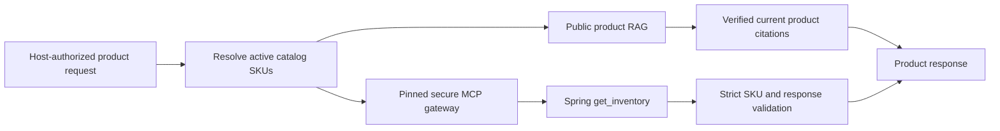
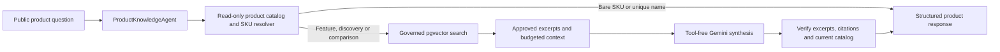

# Phase 8.3 — Product knowledge and inventory

## Phase 8.3B — Secured Spring MCP inventory



Exact SKU and unique catalog-name resolution happens before MCP dispatch. Stock requests with an unknown SKU, duplicate name, or missing product reference never send an identifier to MCP. The resolver supports up to three products. For example, “Which of KB-201 and MN-301 has available inventory?” resolves both products. “Which of these products?” requires the list in the same request. The host-only `ask-live` command binds the existing `retail-demo/analyst` local delegation scope. The public ADK path has no authorized MCP caller. The two paths keep product knowledge in its public scope and preserve registration and private-memory isolation.

### Actual tool contract

The Spring `get_inventory` tool accepts exactly `{"productId":"KB-201"}`. It returns `productId`, `productName`, `expectedInventory`, `actualInventory` and `reorderThreshold`. The server recognizes `WM-101`, `KB-201` and `MN-301`. Its live endpoint currently reads a fixed demonstration fixture. The application reads it at request time and labels the result as the reported product-level actual count.

The separate ADK warehouse fixture uses `WH-CENTRAL-01`, `WH-EAST-02` and `WH-WEST-03`. The Spring tool has no warehouse input or output and no verified mapping from its product IDs to that fixture. Recognized warehouse requests return `WAREHOUSE_UNSUPPORTED`. Unknown or unresolved warehouses return `UNKNOWN_WAREHOUSE`. Neither case calls the unscoped tool. Separately named on-hand, reserved, and sellable available quantities are unprovided under this contract, so the corresponding fields stay null. `actualInventory` is retained in its own field.

### Evidence handling and fallback

- The gateway pins the existing Spring schema, checks caller and delegation scope, bounds the response, applies the read-only retry and timeout rules, and records metadata-only audit events. The only authorized alias for this host is `mcp_get_inventory`.
- The adapter checks the exact response shape, catalog SKU and name, and the three non-negative integer fields. It rejects extra keys, duplicate keys, trailing content, and SKU mismatches. The typed observation records the SKU, normalized inventory status, gateway outcome, source, request ID, and retrieval completion time when an attempt completed. It includes a warehouse ID only as request scope on a warehouse error.
- The renderer emits a separate Inventory section from typed evidence. Raw MCP text never enters a Gemini request or the user-facing answer. Product features still use reviewed pgvector evidence and validated document citations. Inventory values carry MCP provenance and no document citations.
- Connection, authentication, timeout, malformed payload, remote missing-record, and SKU mismatch failures return typed statuses without a quantity. A validated zero stays distinct from missing stock. A successful product answer survives an MCP outage. A valid inventory count survives missing or unavailable product documentation.

### Windows PowerShell execution

Use the Phase 8.3A PostgreSQL setup and reader/audit settings below. Run the existing Spring Boot JAR on loopback with its matching base64 delegation key in the server and client process environments. Supply the key privately and do not put it in a command argument. In the server terminal:

```powershell
$jar = 'C:\agent-AI-workspace\retail-stock-investigator\retail-inventory-mcp\target\retail-inventory-mcp-1.0.0.jar'
$serverJava = 'C:\Program Files\Java\jdk-25.0.5.0.3\bin\java.exe'
& $serverJava -jar $jar '--server.address=127.0.0.1' '--server.port=18080'
```

In the ADK operator terminal, inherit the same key as `MCP_DELEGATION_KEY`. Set the absolute audit path to a secured directory.

```powershell
Set-Location C:\agent-AI-workspace\retail-adk-agent
$env:JAVA_HOME = 'C:\Program Files\Java\jdk-17'
$env:MCP_SERVER_URL = 'http://127.0.0.1:18080/mcp'
$env:MCP_AUDIT_FILE = Join-Path $PWD.Path 'target\product-mcp-audit.jsonl'
$product = '-Dexec.mainClass=com.retail.agent.context.ProductKnowledgeCliRunner'
mvn -B -ntp compile exec:java $product "-Dexec.args=ask-live 'Tell me about KB-201 and check its availability.'"
mvn -B -ntp compile exec:java $product "-Dexec.args=ask-live 'Is WM-101 available in the central warehouse?'"
mvn -B -ntp compile exec:java $product "-Dexec.args=ask-live 'Compare KB-201 and MN-301 and show their stock.'"
```

Tests compile and run from the ADK checkout. The Spring integration script starts the existing JAR on an ephemeral loopback port with a disposable key. It writes its logs and audit file under the ADK `target` directory. The Spring project is read only during this run.

```powershell
mvn -B -ntp test
mvn -B -ntp '-Dtest=ProductInventoryIntegrationTest,ProductKnowledgeAgentTest,SecureMcpGatewayTest' test
$pgBin = 'C:\Program Files\PostgreSQL\18\bin' # Use the pgvector-enabled installation.
.\scripts\Run-PostgresMemoryIntegrationTests.ps1 -Documents -PgBin $pgBin
.\scripts\Run-ProductInventoryMcpTests.ps1

# Independent Gemini gates. The Spring integration suite uses a scripted model.
mvn -B -ntp '-Dtest=ProductKnowledgeAgentTest#geminiGeneratesGroundedProductComparison' '-DrunProductLiveGenerationTests=true' test
mvn -B -ntp '-Dtest=ProductKnowledgeAgentTest#geminiEmbeddingsFindAProductWithoutLiveGeneration' '-DrunProductLiveEmbeddingTests=true' test
```

| Verification on November 19, 2026 | Actual result |
|---|---|
| Full ADK regression on Java 17 | 277 passed, 208 gated skips, zero failures or errors |
| Targeted product and gateway suite | 39 passed, 2 gated skips, zero failures or errors |
| PostgreSQL 18.7 with pgvector 0.8.7 | 46 passed, including combined PostgreSQL product evidence with the deterministic MCP fixture |
| Secured Spring MCP JAR on loopback | 2 passed. The live comparison returned actual counts of 15 for KB-201 and 55 for MN-301. The invalid signature was denied. |
| Independently gated Gemini generation and embeddings | 1 passed in each run |

Warehouse-specific availability, reservations, and sellable stock require a source contract that provides those fields. This increment adds no cross-turn product state. Stock and product intent detection supports common wording and relies on explicit catalog identifiers for live calls. The host-only local command uses the existing HMAC demo identity and does not establish a production identity provider.

## Phase 8.3A — Product catalog and semantic product knowledge

## Architecture

The product ADK agent reads a structured catalog and retrieves reviewed product documentation from the existing PostgreSQL/pgvector repository. It has a dedicated public tenant, reader and publisher. Registration keeps its existing tenant and FAQ behavior. Product requests have no access to customer memory, private documents, or inventory tools.



`EvidenceSynthesis` contains the shared Phase 8.2B tool-free ADK model runner, request budget check, and strict passage validator. Registration continues to use its existing instructions and renderer. The model configuration remains the project's configured Gemini model. The product CLI returns a structured response. An ADK text runner can also invoke the agent as a public product capability.

## Catalog data model

V005 adds isolated tables to the existing `retail_memory` schema. PostgreSQL row-level security restricts runtime catalog reads to the product tenant and its two host-issued principals. The existing document reader role receives only SELECT on these tables, and the catalog owner manages reviewed metadata. Catalog docs live in the existing governed document tables under the product tenant. Their version and lifecycle remain under the existing ingestion and revocation APIs.

| Table | Fields |
|---|---|
| `product_catalog` | SKU primary key, product name, category, description, lifecycle status |
| `product_document_refs` | SKU foreign key, approved document UUID, source ID, reviewed normalized excerpt SHA-256 |

Active listings are eligible for lookup. Status describes the catalog lifecycle. A catalog row can still be found when its documentation is missing or revoked. Feature claims require current evidence. The product response includes outcome, matched listings, cited answer and an empty `liveInventoryBySku` map.

## Synthetic corpus

Identifiers and display names match the inventory MCP fixtures in `RetailInventoryService`. The following technical details are reviewed synthetic examples for this POC.

| SKU | Name | Category | Example evidence |
|---|---|---|---|
| WM-101 | Wireless Mouse | Pointing devices | 2.4 GHz USB receiver and one AA battery |
| KB-201 | Mechanical Keyboard | Keyboards | Wired USB-C and tenkeyless layout |
| MN-301 | Computer Monitor | Displays | 24-inch 1080p at 60 Hz and HDMI input |

Each file under `docs/product-knowledge` is published by an operator. The catalog controls the source ID, UUID, and reviewed digest. Publication checks the single paragraph against that digest before passing the file through the existing extraction, chunking, embedding, ACL, versioning and audit workflow. The publisher grants the product reader access. A new embedding profile requires republishing each active source as a new version using its current expected version. A wording revision requires an approved catalog digest change and a matching document revision. Until the two match, the runtime abstains. Revoked documents remain revoked.

## Retrieval and grounding

- Explicit SKU tokens are resolved case-insensitively before any embedding call. An unknown SKU returns an explicit error. Bare known SKUs and normalized unique product names return catalog metadata directly. Duplicate names ask for a SKU. A feature request with a known SKU or full name searches only that product's approved document IDs. Comparisons can mix SKU and name.
- With no identifier match, the agent embeds the bounded question and searches active products' approved document IDs using pgvector cosine similarity. PostgreSQL applies the ID filter before ranking, inside the existing tenant and ACL boundary. Exact product evidence uses the resolved SKU and names as its query and admits every score for those approved IDs. Unresolved discovery uses a minimum score of 0.05.
- Retrieval selects up to 10 evidence chunks within a 12,000-byte document budget. Comparisons accept at most three products and require citations for every explicitly resolved product. Comparison language also requires two cited products. Context assembly uses a 12,000 UTF-8-byte budget and the actual serialized model request is checked against the same limit.
- Gemini selects complete verbatim passages. The renderer displays only passages whose citations and complete text match assembled, current, catalog-approved evidence. The runtime revalidates catalog status, document access, and freshness before the model call and before returning cited output. Unsupported claims, forged references, or revoked evidence yield insufficient evidence. Dependency failures yield a fixed unavailable response. Bare catalog lookups require neither embedding nor generation calls.

## Windows PowerShell

Use the existing DBA procedure in [Phase 6.6B](phase-6-6b-enterprise-document-grounding.md) to bootstrap the roles and install pgvector in `public`. Configure `MEMORY_POSTGRES_MIGRATION_{URL,USER,PASSWORD}` privately for the DBA process. Run from the ADK project root.

```powershell
Set-Location C:\agent-AI-workspace\retail-adk-agent
$env:JAVA_HOME = 'C:\Program Files\Java\jdk-17'
$admin = '-Dexec.mainClass=com.retail.agent.context.PostgresMemoryAdminCliRunner'
mvn -B -ntp compile exec:java $admin '-Dexec.args=migrate-product-catalog'
```

In the operator process, configure the existing `DOCUMENT_POSTGRES_READER_{URL,USER,PASSWORD}`, `DOCUMENT_POSTGRES_INGEST_{URL,USER,PASSWORD}`, and `MEMORY_POSTGRES_AUDIT_{URL,USER,PASSWORD}` triplets. Configure Gemini SDK credentials privately. The flag below selects the Gemini embedding adapter. Leave it unset or set it to false to use deterministic lexical vectors for local test fixtures. Publish and query with the same profile.

```powershell
$product = '-Dexec.mainClass=com.retail.agent.context.ProductKnowledgeCliRunner'
$env:PRODUCT_LIVE_EMBEDDINGS = 'true'
foreach ($sku in 'WM-101', 'KB-201', 'MN-301') {
    mvn -B -ntp compile exec:java $product "-Dexec.args=publish $sku 0"
    if ($LASTEXITCODE -ne 0) { throw "Product publication failed for $sku" }
}
# To revoke a version, run the corresponding operator command explicitly.
# mvn -B -ntp compile exec:java $product '-Dexec.args=revoke WM-101 1'
```

In the public reader process, configure the reader and audit triplets. The `ask` command opens no ingestion or retention pool.

```powershell
$product = '-Dexec.mainClass=com.retail.agent.context.ProductKnowledgeCliRunner'
$env:PRODUCT_LIVE_EMBEDDINGS = 'true'
mvn -B -ntp compile exec:java $product '-Dexec.args=ask WM-101'
mvn -B -ntp compile exec:java $product "-Dexec.args=ask 'Find a screen that accepts HDMI video input.'"
mvn -B -ntp compile exec:java $product "-Dexec.args=ask 'Compare WM-101 and KB-201 in how they connect.'"
```

## Tests

```powershell
mvn -B -ntp test
mvn -B -ntp '-Dtest=ProductKnowledgeAgentTest,ConversationalRegistrationTest,RegistrationKnowledgeAgentTest' test
# Point this to PostgreSQL binaries with matching pgvector files in lib and share.
$pgBin = 'C:\Program Files\PostgreSQL\18\bin'
.\scripts\Run-PostgresMemoryIntegrationTests.ps1 -Documents -PgBin $pgBin

# Independent live opt-ins with Gemini SDK credentials
mvn -B -ntp '-Dtest=ProductKnowledgeAgentTest#geminiGeneratesGroundedProductComparison' '-DrunProductLiveGenerationTests=true' test
mvn -B -ntp '-Dtest=ProductKnowledgeAgentTest#geminiEmbeddingsFindAProductWithoutLiveGeneration' '-DrunProductLiveEmbeddingTests=true' test
```

| Scenario | Expected result |
|---|---|
| Exact SKU and unique name | Return the active catalog row without calling embeddings or Gemini |
| Unknown SKU and duplicate name | Return unknown SKU or request disambiguation |
| Semantic discovery and product features | Cite relevant approved product passages |
| Comparison | Cite each requested product and stop at three products |
| Unsupported spec, forged marker, injection | Reject unsupported or modified text and keep citations scoped |
| Revoked document | Hide the excerpt, including when revoked during model execution |
| Registration and private evidence | Keep both outside the product context |
| Embedding and model outages | Return the fixed unavailable outcome |
| PostgreSQL | Apply V005 twice safely, verify catalog isolation, retrieve and revoke governed product evidence |
| Registration compatibility | Preserve the full existing registration and ADK regression suites |

| Verification on November 19, 2026 | Actual result |
|---|---|
| Full ADK Maven regression, Java 17 | 269 passed, 204 gated skips, zero failures or errors |
| Disposable PostgreSQL 18.7 with pgvector 0.8.7 | 45 passed, zero failures, errors, or skips |
| Gated live Gemini generation, deterministic embeddings | 1 passed. Both products appeared with authorized evidence in a comparison. |
| Gated live Gemini embeddings, scripted generation | 1 passed. The natural-language query retrieved the reviewed monitor evidence. |

## Limitations and Phase 8.3B design

The catalog contains three synthetic products, exact matching for listed names and IDs, and small bounded searches. Gemini selects and orders evidence passages, so paraphrase recall and coverage depend on the embedding model and available documents. The POC uses one reviewed paragraph per published source and has no cross-turn memory. Public questions should avoid personal information.

For Phase 8.3B, route authorized inventory requests through the existing secure MCP gateway. Use each resolved SKU as MCP `productId` and populate `liveInventoryBySku` with the returned `actualInventory`, the source and observation timestamp. The MCP field describes an observed inventory count. A sellable-availability claim would require a separate explicit contract. Leave entries absent when calls fail or observations are missing. Phase 8.3A makes no inventory MCP calls.
