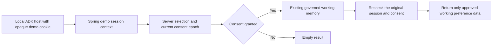

# Phase 8.4A — Customer context and governed memory

## Architecture

The local ADK host can store and retrieve a synthetic customer's explicitly selected detail preference. It resolves the customer and consent from the Phase 8.1 session on every personalized operation. Public registration and product knowledge continue to use their existing retrieval scopes. The inventory gateway still requires its own host-authenticated caller and delegated tool scope.



There is no model invocation, prompt ingestion, customer chat endpoint, or UI in this increment. The host capability returns untrusted reference data for explicitly approved preferences. It is separate from the registration agent, the product agent, and MCP tools.

## Session trust boundary and integration contract

The Phase 8.1 `POST /api/v1/demo/session` operation still selects a registered `.test` customer and creates the `RETAIL_DEMO_SESSION` cookie. Selecting again invalidates the prior session and creates a fresh random selection ID. `DELETE /api/v1/demo/session` invalidates the current session. Spring manages the 30-minute inactivity timeout and remains bound to loopback in the `poc` profile.

Phase 8.4A adds one POC-only endpoint, `GET /api/v1/demo/session/context`. It resolves the opaque cookie, reads the current consent row, and returns `Cache-Control: no-store` with exactly four fields.

| Field | Meaning |
|---|---|
| `customerId` | UUID already selected in the server session |
| `selectionId` | Random session selection identifier, regenerated on every selection |
| `personalizationConsent` | Current boolean preference from PostgreSQL |
| `consentEpoch` | Random UUID that changes on every consent toggle |

The endpoint returns `403` when the session is absent, expired, or invalidated and `404` outside the `poc` profile. It accepts no identity argument. Query parameters or identity headers have no effect. The response omits email, names, locale, marketing choices, and the session cookie. A selection ID or epoch alone grants no access. The ADK client pins the path to an explicit `http://127.0.0.1:<port>` origin, disables redirects and proxies, and sends only the validated opaque cookie. Transport failure, unexpected status, or malformed contract data fails closed.

Customer-service Flyway V2 adds a consent epoch and initializes existing rows. The existing preference update rotates the epoch in the same database update as the consent change, with the existing write audit in the same transaction. Repeating the same boolean keeps the epoch. Existing registration and preference API response formats stay compatible.

## Memory namespace and consent lifecycle

| Boundary | Implementation |
|---|---|
| Tenant | Dedicated `demo-customer-personalization` |
| User | `customer-<server-selected UUID>` |
| Session | `selection-<selection UUID>-<consent epoch>` |
| Type and trust | Confidential `WORKING` memory with `CANDIDATE` verification |
| Values | Host-selected `CONCISE` or `DETAILED` detail preference |
| Retention | 30 minutes from writing, with existing repository expiry and revocation |

ADK issues an operation-scoped governed credential only after a successful consent check and revokes that credential at the end of the operation. The backend uses the existing PostgreSQL memory tables, row-level security, write rules, audit, provenance, and revocation. Reads accept only exact session scope, the allowed type and canonical preference values. The host API accepts a typed cookie and preference and has no arbitrary draft, prompt, customer ID, or SQL argument.

If the initial check finds consent disabled, missing, or unresolved, the host returns no personalized data and makes no memory repository calls. With consent granted, the host checks the same cookie and binding again before releasing a result. If a concurrent switch, invalidation, or consent change alters the binding, the result is withheld. The host attempts governed revocation of any row it just wrote when revalidation fails. A fresh selection or re-grant cannot reopen the old namespace. Withdrawal fences old memory through the changed epoch. Physical deletion remains subject to the existing retention process.

## Threat model and POC limits

A pasted UUID in a prompt, body, query parameter, or identity header cannot select a memory namespace. Cross-customer reads and writes are constrained by the cookie-backed session and PostgreSQL scope. The public agents never receive customer preferences, the cookie, or this memory capability. The inventory MCP authentication and signatures are independent of the demo context.

Use synthetic data and trusted local processes. A local caller who knows an eligible synthetic UUID can select it, and a stolen demo cookie can carry its selection until it expires or is invalidated. The POC assumes control of the literal loopback service and its database credentials. The management commands keep cookies out of command arguments and console output. These mechanisms provide a local test boundary. They do not establish production authentication.

The services use separate transactions. A revocation concurrent with a memory operation can allow an in-flight repository access before the second check. The host suppresses that result, attempts to revoke a just-written row, and uses the new epoch to prevent later delivery. Cleanup failure can leave an old row until expiry and retention cleanup. Consent changes cannot retract data already returned. A later chat integration would need its own final consent check at the model boundary.

## Local PowerShell verification

Use a disposable PostgreSQL database for integration tests. Configure credentials privately as described in [Phase 8.1](../../retail-customer-service/docs/phase-8-1-customer-registration-poc.md). In the customer workspace on Java 25, configure the three `RETAIL_TEST_DB_*` variables, then build and run the regression suite.

```powershell
Set-Location C:\agent-AI-workspace\retail-customer-service
$env:JAVA_HOME = 'C:\Program Files\Java\jdk-25.0.5.0.3'
mvn -B -ntp verify

# Use RETAIL_DB_URL, RETAIL_DB_USER, and RETAIL_DB_PASSWORD for the disposable HTTP fixture.
$env:SPRING_PROFILES_ACTIVE = 'poc'
& "$env:JAVA_HOME\bin\java.exe" -jar target\retail-customer-service-0.1.0-SNAPSHOT.jar
```

In another terminal, run the regression suite and the independently gated fixtures.

```powershell
Set-Location C:\agent-AI-workspace\retail-adk-agent
$env:JAVA_HOME = 'C:\Program Files\Java\jdk-17'
mvn -B -ntp test
# Use PostgreSQL binaries with pgvector installed in the matching lib/share directories.
$pgBin = 'C:\Program Files\PostgreSQL\18\bin'
.\scripts\Run-PostgresMemoryIntegrationTests.ps1 -Documents -PgBin $pgBin

$env:RETAIL_CUSTOMER_CONTEXT_URL = 'http://127.0.0.1:8081'
mvn -B -ntp '-Dtest=ConsentAwareCustomerMemoryTest,DemoCustomerContextHttpTest' '-DrunCustomerContextHttpTests=true' test

# Separate live MCP regression using the existing Spring MCP JAR.
.\scripts\Run-ProductInventoryMcpTests.ps1
```

The gated customer HTTP test creates synthetic accounts, grants and withdraws consent, rotates the session, and invalidates it. It uses real Spring HTTP and an in-memory ADK repository. The independently gated PostgreSQL suite checks the same ADK facade with existing PostgreSQL RLS and governed storage.

| Verification on November 19, 2026 | Actual result |
|---|---|
| Customer-service Maven verify with PostgreSQL 18.7 | 15 passed, zero failures, errors, or skips |
| Full ADK Maven regression | 285 passed, 211 gated skips, zero failures or errors |
| Targeted consent and real customer HTTP tests | 9 passed, including spoofed identity, customer switching, re-grant, and invalidation against the packaged customer service |
| ADK PostgreSQL 18.7 / pgvector 0.8.7 | 47 passed, including consent namespace scoping on the existing memory role |
| Separately gated secured Spring MCP | 2 passed, including invalid-signature rejection against the existing JAR |
| Live Gemini | Independently gated and left off for this model-free increment |

### Exercise the host CLI

Configure the existing PostgreSQL memory backend and the separate audit writer using the Phase 6.4 credentials and migrations. The CLI uses `MEMORY_REPOSITORY=postgres`, `MEMORY_POSTGRES_{URL,USER,PASSWORD}`, and `MEMORY_POSTGRES_AUDIT_{URL,USER,PASSWORD}`. Use an actual cookie from a new local synthetic selection. For example, after selecting a registered synthetic customer using the Phase 8.1 PowerShell sample:

```powershell
# $demo is the PowerShell web session returned by Phase 8.1 selection.
$env:RETAIL_DEMO_SESSION = $demo.Cookies.GetCookies([uri]'http://127.0.0.1:8081/')['RETAIL_DEMO_SESSION'].Value
$env:MEMORY_REPOSITORY = 'postgres'
$main = '-Dexec.mainClass=com.retail.agent.context.CustomerMemoryCliRunner'
mvn -B -ntp compile exec:java $main '-Dexec.args=read'
# Enable consent using the Phase 8.1 preferences API for the selected customer.
mvn -B -ntp compile exec:java $main '-Dexec.args=remember concise'
mvn -B -ntp compile exec:java $main '-Dexec.args=read'
Remove-Item Env:RETAIL_DEMO_SESSION
```

The initial read returns `CONSENT_DISABLED` for a new customer. Once consent is granted, the same session can write and read the approved preference. After withdrawal or a new selection the old preference is inaccessible.

## Changed components

- Customer service adds the POC context endpoint, rotates a selection identifier with the existing session, and persists the consent epoch through Flyway V2.
- ADK adds the loopback context client, the governed consent facade and an operator CLI. The existing governed memory service gains a package-scoped exact-scope read for this capability.
- Regression coverage runs against both projects. The inventory MCP project is read only.
