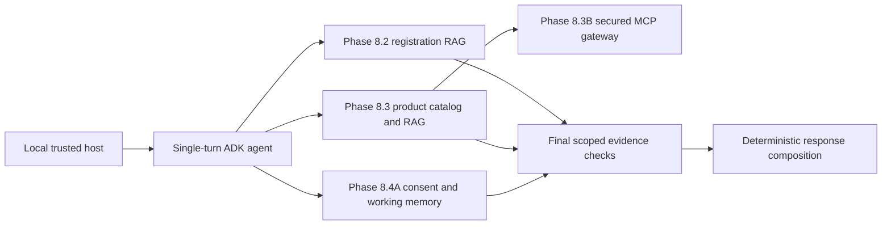
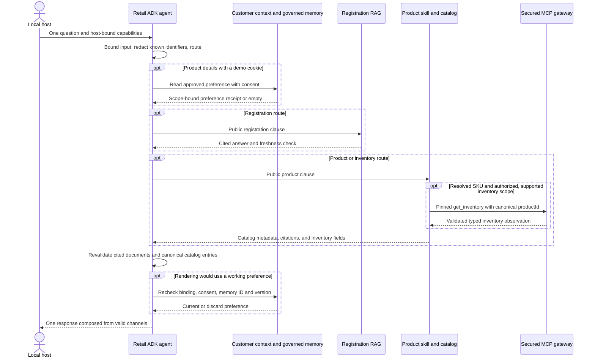

# Phase 8.4B — Personalized retail orchestration

## Component architecture

`PersonalizedRetailAgent` is a single-turn ADK `BaseAgent`. The local CLI creates and deletes one in-memory ADK session per invocation. The host can bind the Phase 8.1 demo cookie and the separately authorized Phase 8.3B MCP host. Both are optional, independent capabilities. ADK session metadata and question text confer no customer or MCP authority.



## Execution sequence



## Routing and context flow

The router accepts one text question of up to 1,200 characters. It removes the bound cookie if it appears in the question and reuses registration redaction for UUIDs and common email forms. It separates question boundaries, semicolons, and common conjunctions before a new command. Reviewed FAQ phrasings and registration cues select registration. Explicit SKU tokens, product cues, and the existing inventory intent rule select the product skill. A clause may go to both skills when it includes both subjects. Other discovery phrasing goes through the existing semantic product path. The router uses no extra Gemini classifier.

The product skill resolves exact SKUs and unique catalog names before any MCP request, preserving existing ambiguity and comparison limits. Explicit product-and-inventory requests run both parts in the product skill. Short stock-only requests use the typed inventory path. The existing `WAREHOUSE_UNSUPPORTED` result is preserved when a known warehouse is requested. Mixed questions can return both public documentation sections. Cross-turn pronouns or omitted product references may require clarification.

Each RAG channel uses its existing scope, context budget, embedding profile, and tool-free Gemini evidence selector. The parent collects a freshness check from a channel only after that channel validates citations and text. It uses a fresh scoped reader to recheck the original evidence versions before returning. Product catalog entries are also checked against the current active catalog. The parent does not ask Gemini to rewrite or reconcile the resulting sections.

## Consent and memory controls

The Phase 8.4A loopback context client resolves the cookie-backed selection. A UUID in the question, a caller-supplied header, or an ADK session ID cannot alter that binding. The consent facade performs no personalized repository access when the initial check denies consent. The orchestrator reads existing approved, unexpired `WORKING` detail preferences only on product-detail routes. No turn writes memory. An operator can seed a synthetic preference separately with the Phase 8.4A CLI.

The only personalization is deterministic presentation of validated catalog matches. `CONCISE` uses a one-line catalog index. `DETAILED` includes SKU, name, and category. Existing cited passages and inventory observations remain intact. No customer preferences, memory text, cookie, or customer identity go into either public model request.

Immediately before applying a preference, the host reads through the consent facade again and verifies the same selection, consent epoch, and preference ID and version. Withdrawal, switching, expiration, revocation, or store failure causes standard presentation. This path never reuses a personalized model result because preference rendering happens outside the model.

## Evidence provenance and failure behavior

| Channel | Accepted evidence and fallback |
|---|---|
| Registration RAG | Reviewed public registration passages. Preserve validated DOC markers. A failed final freshness check removes only the registration evidence. |
| Product RAG | Reviewed public product passages for the resolved products. Stale documents are withheld and separately verified inventory can still be returned. |
| Catalog | Current active catalog rows identify canonical SKUs and names. A changed listing prompts a retry and suppresses its product result. |
| Inventory MCP | Typed observations from the existing authorized gateway, with request ID, status, and retrieval time. Raw tool output never becomes a model input. Missing or failed lookups carry no count. |
| Governed memory | Existing consent- and scope-bound detail preference. An invalid binding or expired or revoked preference gives ordinary presentation. |

Spring MCP supplies a product-level actual count. Warehouse-specific quantities, reservations, and sellable availability remain unknown under that contract. The inventory section uses MCP provenance and contains no document citations. An MCP outage can leave product citations available. A product RAG outage can leave a validated observed count available.

## Windows PowerShell

Use the existing local setup and approved documents from [Phase 8.2](phase-8-2-registration-rag.md) and [Phase 8.3](phase-8-3-product-knowledge.md). The host expects the existing reader and audit configurations. The registration and product embedding flags must match their published vectors. For the optional personalization path, use the existing PostgreSQL governed-memory role and set the cookie privately as described in [Phase 8.4A](phase-8-4-customer-context-memory.md). For secured inventory, use the existing loopback Spring MCP configuration with `MCP_SERVER_URL`, `MCP_AUDIT_FILE`, and a privately supplied matching `MCP_DELEGATION_KEY`.

```powershell
Set-Location C:\agent-AI-workspace\retail-adk-agent
$env:JAVA_HOME = 'C:\Program Files\Java\jdk-17'
$env:RETAIL_CUSTOMER_CONTEXT_URL = 'http://127.0.0.1:8081'
$env:MEMORY_REPOSITORY = 'postgres'
$main = '-Dexec.mainClass=com.retail.agent.context.PersonalizedRetailCliRunner'
mvn -B -ntp compile exec:java $main "-Dexec.args='How do I register? Tell me about KB-201 and check its availability.'"
mvn -B -ntp compile exec:java $main "-Dexec.args='Compare KB-201 and MN-301 and show their stock.'"
mvn -B -ntp compile exec:java $main "-Dexec.args='Is WM-101 available in the central warehouse?'"
```

Keep the cookie in the process environment. Public registration and product questions work without it. The local MCP host still requires its own delegated credentials, independent of consent or the presence of a customer cookie.

## Test matrix and execution

| Group | Expected behavior |
|---|---|
| Registration, product, mixed, and comparison | Scope-specific citations and canonical catalog metadata. ADK runner emits a single response. |
| Inventory-only and combined | Separate MCP observations and document evidence. Unknown and ambiguous identifiers do not trigger MCP. |
| Consent and switching | Disabled consent bypasses repository access. Active preference formats discovery. Withdrawal, switching, invalidation, or memory revocation during synthesis discards the preference. |
| Spoofing and injection | Pasted IDs and cookie text cannot choose a scope. Forged citations and injected MCP content are withheld. |
| Warehouse and dependency failures | Preserve unsupported warehouse status. Return unaffected verified evidence and distinguish missing counts from zero. |
| PostgreSQL/pgvector | Governed working memory, product catalog, and public document evidence use separate PostgreSQL scopes in one turn. |
| Real Spring MCP and Gemini | Separate opt-in runs exercise the secured Spring server and live grounded product synthesis. |

```powershell
# From the ADK project with Java 17
mvn -B -ntp clean test
mvn -B -ntp '-Dtest=PersonalizedRetailAgentTest,ConsentAwareCustomerMemoryTest,ConversationalRegistrationTest,ProductInventoryIntegrationTest' test
$pgBin = 'C:\Program Files\PostgreSQL\18\bin' # Use a pgvector-enabled installation.
.\scripts\Run-PostgresMemoryIntegrationTests.ps1 -Documents -PgBin $pgBin
.\scripts\Run-ProductInventoryMcpTests.ps1
mvn -B -ntp '-Dtest=PersonalizedRetailAgentTest#liveGeminiKeepsProductGroundingInAPersonalizedTurn,ConversationalRegistrationTest#geminiSelectsCitedPassagesFromMultipleTopicsUsingDeterministicVectors' '-DrunPersonalizedRetailLiveGeminiTests=true' '-DrunRegistrationLiveGenerationTests=true' test
mvn -B -ntp '-Dtest=ConversationalRegistrationTest#geminiSelectsCitedPassagesFromMultipleTopicsUsingDeterministicVectors' '-DrunRegistrationLiveGenerationTests=true' test

# From the customer-service project with Java 25 and disposable RETAIL_TEST_DB_* settings
mvn -B -ntp test
```

| Verification on November 19, 2026 | Passed | Failed or errored | Skipped |
|---|---:|---:|---:|
| Clean ADK regression on Java 17 | 296 | 0 | 215 |
| Customer-service regression on PostgreSQL 18.7 | 15 | 0 | 0 |
| ADK PostgreSQL 18.7 and pgvector 0.8.7 | 48 | 0 | 0 |
| Secured Spring MCP on loopback | 3 | 0 | 0 |
| Live Gemini generation, first gated run | 1 | 1 | 0 |
| Inherited live registration check, isolated retry | 0 | 1 | 0 |
| Inherited live registration check on pre-change ADK source | 0 | 1 | 0 |

The PostgreSQL turn used deterministic model and MCP fixtures. The actual Spring run exercised the authorized inventory path from the retail agent with a separate loopback process and the existing test JAR. Live personalized product discovery passed. The inherited conversational registration test returned insufficient evidence instead of the two expected cited passages in the first run, its isolated retry, and a fresh build from the pre-change checkout. The response included no unverified claims. The deterministic registration and mixed-route tests passed.

## POC limitations

The orchestrator handles one text turn and supports a bounded set of routing cues. It remembers no conversation history. The synthesized public passages are extractive, and both corpora are synthetic. The Spring inventory fixture supplies product-level counts. If the shared PostgreSQL setup cannot resolve the product catalog, the host cannot authorize an inventory lookup for an unverified SKU. The demo cookie remains a local synthetic selection mechanism. Document, memory, and consent checks cross service boundaries, so a change after the final check cannot retract a response already delivered. Keep personal information out of demo prompts.

Only the ADK checkout changes in this phase. The customer-service contract and inventory MCP server are reused as shipped.
