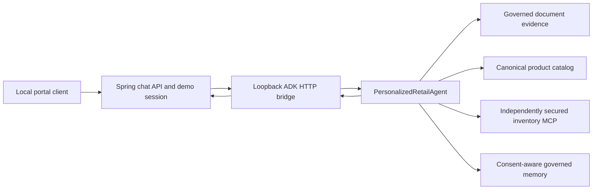
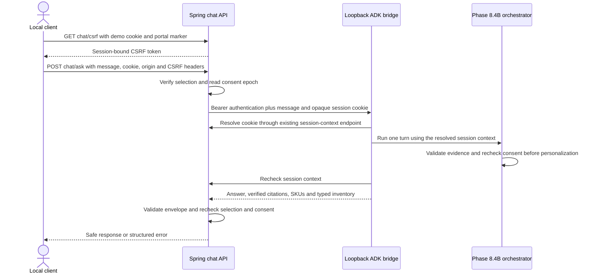

# Phase 8.5B — Spring Boot chat API and ADK bridge

## Architecture

Spring owns browser-facing session and CSRF validation. A narrow Java HTTP bridge in the ADK application invokes the existing Phase 8.4B single-turn orchestrator. The Phase 8.2 registration RAG, Phase 8.3 catalog and product RAG, Phase 8.3B secured inventory MCP, and Phase 8.4A consent-aware memory remain the authorities for their respective evidence. Spring validates and forwards the resulting response contract.





## Public HTTP contract

The routes exist only in the `poc` profile with `RETAIL_CHAT_ENABLED=true`. The customer service retains its loopback bind. Responses have `Cache-Control: no-store`.

- `GET /api/v1/chat/csrf` requires the active `RETAIL_DEMO_SESSION` cookie and `X-Retail-Portal: 1`. It returns `{"csrfToken":"<uuid>"}` for the current selection.
- `POST /api/v1/chat/ask` requires the cookie, `Content-Type: application/json`, the exact configured `Origin`, `X-Retail-Portal: 1`, and the token in `X-Retail-CSRF`. A supplied `Sec-Fetch-Site` must be `same-origin`. The only JSON field is `message`. It must be nonblank and at most 1,200 Java UTF-16 code units, with an 8 KiB request body limit. Identity headers, query parameters, extra JSON fields, and duplicate JSON keys are rejected.

```json
{"message":"Tell me about KB-201 and check its availability."}
```

A successful envelope has these fields.

| Field | Contract |
|---|---|
| `answer` | Final plain text from the single-turn agent |
| `citations` | Verified DOC markers with a `REGISTRATION` or `PRODUCT` channel |
| `productSkus` | Canonical catalog SKUs associated with the result |
| `inventoryObservations` | Typed inventory entries, with SKU, status, tool outcome, retrieval time, source and request ID where applicable |
| `personalized` | Whether a current approved preference affected presentation |
| `status` | `OK`, `PARTIAL`, `INSUFFICIENT`, or `ERROR` |
| `error` | Null for evidence responses, otherwise a stable `code` and safe `message` |

Verified partial or insufficient evidence can return HTTP 200. An error response contains an empty answer and evidence arrays and sets `personalized` to false. Spring requires the citation list to agree with the rendered markers. Inventory provenance remains in the inventory entries. The Spring MCP contract supplies a product-level `actualInventory` count and does not establish warehouse-specific on-hand, reserved, or sellable quantities. Those fields remain null. Failed observations carry no count. A warehouse request can retain `WAREHOUSE_UNSUPPORTED`.

## Service-to-service trust boundary

The ADK process binds the JDK HTTP server to `127.0.0.1` and exposes only `POST /internal/v1/retail/ask`. Spring uses a fixed literal loopback origin without proxying or redirects. Both local processes receive the same independently generated 32-byte base64url bearer secret through `RETAIL_CHAT_BRIDGE_TOKEN`. ADK checks it before reading the JSON body. The only internal fields are `message` and the validated opaque `sessionCookie`; caller-controlled identity headers, namespaces, and browser Origin headers are rejected. ADK obtains identity and consent by resolving the cookie against the existing customer-session endpoint.

The bridge secret is separate from the inventory MCP delegation secret. Existing MCP authentication, pinned input schema, roles and audit remain in force. The internal response body is bounded to 32 KiB on both sides. The ADK queue is bounded and its default 45-second turn deadline includes session checks. Spring's default 50-second deadline covers the upstream response body. A timeout cancels delivery and attempts to interrupt the outstanding work.

## Session and consent

CSRF tokens rotate with the existing demo selection and are bound to that selection. The cookie retains its `HttpOnly` and `SameSite=Strict` attributes. Spring rechecks the request's original selection after the ADK call and after reading the latest consent. ADK also resolves the binding before and after running the turn. Changing or invalidating the session discards the entire result. A personalized result requires consent to be granted at both checkpoints with the same consent epoch. Withdrawal or an off/on transition invalidates that result. The agent may still return a verified ordinary response when its own consent check discarded personalization before the bridge returned.

## Error mapping

| HTTP | Public code | Cause |
|---:|---|---|
| 400 | `INVALID_REQUEST` | Invalid JSON, message, or identity argument |
| 403 | `SESSION_REQUIRED` | Missing, expired, or invalid demo selection at entry |
| 403 | `CSRF_REJECTED` | Missing or invalid origin, request marker, or CSRF token |
| 409 | `SESSION_CHANGED` | Session changed during execution or personalized output was fenced by consent |
| 502 | `INVALID_ADK_RESPONSE` | Invalid, inconsistent, or oversized upstream response |
| 503 | `ADK_UNAVAILABLE` | Unreachable, busy, or misconfigured ADK service or unavailable context dependency |
| 504 | `ADK_TIMEOUT` | The bridge or Spring deadline expired |

## Windows PowerShell startup

Configure the two PostgreSQL backends using the existing [customer context](phase-8-4-customer-context-memory.md) and [orchestration](phase-8-4-personalized-orchestration.md) instructions. Install and publish the existing reviewed documents before starting ADK. Generate a bridge secret privately and supply the same value to both process environments. Never include the value in CLI arguments or output.

```powershell
# In the trusted local shell, generate the secret without printing it.
$env:RETAIL_CHAT_BRIDGE_TOKEN = [Convert]::ToBase64String([Security.Cryptography.RandomNumberGenerator]::GetBytes(32)).TrimEnd('=').Replace('+','-').Replace('/','_')
```

```powershell
# Spring terminal, with RETAIL_CHAT_BRIDGE_TOKEN and RETAIL_DB_* already set.
Set-Location C:\agent-AI-workspace\retail-customer-service
$env:JAVA_HOME = 'C:\Program Files\Java\jdk-25.0.5.0.3'
$env:SPRING_PROFILES_ACTIVE = 'poc'
$env:RETAIL_CHAT_ENABLED = 'true'
$env:RETAIL_CHAT_ADK_URL = 'http://127.0.0.1:8091'
$env:RETAIL_CHAT_PORTAL_ORIGIN = 'http://127.0.0.1:5173'
mvn spring-boot:run
```

```powershell
# ADK terminal with the same secret and the existing document, memory, and optional MCP settings.
Set-Location C:\agent-AI-workspace\retail-adk-agent
$env:JAVA_HOME = 'C:\Program Files\Java\jdk-17'
$env:RETAIL_CUSTOMER_CONTEXT_URL = 'http://127.0.0.1:8081'
$env:RETAIL_CHAT_ADK_PORT = '8091'
mvn -B -ntp compile exec:java '-Dexec.mainClass=com.retail.agent.context.RetailChatHttpServer'
```

After registering and selecting a synthetic customer with the Phase 8.1 PowerShell sample, use its `$demo` web session.

```powershell
$portalHeaders = @{ 'X-Retail-Portal' = '1' }
$csrf = Invoke-RestMethod 'http://127.0.0.1:8081/api/v1/chat/csrf' -WebSession $demo -Headers $portalHeaders
$portalHeaders['Origin'] = 'http://127.0.0.1:5173'
$portalHeaders['X-Retail-CSRF'] = $csrf.csrfToken
Invoke-RestMethod -Method Post -Uri 'http://127.0.0.1:8081/api/v1/chat/ask' -WebSession $demo -Headers $portalHeaders -ContentType 'application/json' -Body (@{
    message = 'Tell me about KB-201 and check its availability.'
} | ConvertTo-Json)
```

## Verification

```powershell
Set-Location C:\agent-AI-workspace\retail-adk-agent
$env:JAVA_HOME = 'C:\Program Files\Java\jdk-17'
mvn -B -ntp clean test

# Spring regression with real PostgreSQL and a separately gated real ADK HTTP turn.
.\scripts\Run-RetailChatIntegrationTests.ps1

# PostgreSQL/pgvector ADK integration and independently gated real secured MCP.
$pgBin = 'C:\Program Files\PostgreSQL\18\bin' # Use a pgvector-enabled bin directory.
.\scripts\Run-PostgresMemoryIntegrationTests.ps1 -Documents -PgBin $pgBin
.\scripts\Run-ProductInventoryMcpTests.ps1
```

| Test area | Expected evidence |
|---|---|
| Active, missing, invalidated and switched sessions | Real Spring HTTP accepts only the server selection and discards an out-of-date response |
| CSRF, malformed input and forged identity | Reject before invoking the internal adapter |
| Consent withdrawal while running | No personalized answer is returned |
| Registration, product, stock and combined questions | Answer, citation list and typed inventory stay consistent |
| ADK failure, timeout or invalid body | Stable public error without upstream diagnostics |
| ADK bridge trust | Wrong bearer fails, arbitrary identity headers fail, cached identity cannot substitute for session resolution |
| Existing PostgreSQL and secured inventory paths | Actual pgvector and a separately running, secured Spring MCP JAR |

| Verification on November 20, 2026 | Passed | Failed or errored | Skipped |
|---|---:|---:|---:|
| Customer-service Maven verify on PostgreSQL 18.7 | 21 | 0 | 0 |
| Clean ADK regression on Java 17 | 299 | 0 | 219 |
| ADK PostgreSQL 18.7 and pgvector 0.8.7 | 49 | 0 | 0 |
| Separately gated Spring-to-ADK HTTP integration | 1 | 0 | 0 |
| Separately gated secured Spring MCP integration | 4 | 0 | 0 |

The Spring-to-ADK gate used the packaged Spring service, the actual loopback ADK adapter, and the existing single-turn orchestrator with deterministic generation, vector, and MCP fixtures. The PostgreSQL ADK suite exercised persisted governed evidence through the bridge. The independently gated MCP suite used the existing secured server JAR and verified provenance through the chat bridge. Live Gemini remained gated.

## POC limitations

The bridge is local HTTP and assumes trusted local processes. A stolen valid demo cookie retains its synthetic selection until invalidated or expired. A process holding the bridge secret can use the internal endpoint with a valid demo cookie. The demo session establishes synthetic local context only. Session and database checks happen at separate service boundaries. A change after the final check cannot retract a response already delivered.

The existing React portal's Vite allowlist does not expose the two chat routes yet. Phase 8.5C can add those routes and a chat-specific proxy timeout when it adds the browser client. This phase uses the direct, local PowerShell example and introduces no React UI, streaming, or persistent turn state.
