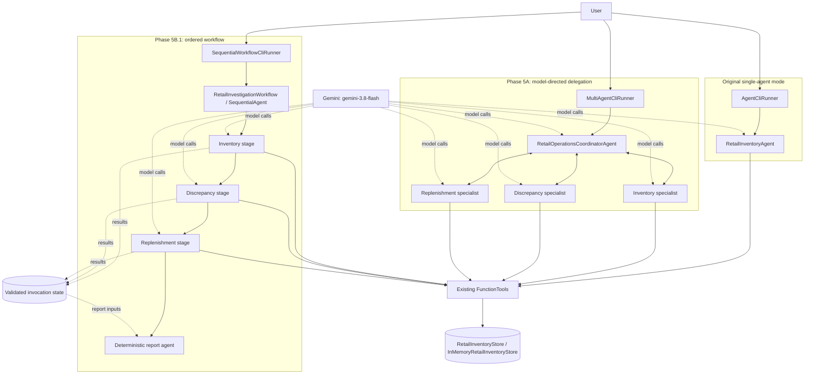
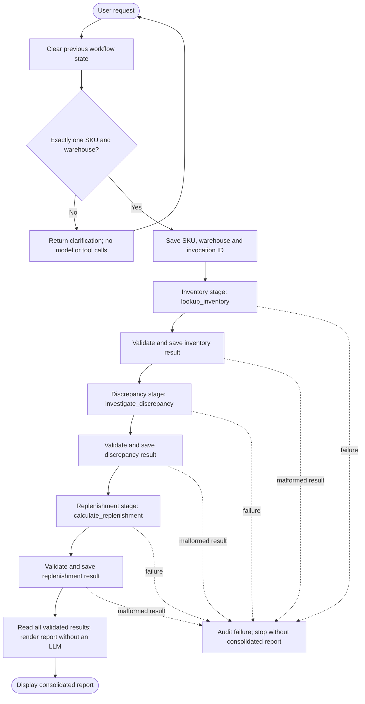
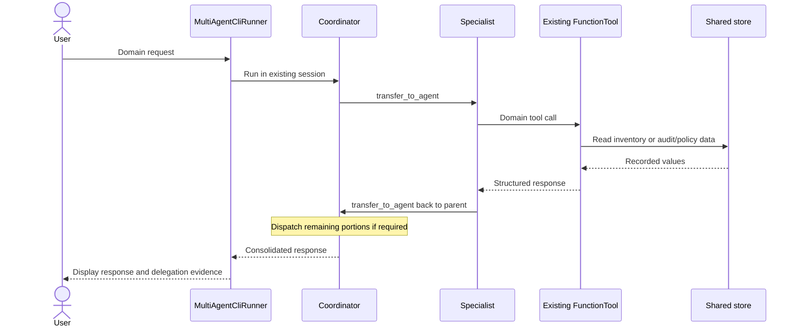

# Retail ADK project architecture

This describes the current Java 17 / Maven implementation using Google ADK Java 1.13.0
and `gemini-3.8-flash`. No application code was changed for this analysis.

## Architecture diagram

Each CLI creates its own `InMemoryRunner` and in-memory session. All three modes use the
same shared-store definition; separate CLI processes have separate JVM memory and do not
share live inventory mutations with each other. Within an agent graph all tools receive the
same store instance. The store contains product catalog, warehouse stock, cycle-count records
and replenishment policies.

Cross-cutting runtime services omitted from the diagram for readability:

- `InMemoryRunner`: invokes the selected root and emits ADK events.
- In-memory session service: conversation events and callback state.
- `MultiAgentObservabilityCallbacks`: lifecycle auditing for Phase 5A and workflow agents.
- `ToolObservabilityCallbacks`: tool start, duration, success and failure auditing.
- `AgentAuditLogger`: correlated, sanitized logs and a bounded in-memory audit buffer.

| Tool | Single agent | Phase 5A owner | Phase 5B.1 owner |
| --- | --- | --- | --- |
| `lookup_inventory` | Yes | Inventory specialist | Inventory stage |
| `summarize_stock` | Yes | Inventory specialist | Not part of this workflow |
| `investigate_discrepancy` | Yes | Discrepancy specialist | Discrepancy stage |
| `calculate_replenishment` | Yes | Replenishment specialist | Replenishment stage |

## Sequential workflow flow diagram

At each LLM stage:

1. Verify preceding state envelopes belong to the current request/invocation.
2. Supply the validated request and prior results to Gemini.
3. Restrict function calling to the designated tool.
4. Accept exactly one tool call with the exact requested identifiers; strip accompanying model text.
5. Execute the existing tool with audit callbacks.
6. Validate its response and persist an immutable structured result.
7. Finish with a local acknowledgement, without another Gemini call.

Normal domain outcomes such as `SKU_NOT_FOUND`, `NO_RECORDS_FOUND` and `POLICY_NOT_FOUND`
are saved and included as unavailable findings; they do not abort the remaining stages.
Unexpected failures, malformed responses, wrong arguments or missing/repeated calls abort.

## Phase 5A delegation flow

The Phase 5A path is model-directed; return transfers are instructed behavior, not a fixed
schedule. Its coordinator and specialists are independent of the Phase 5B.1 agents.

## Architectural assessment

- Clear separation: original, conversational multi-agent and ordered workflow entry points coexist.
- Reuse: domain tools, business calculations, store interface and auditing are shared.
- Reliable workflow boundaries: explicit IDs, invocation-bound state, guarded calls and deterministic reports.
- In-memory scope: inventory, sessions and audit history do not survive process restart.
- Model dependency: sequential order is fixed, but Gemini must still produce a valid guarded tool call.
- Consistency: reads across stages are not an atomic snapshot; changing available stock is disclosed.
- Safety: quantities come from tools, audit notes remain evidence, and replenishment is advisory only.
- Current scope: no ParallelAgent, LoopAgent, database, web API or deployment layer is implemented here.

Latest previously completed offline build: 106 discovered, 103 passed, 3 live tests skipped,
zero failures/errors. Tests were not rerun for this documentation-only analysis.
