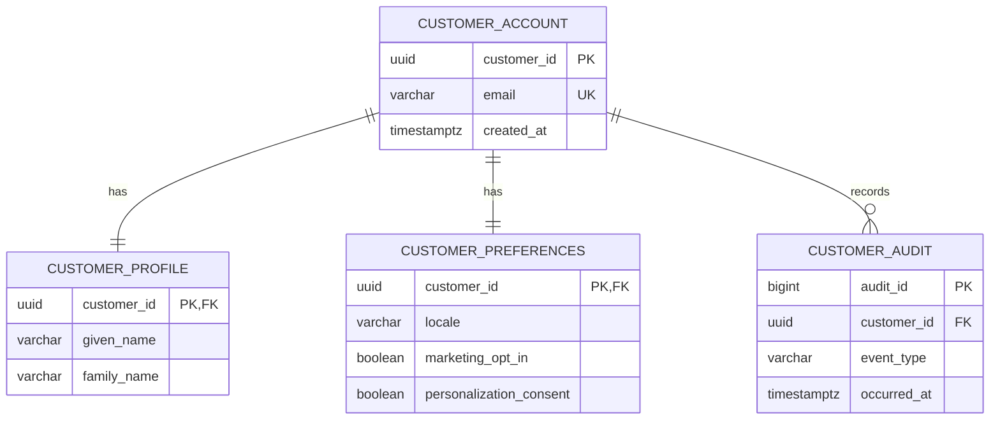

# Phase 8.1 — Customer Registration POC

## Architecture

The standalone Java 25 service uses Spring Boot 3.5, Spring MVC, Bean Validation, Spring JDBC and PostgreSQL. Flyway creates the schema at startup. Registration generates a random UUID, strips surrounding whitespace from the email and lowercases it with `Locale.ROOT`. A database constraint enforces uniqueness on the normalized value. Registration writes the account, profile, default preferences and audit event in one transaction. Profile and preference updates each commit with their audit event.

`CustomerIdentityProvider` resolves the effective customer UUID in the request. In the `poc` profile, its implementation reads a UUID bound to the server's HTTP session. The demo selection endpoint checks that the account exists and uses a reserved `.test` email domain, then creates a fresh session for that selection. The customer routes use the session UUID for database access and require it to match the URL. This gives a future local chat adapter a server-side customer lookup without putting customer IDs into browser claims or model input.

## Database ER diagram



The three write events are `REGISTERED`, `PROFILE_UPDATED` and `PREFERENCES_UPDATED`. Audit rows record the type and time of a successful write. They do not contain profile values or a history of consent values.

## API contracts

Use `Content-Type: application/json` for requests with bodies. The profile response includes `customerId`, `email`, `givenName` and `familyName`. Preferences responses include `locale`, `marketingOptIn` and `personalizationConsent`.

| Method and path | Profile | Request and successful response |
|---|---|---|
| `POST /api/v1/customers` | All | Required email and two names. Returns `201`, the profile and a `Location` header. |
| `POST /api/v1/demo/session` | `poc` | Send `{"customerId":"<uuid>"}`. Returns `204` and an opaque session cookie. Selecting again replaces the session. |
| `DELETE /api/v1/demo/session` | `poc` | Invalidates the current session if present. Returns `204`. |
| `GET /api/v1/customers/{customerId}` | `poc` | Returns `200` and the selected profile. |
| `PATCH /api/v1/customers/{customerId}` | `poc` | Send at least one non-null name. Missing or null fields are skipped. Returns `200` and the updated profile. |
| `GET /api/v1/customers/{customerId}/preferences` | `poc` | Returns `200` and current preferences. Defaults are `en`, `false`, `false`. |
| `PUT /api/v1/customers/{customerId}/preferences` | `poc` | Send all three preference fields. Send `false` to withdraw consent. Returns `200` and stored preferences. |

Names are trimmed and must have 1–80 characters. Email must be valid and fit 254 characters after normalization. The locale accepts language tags such as `en` and `en-IN`, with a 35-character limit. Invalid requests return `400`, duplicate email returns `409`, and a missing or mismatched demo selection returns `403`. An unknown or ineligible UUID at session selection returns `404`. Demo routes return `404` outside the `poc` profile.

## Local PowerShell startup

In a PostgreSQL administrative `psql` session, provision the role and database if needed. Use the interactive password prompt.

```sql
CREATE ROLE retail_customer_app LOGIN;
\password retail_customer_app
CREATE DATABASE retail_customer OWNER retail_customer_app;
```

From the service workspace, set the environment variables and start the app. The POC binds to `127.0.0.1:8081`.

```powershell
Set-Location C:\agent-AI-workspace\retail-customer-service
$env:RETAIL_DB_URL = 'jdbc:postgresql://127.0.0.1:5432/retail_customer'
$env:RETAIL_DB_USER = 'retail_customer_app'
$env:RETAIL_DB_PASSWORD = (Get-Credential -UserName $env:RETAIL_DB_USER -Message 'PostgreSQL password').GetNetworkCredential().Password
$env:SPRING_PROFILES_ACTIVE = 'poc'
mvn spring-boot:run
```

In a second PowerShell terminal, register and select a synthetic account. Another sample is `dev.shah@example.test` with names `Dev` and `Shah`. Use a fresh synthetic email when repeating registration.

```powershell
$api = 'http://127.0.0.1:8081/api/v1'
$customer = Invoke-RestMethod -Method Post -Uri "$api/customers" -ContentType 'application/json' -Body (@{
    email = ' Asha.Rao@example.test '
    givenName = 'Asha'
    familyName = 'Rao'
} | ConvertTo-Json)
$id = $customer.customerId
Invoke-RestMethod -Method Post -Uri "$api/demo/session" -ContentType 'application/json' -Body (@{
    customerId = $id
} | ConvertTo-Json) -SessionVariable demo
Invoke-RestMethod -Uri "$api/customers/$id" -WebSession $demo
Invoke-RestMethod -Method Patch -Uri "$api/customers/$id" -WebSession $demo -ContentType 'application/json' -Body '{"givenName":"Meera"}'
Invoke-RestMethod -Uri "$api/customers/$id/preferences" -WebSession $demo
Invoke-RestMethod -Method Put -Uri "$api/customers/$id/preferences" -WebSession $demo -ContentType 'application/json' -Body '{"locale":"en-IN","marketingOptIn":false,"personalizationConsent":true}'
Invoke-RestMethod -Method Delete -Uri "$api/demo/session" -WebSession $demo
```

## Tests

Use a local PostgreSQL database dedicated to tests with a role that can create schemas. The tests create a randomly named schema, apply the real migrations and remove that schema at suite completion.

To provision that database with the role from the startup instructions, run `CREATE DATABASE retail_customer_test OWNER retail_customer_app;` as a PostgreSQL administrator.

```powershell
$env:RETAIL_TEST_DB_URL = 'jdbc:postgresql://127.0.0.1:5432/retail_customer_test'
$env:RETAIL_TEST_DB_USER = 'retail_customer_app'
$env:RETAIL_TEST_DB_PASSWORD = (Get-Credential -UserName $env:RETAIL_TEST_DB_USER -Message 'Test PostgreSQL password').GetNetworkCredential().Password
mvn test
```

| Scenario | Expected result |
|---|---|
| Registration | `201` with UUID, normalized email and profile location |
| Duplicate email | Normalized duplicate returns `409` |
| Invalid registration | Invalid email or blank name returns `400` |
| Profile retrieval | Selected account returns `200`. Missing, cleared or mismatched session prevents access. |
| Demo eligibility | An account outside `.test` cannot be selected |
| Profile update | Provided name persists and other name is retained |
| Preferences | Full replacement persists, explicit withdrawal sets consent to false, and a missing consent field returns `400` |
| Consent defaults | Personalization and marketing are both false |
| Audit | All three write events persist |
| Concurrent duplicates | One response is `201`, the other `409`, and one complete aggregate persists |
| Database rollback | Forced database audit failure rolls back registration and retry succeeds |
| POC restrictions | POC forces a loopback bind even with a conflicting address setting. All demo routes are absent outside `poc`. |

Verification on November 19, 2026 used Java 25.0.5.0.3 and an isolated PostgreSQL 18.7 instance. `mvn -B -ntp verify` ran 13 tests with zero failures, errors or skips and built the executable JAR. A separate HTTP smoke test on port 8081 verified registration, cookie-backed selection, profile retrieval, consent defaulting to false and session invalidation.

## POC security limitations

These POC endpoints do not provide authenticated customer isolation. A local caller who knows a synthetic customer's UUID can select that customer. The reserved email suffix limits demo eligibility and does not verify ownership. The session cookie is HTTP-only and SameSite Strict and expires after 30 minutes of inactivity. Sessions live in the server process and are lost on restart. Use synthetic names and addresses and keep the POC on loopback without a proxy or tunnel. Registration is unauthenticated and has no email verification or rate limiting.

## Future OIDC migration

Add a Spring Security adapter that resolves `CustomerIdentityProvider` from a verified OIDC principal. Map the issuer and subject pair to an internal customer UUID in a separate table with a unique constraint on `(issuer, subject)`. Establish that mapping through trusted provisioning or an explicit account-linking flow. Keep normalized email as registration data because it can change and is insufficient for linking accounts.

Authenticated routes can use a `/me` resource or compare an explicit path UUID against the authenticated mapping before calling the service. The chat backend can derive customer context from the verified principal on each request and read current consent before using personalization. Keep demo session components disabled in the OIDC profile. Phase 8.1 has no runtime dependency on the ADK, MCP, memory or RAG applications.
