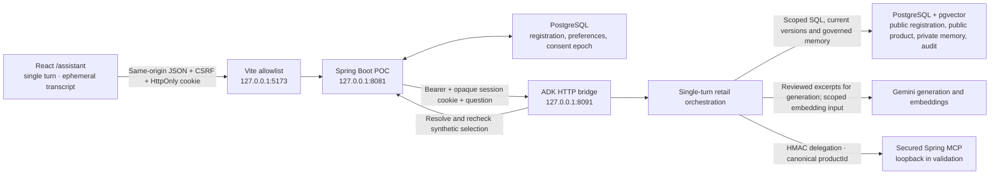

# Phase 8.6 — Retail AI POC validation and architecture review

**Date:** November 20, 2026  
**Scope:** Windows localhost POC, synthetic accounts, reviewed document corpora, and demonstration inventory. This phase changes documentation only.

## Executive summary

React, Spring, ADK, PostgreSQL/pgvector, Gemini and the secured Spring MCP endpoint were exercised in isolated runs. The standard regressions, database integration, and secured MCP suites were green. Live generated answers require a separate acceptance decision because strict evidence verification can produce a safe abstention on supported questions. A safe abstention passes the integrity check and fails the answer-coverage check.

## Architecture and trust boundaries



Spring owns selection and consent. The opaque cookie selects a synthetic account, Spring checks the token against that selection, and ADK resolves the same cookie back at Spring. The customer selection determines the consent epoch and memory scope. React discards the transcript on binding or epoch changes and validates the latest context before displaying a response. ADK uses independent registration, catalog, inventory and customer-memory paths. It checks provenance and currency before output. Spring decodes the result against a bounded contract and checks returned citation markers and typed observations. MCP inventory remains operational evidence with source, tool status, observation time and request ID.

## Environment and execution contracts

| Component | Observed or configured |
|---|---|
| Windows and JVM | Windows 11 amd64. Maven 3.10.0, ADK Java 17.0.12, Spring Java 25.0.5.0.3 |
| Portal | Node 24.22.1, npm 11.19.1, Vite 8.3.8, Vitest 4.1.12 and Chromium. Vite binds IPv4 loopback by default and checks Host, Origin, request method, portal marker and chat CSRF header. |
| Customer service | Spring Boot 3.5.16, default port 8081, `poc` profile forces IPv4 loopback. `RETAIL_DB_URL`, `RETAIL_DB_USER` and `RETAIL_DB_PASSWORD` configure JDBC. Chat requires `RETAIL_CHAT_ENABLED=true`. |
| ADK | Google ADK Java 1.13.0. Bridge binds IPv4 loopback, default port 8091. `RETAIL_CHAT_ADK_PORT` and `RETAIL_CUSTOMER_CONTEXT_URL` configure the adapter. Spring uses `RETAIL_CHAT_ADK_URL` and exact `RETAIL_CHAT_PORTAL_ORIGIN`. |
| Storage | PostgreSQL 18.7, pgvector 0.8.7 from the workspace's pgvector-enabled PostgreSQL distribution. Disposable databases and generated role accounts used for integration. ADK separates document reader, publisher, retention, memory and audit access. |
| Gemini | Generation `gemini-3.8-flash`, embeddings `gemini-embedding-001` at 768 dimensions. A configured `GEMINI_API_KEY` was detected without printing it. Successful live generation and embeddings verified provider access. The terminal credential was used only for test inputs. |
| Inventory | Existing Spring inventory JAR, default port 8080, explicitly bound to loopback on an ephemeral port in validation. ADK uses `MCP_SERVER_URL`, `MCP_DELEGATION_KEY` and `MCP_AUDIT_FILE`. The service returns synthetic operational fixture data. |

Chat uses `GET /api/v1/chat/csrf` and `POST /api/v1/chat/ask`. The POST carries only `{message}`, with the portal marker and a session-bound CSRF token. Spring forwards only the message and opaque session cookie to `POST /internal/v1/retail/ask`. Spring and ADK share a 32-byte random bearer via `RETAIL_CHAT_BRIDGE_TOKEN`. MCP has a separate HMAC key and host-issued delegation. `get_inventory` accepts only a canonical `productId`. It reports product-level `actualInventory`. Requests for warehouse-specific availability return an unsupported result. On-hand, reserved and sellable quantities are outside the tool contract.

### Reproduction

Use the [Phase 8.5B setup](../../retail-adk-agent/docs/phase-8-5-chat-api-integration.md), [Phase 8.3 document/MCP setup](../../retail-adk-agent/docs/phase-8-3-product-knowledge.md) and [Phase 8.5C browser setup](../../retail-customer-web/docs/phase-8-5-react-customer-portal.md). Use separate terminals and retain secrets only in the respective process environments. Publish and query with matching embedding flags, `REGISTRATION_LIVE_EMBEDDINGS=true` and `PRODUCT_LIVE_EMBEDDINGS=true`, for a real Gemini-embedding browser run.

```powershell
# In ADK with Java 17 and the required role credentials configured
mvn -B -ntp test
.\scripts\Run-RetailChatIntegrationTests.ps1
.\scripts\Run-PostgresMemoryIntegrationTests.ps1 -Documents -PgBin $pgVectorBin
.\scripts\Run-ProductInventoryMcpTests.ps1
mvn -B -ntp '-Dtest=ConversationalRegistrationTest,ProductKnowledgeAgentTest,PersonalizedRetailAgentTest' '-DrunRegistrationLiveGenerationTests=true' '-DrunRegistrationLiveSemanticEmbeddingTests=true' '-DrunProductLiveGenerationTests=true' '-DrunProductLiveEmbeddingTests=true' '-DrunPersonalizedRetailLiveGeminiTests=true' test

# In the customer portal
npm run build
npm test
npx playwright install chromium
.\scripts\Test-AgainstCustomerService.ps1

# With real ADK configured on 8091 and its customer context targeting port 8081
.\scripts\Test-AgainstCustomerService.ps1 -CustomerPort 8081 -ChatAdkUrl 'http://127.0.0.1:8091'
```

The Spring startup command is `mvn spring-boot:run` in the customer project with Java 25. The ADK production entry point is `mvn -B -ntp compile exec:java '-Dexec.mainClass=com.retail.agent.context.RetailChatHttpServer'`. The portal runs with `npm run dev`. Start the existing inventory JAR with `java -jar target/retail-inventory-mcp-1.0.0.jar --server.address=127.0.0.1 --server.port=8080` and the configured delegation key.

The live browser matrix used a temporary host fixture that provisioned the real PostgreSQL repositories, published reviewed content using Gemini vectors, launched the actual ADK HTTP bridge and orchestrator, and called Gemini and a separate secured Spring MCP process. Real Spring queried a separate disposable customer database. The fixture inserted one approved working-memory preference through the existing consent-aware API for the consent-enabled check. It substituted no model, embedding, repository, or MCP response. This matrix validates integration of the existing components. Launching with the production ADK configuration loader and production credentials remains a separate deployment-readiness gate.

## Regression and separately gated integration

| Run | Passed | Failed | Skipped | Dependency mode |
|---|---:|---:|---:|---|
| Customer Maven verify | 21 | 0 | 0 | Real Spring and PostgreSQL, controlled bridge faults |
| ADK standard regression | 299 | 0 | 219 | Standard gates off, 518 discovered |
| PostgreSQL/pgvector ADK integration | 49 | 0 | 0 | Real database and pgvector, deterministic external dependencies |
| Secured Spring MCP integration | 4 | 0 | 0 | Real secured inventory server, deterministic generation where used |
| Spring-to-ADK HTTP integration | 1 | 0 | 0 | Real HTTP and customer database, deterministic ADK dependencies |
| TypeScript and Vite build | 1 | 0 | 0 | Production build |
| Vitest component suite | 18 | 0 | 0 | Controlled browser API responses |
| Chromium standard suite, isolated retry | 9 | 0 | 0 | Real Spring and ADK HTTP with deterministic external dependencies |
| Gated Gemini suite | 36 | 1 | 0 | Five live calls/tests gated on alongside 32 deterministic tests. The product comparison generation assertion received `INSUFFICIENT`. |

The concurrent first attempt produced 7 Chromium passes and 2 failures. Spring tests passed, packaging could not rename the open JAR, and Chromium recorded a connection reset and a profile-retry assertion failure. Packaging and Spring-to-ADK HTTP passed once run separately. The live Chromium rerun used its own JAR copy.

## Live browser outcomes

The live run completed 18 Chromium cases with **17 passed, 1 failed, 0 skipped**. This includes nine existing portal regressions (9 passed) and nine Phase 8.6 live scenario tests (8 passed). The consent and session scenarios share a single test. FAQ and direct stock branches may execute without Gemini by design.

| Scenario | Result | Observed evidence |
|---|---|---|
| Registration FAQ | Pass | `OK` and current registration citation through real governed retrieval |
| Natural-language registration | Pass | `OK` and registration citation for the new-account details paraphrase |
| Exact SKU lookup | Pass | `KB-201` and product citation |
| Semantic product discovery | Pass | HDMI display paraphrase selected `MN-301` with a product citation |
| Product comparison | Pass | Browser returned `KB-201` and `MN-301` with two product citations. A separate live-generation JUnit case with deterministic vectors returned `INSUFFICIENT`. |
| Live inventory for KB-201 and MN-301 | Pass, two tests | MCP returned 15 and 55 respectively as product-level fixture counts. MCP source survived end to end. Sellable and reserved fields were null. |
| Combined product and inventory | **Fail for completeness, pass for graceful degradation** | `PARTIAL` with verified KB-201 observation of 15, and no document citation. The positive assertion required `OK` with product and inventory evidence. |
| Consent disabled, enabled, withdrawn, customer switched, session invalidated | Pass | Personalized indicator followed approved working memory and consent. New customer was non-personalized. Old conversation was cleared and the ended session could no longer chat. |

The live browser matrix used real requests and hosted services. Running against the inventory server in this configuration provides live transport and authentication evidence against synthetic fixture counts. It provides no evidence about production stock accuracy or warehouse availability.

## Security and failure findings

| Area | Method and result |
|---|---|
| Browser cookie and cross-origin policy | Chromium checked the `HttpOnly` and `SameSite=Strict` attributes, absent JavaScript cookie, rejected foreign origins and proxy path restrictions. Spring accepted valid token flow and refused a bad token. Vite forwards exact API paths only. |
| Session binding, spoofing, and customer switching | Real Spring tests rejected forged identity and namespace headers, missing and invalidated sessions, and results from a switched selection. Browser regression verified that switching clears cross-tab state and old cookies cannot resolve context. |
| Customer isolation and consent | Real PostgreSQL memory tests and HTTP/browser checks covered distinct customer and epoch scopes. A consent withdrawal during execution discarded personalized evidence in the controlled HTTP race. Live browser toggling and invalidation passed. |
| ADK bridge authentication | `RetailChatHttpServerTest` exercised bearer rejection, missing session, and forged browser/internal identity fields. Caller-supplied identity cannot substitute for the cookie resolution result. |
| Secured MCP | The existing MCP suite rejected a bad HMAC against the real Spring server. Valid calls preserved pinned tool/schema and provenance. The verifier checks audience and expiry, and the gateway binds the expected tool arguments. |
| Public/private access and revocation | Real pgvector tests covered RLS and scoped retrieval, private and obsolete documents, and revocation exclusion. ADK can revalidate retrieved evidence before emitting citations. |
| Prompt injection and fabricated evidence | Deterministic ADK regressions cover untrusted instructions, fabricated markers, malformed quotes and tool data variants. Tested inputs failed closed. This is bounded test evidence and supports further adversarial evaluation before broader use. |
| Gemini or embedding unavailable | Controlled generation and embedding failures in ADK tests return the governed unavailable response. Reviewed exact FAQ routing uses deterministic text selection, with retrieval still required. No hosted provider outage was induced. |
| PostgreSQL unavailable | Started a disposable Spring instance against a closed loopback database endpoint. Flyway failed with connection refused and the process exited without serving requests. ADK repository fault paths are covered by controlled tests. Live mid-turn loss of both production stores was outside this check. |
| MCP unavailable | Controlled transport outage in ADK produced `UNAVAILABLE` without an inventory quantity. A valid product response can still be returned independently. |
| Session expiry and consent change | Browser component tests cover expiry and delayed-response suppression. Spring real HTTP races cover selection change and consent withdrawal. The expiry test exercised rejection semantics without waiting for the servlet's 30-minute idle clock. |
| ADK timeout and invalid response | Spring real HTTP integration drove controlled upstream faults and verified safe error envelopes. Missing, timed-out and invalid upstream evidence yielded no fabricated citations or quantities. |

## Inherited conversational registration abstention

The previous positive test asks a two-topic question about registration and consent. It publishes both reviewed documents, uses deterministic vectors for retrieval, invokes live Gemini for quote selection, and requires the registration POST instruction, the default false consent detail, and both document citations. The expected evidence exists in the corpus. Scripted model checks passed, and the independent real-embedding test retrieved both topics with scripted generation. The live browser also returned a citation for a different, single-topic registration paraphrase.

The inherited positive test **reproduced the generic insufficient-evidence response** on the first isolated repeat. It passed in the original gated phase run and the next two identical isolated repeats. Because input, corpus and seeds for retrieval were unchanged, the evidence points to variation at generation or verification rather than a persistent retrieval issue or an impossible test expectation. The generic response can be returned for a security or budget rejection. The prefixed account-boundary response is used for an empty included set or an accepted empty proposal. The failing output was the generic form. This does not uniquely identify the validator branch by itself.

Four isolated JVM exception-trace runs all passed. They did not capture a failing invocation, so the exact reason for the failing proposal remains unconfirmed. The live evidence points to quote selection or verification. It does not justify relaxing the grounding policy. To repeat the diagnostic, run the command below from the ADK project with Java 17 and Gemini access.

```powershell
mvn -B -ntp '-Dtest=ConversationalRegistrationTest#geminiSelectsCitedPassagesFromMultipleTopicsUsingDeterministicVectors' '-DrunRegistrationLiveGenerationTests=true' '-DargLine=-Xlog:exceptions=info:file=phase86-registration-exceptions.log' test
```

The existing verifier requires an array with exact marker IDs, complete verbatim passages from the cited spans, and current evidence. The user-visible response deliberately hides the rejection reason. The report treats abstentions as missed coverage. Grounding remains enforced. No application behavior changed.

## Open defects and production-readiness gaps

| Priority | Gap | Recommended gate |
|---|---|---|
| High for answer quality | Intermittent live registration and product abstentions. The combined turn lost its product citation and the isolated product comparison once abstained. | Establish repeatable coverage across single-topic, multi-topic and multi-evidence prompts. Record allowed rejection-stage codes and aggregate abstentions. Preserve strict verification. |
| High before real customer data | Demo selection uses a synthetic UUID. Cookie possession proves possession of demo state. Loopback and a shared bridge bearer assume trusted local processes. | Adopt organizational identity and account authorization, authenticated service identities, TLS, production cookie settings, and secret rotation. Keep browser identity claims out of authorization decisions. |
| High before customer inventory commitments | Product-level fixture counts have no warehouse, reservation or sellable semantics. | Qualify an authoritative inventory contract and preserve the distinctions among product count, warehouse, reservation and sellable measures. Verify freshness and provenance under actual operational data. |
| Medium | Evidence scope, current-version checks and audit are implemented. Quality failures converge on generic user-facing messages and several diagnostic branches share that surface. | Add correlated, redacted metrics for retrieval candidates, generation and verifier outcomes, document freshness, MCP latency, partial results and consent revalidation rejects. Test audit sink degradation and define retention and access controls. |
| Medium | The deployment is one local process per service with per-turn model calls and a bounded ADK turn pool. The 45-second ADK deadline is nested under Spring's 50-second and Vite's 60-second defaults. Serial mixed branches can share or exhaust the turn budget. | Load-test concurrent mixed requests and provider stalls. Verify cancellation, queue saturation, rate limiting, connection-pool budgets, retries, and p95/p99 latency. Validate the actual service launch configuration with least-privilege roles. |
| Medium | Consent is rechecked at service boundaries. An update following final delivery cannot revoke a response already shown. Governance scopes prevent subsequent use under a stale epoch. | Define consent consistency and revocation expectations. Validate distributed session handling, memory retention/deletion, auditable consent transitions, and data-minimization controls before accepting real customer data. |
| Medium | Windows cannot reliably replace a JAR held by a running JVM. The concurrent attempt also surfaced an existing browser retry assertion that passed in isolated reruns. | Give browser smoke tests their own immutable artifact. Isolate failure fixtures and record any recurring profile-retry flake separately. |

## Acceptance recommendation

**Accept for a supervised localhost demonstration with synthetic data.** The main security and integration controls passed the exercised regression cases. Report partial results as partial during the demo and use known representative questions for scheduled walkthroughs.

**Keep unconditional full-stack quality acceptance and production readiness open.** The combined browser scenario and standalone live product comparison missed the required evidence. The inherited registration failure was reproducible but intermittent. Require repeated live success against explicit coverage thresholds, authenticated production identity, and operational hardening before broader use.

Application sources were unchanged. The temporary live harness and logs are under ignored validation output. This review does not introduce Phase 9 features or persistent chat memory.
